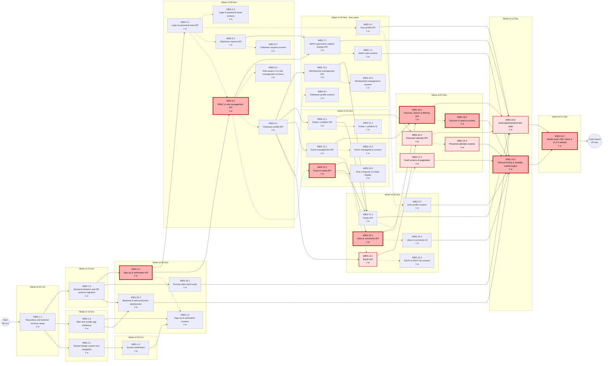
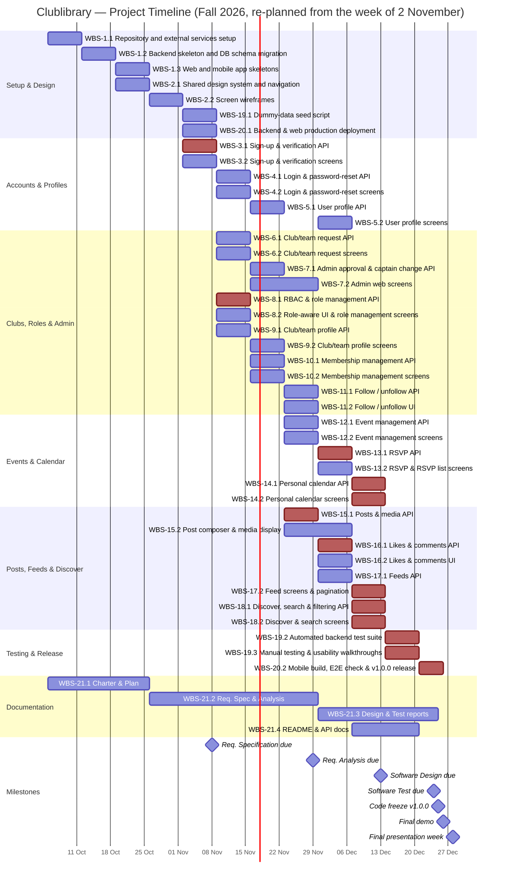

# Software Engineering — Project Plan

## Cover Page

| Field | Details |
|---|---|
| **Course** | BLG411E Software Engineering |
| **Report name** | Project Plan |
| **Project title** | Clublibrary – Student Clubs & Project Teams Social Platform |
| **Group name / number** | Al-ı Memnu |
| **Group members** | Melih Kart — 150200701, Beyza Arısan — 150230069, Eslem Azra Yılmaz — 150220110, Yusuf Erdem Cıdık — 040230205 |
| **Instructor** | Ayşe Tosun Kühn, Tolga Ovatman |
| **Submission date** | 2026-10-25 |
| **Document version** | 1.1 |

---

## 1. Introduction

### 1.1 Scope

**Project overview:**  
Clublibrary is a social media web and mobile application for university student clubs and project teams. It gives students a single place to discover clubs and teams, follow their activity, and stay informed about the events, lectures, and meetings happening on campus. Captains and managers get tools to organize their members, publish events, and share updates through posts. The goal is to replace the scattered mix of social media pages and posters that clubs and teams rely on today with one dedicated campus platform.

The project belongs to the education domain and focuses on student life outside the classroom. Its possible customers are universities that want to bring all of their student clubs and project teams together on one digital platform. The key users are students and the members, managers, and captains of clubs and project teams, together with platform administrators who approve new clubs and project teams.

**In scope:**
- **Web & Mobile Applications** – The platform is delivered as both a responsive web application and a mobile application (Android and iOS), which offer the features below and use the same backend. The Platform Administrator screens are provided only in the web application.
- **User Accounts & Authentication** – Sign-up and login with a university e-mail address, e-mail verification, password reset, and user profiles (department, year, interests).
- **Club & Project Team Management** – Clubs and project teams work the same way. A student requests a new club or project team, which stays pending until a Platform Administrator checks whether it is legitimate and approves or rejects it. Once it is approved, the student who requested it becomes its Captain; captains are assigned only to approved clubs and project teams. Each club and project team has a profile page (description, logo, contact info) and a member list, students join through membership requests and can leave, and the Captain and Managers can remove members.
- **Roles & Permissions** – Role-based access with four roles in each club or project team: Student (non-member), Member, Manager, and Captain. Captains assign managers and can hand over the Captain role to another member; each role has defined rights over content and events. In addition, a platform-level Platform Administrator role approves or rejects requests for new clubs and project teams and can change the Captain of a club or project team when needed.
- **Events & Calendar** – Clubs and project teams create events of different types (social events, lectures/talks, meetings, workshops) with date, time, and location; member-only or public visibility (non-members see a member-only event only as a teaser on the club page: its title, type, and start date and time); RSVP (going / not going) with RSVP lists on the event page; a personal calendar of upcoming events.
- **Posts & Media Feed** – Posts by clubs and project teams with text, photos, and videos; likes and comments; a feed for each club and team, and a personal home feed built from joined and followed clubs and teams.
- **Discover** – Browsing and searching clubs, project teams, upcoming public events, and popular posts, with filtering by club category and event type.

**Optional scope:**
- Messaging groups (group chats for the members of a club or project team), implemented only if time remains after all in-scope features are complete.

**Out of scope:**
- Integration with official university systems (student information system, LMS, official course timetables).
- Ticket sales, payments, and membership fees.
- Live streaming, voice, and video calls.
- Automatic cross-posting to external social media platforms.

**Assumptions and constraints:**
- **Time:** the project follows the course schedule; each report is due in the week shown in the Project Charter's milestone table. The Requirement Specification, Requirement Analysis, Software Design, and Software Test Reports are delivered during the project; the code freeze is on 25.12.2026 with release `v1.0.0` on `main`, the demo is on 26.12.2026, and the presentation is on 28.12.2026.
- **Team:** the team (Al-ı Memnu) has four members. All members work as full-stack developers and take part in every phase of the project; in addition, each member leads one area: project management and the mobile application (Melih Kart), backend (Beyza Arısan), frontend (Eslem Azra Yılmaz), and requirements and QA (Yusuf Erdem Cıdık). All members are students taking other courses, so they work on the project part-time.
- **Technology:**
  - *Backend:* Python with Flask (REST API), SQLAlchemy (Flask-SQLAlchemy) with Flask-Migrate, and Flask-JWT-Extended with bcrypt; a MySQL-compatible database hosted on TiDB Cloud (Starter plan); Cloudinary for photo and video storage; Gmail SMTP for verification and password-reset e-mails.
  - *Web:* Next.js with TypeScript, Tailwind CSS, and shadcn/ui.
  - *Mobile:* React Native with Expo (TypeScript) for Android and iOS, using the same REST API as the web application.
  - *Hosting:* the backend and the web application on Vercel, the database on TiDB Cloud.
- **Budget:** the project has no budget, so only free plans are used: TiDB Cloud Starter (free plan; it replaced Aiven, whose free MySQL plan ends on 21 December 2026), Vercel (Hobby), Cloudinary (free plan), Gmail SMTP, and Expo Go. Their limits shape some decisions: the TiDB Cloud free quota is limited to 5 GiB of storage and 50 million Request Units per month (with a $0 spending limit, the database is throttled instead of billed when the quota runs out), a Vercel function accepts requests of at most 4.5 MB (so photos and videos are uploaded directly to Cloudinary), and Gmail sends about 500 e-mails per day.
- **Changing requirements:** the TA acts as the customer in project meetings. Each new request is recorded as a GitHub issue with the `customer-requests` label within 48 hours and is accepted, deferred, or declined with a written reason, so the scope may change during the project.
- **Process:** all work is tracked on the GitHub Projects board; every change is made on its own branch and merged through a pull request reviewed by at least one teammate.
- **AI assistance:** the team uses Claude Opus 5.x, Gemini, and GPT 5.x as development assistants for coding, dummy data and test generation, debugging, research, and code review. AI-generated code is reviewed and tested by a team member before it is merged.

### 1.2 Deliverables

Number each project deliverable. Use the same IDs in the task table below. **Please note that, in this case, the deliverables are not the documents that you are going to submit throughout the project timeline. However, 'Documentation' is a deliverable itself ;)**

| Deliverable ID | Deliverable name | Description / contents | Acceptance criterion |
|---|---|---|---|
| D-01 | Core and account API | Foundation of the Flask REST API under `/api`, used by both the web and the mobile application: configuration, the TiDB Cloud database connection, health-check endpoints, one JSON error format, JWT authentication and role-check decorators, and signed Cloudinary upload parameters. On top of it: sign-up with e-mail verification and login, logout, and password reset (e-mails sent through Gmail SMTP), and user profiles. Deployed on Vercel. | Unverified accounts cannot log in; verification and password-reset links expire, and a reset link stops working once the password has been changed; protected endpoints return `401` without a valid token and `403` for a role without the right; no response contains a password hash; the related API tests in `tests/` pass. |
| D-02 | Club and community API | Endpoints for club and project team requests, Platform Administrator approval or rejection and captain change, club and project team profiles, roles and role management, membership requests and membership management, and follow / unfollow. | Only Platform Administrators can approve or reject requests; approval makes the requester the Captain and first member in one transaction; duplicate memberships and duplicate pending membership requests are rejected; every action is allowed only for the roles defined in T-08; the related API tests in `tests/` pass. |
| D-03 | Events and calendar API | Endpoints for creating, editing, and deleting events, RSVPs (going / not going), the going / not-going lists, and the personal calendar. | Non-members see a member-only event only as a teaser (title, type, and start date and time) on the club page and never see its RSVP lists; each user has at most one RSVP per event; the calendar returns only upcoming events the user is allowed to see, in date order; the related API tests in `tests/` pass. |
| D-04 | Content and discovery API | Endpoints for posts with photos and videos (stored on Cloudinary), likes, comments, club and personal home feeds, and Discover (browsing, search, and filters). | A post has text, media, or both; each user can like a post at most once; feeds and search results are paginated, newest first, and respond within 1 second on the seeded data; only approved clubs and public events appear in Discover; the related API tests in `tests/` pass. |
| D-05 | Database | MySQL-compatible database hosted on TiDB Cloud with the full schema (for example users, clubs and project teams with their approval status, categories, memberships and roles, follows, events, RSVPs, posts, likes, and comments), managed by Flask-Migrate migrations, plus a dummy-data seed script. | The whole schema is created from the migrations on an empty database with no manual steps; the seed script fills realistic demo data; foreign keys and unique constraints reject invalid data (for example duplicate memberships or RSVPs). |
| D-06 | Web application | Responsive Next.js (TypeScript) web application built with Tailwind CSS and shadcn/ui and hosted on Vercel. It covers all in-scope features, including the Platform Administrator screens, which exist only in the web application. | Every in-scope feature can be used in the browser, connected to the deployed API (D-01–D-04), on desktop and phone-size screens, and the site is reachable at its Vercel URL. |
| D-07 | Mobile application | React Native with Expo (TypeScript) application for Android and iOS that uses the same backend API (D-01–D-04). It covers all in-scope features for students, members, managers, and captains; the Platform Administrator screens are not included. | Every in-scope student, member, manager, and captain feature can be used on real Android and iOS devices through Expo Go or an installable build. |
| D-08 | Test suite | Automated backend tests (unit and API/integration) in `tests/`, plus manual test cases for the web and mobile applications. | The automated tests run with one command and pass; every functional task T-03–T-18 is covered by at least one automated or manual test case, and the results are recorded in the Software Test Report. |
| D-09 | Deployed release | The running system: the backend and the web application deployed on Vercel, the database on TiDB Cloud, a mobile build, and release `v1.0.0` on the `main` branch. | Release `v1.0.0` is created on `main` by 25.12.2026 (code freeze), and the full system works end to end in the demo on 26.12.2026. |
| D-10 | Documentation | Repository README (project description, team roles, and setup and run guide), API endpoint documentation, and the course reports: Project Charter, Project Plan, Requirement Specification, Requirement Analysis, Software Design, and Software Test Reports. | Each report is submitted in `docs/` on its own branch with a pull request and a release by its deadline, and merged after review; a new team member can run the project by following the README. |

### 1.3 Functional Requirements / Tasks

Number the functional tasks and map **every task** to one or more deliverables from Section 1.2.

| Task ID | Functional requirement / task | Description | Related deliverable ID(s) |
|---|---|---|---|
| T-01 | Project setup and architecture | Set up the repository structure, the Flask application with its connection to the TiDB Cloud database, the Next.js and Expo application skeletons, environment configuration, and the Cloudinary and Gmail SMTP accounts; design the database schema and create the first migration. | D-01, D-05, D-06, D-07 |
| T-02 | UI/UX design | Design the screen layouts, navigation, and a shared visual style (wireframes) for the web and mobile applications, so that both offer the same main flows with a consistent look. | D-06, D-07 |
| T-03 | Sign-up and e-mail verification | A student signs up with a university e-mail address (`@itu.edu.tr` in this project) and a password; the account becomes active only after the student opens the verification link sent by e-mail. The link expires after a set time, and the student can request a new one. | D-01, D-05, D-06, D-07 |
| T-04 | Login, logout, and password reset | A verified user logs in and receives a JWT access token, can log out, and can set a new password through a reset link sent by e-mail, which also expires after a set time. | D-01, D-05, D-06, D-07 |
| T-05 | User profile | A user views and edits their own profile (name, photo, department, year, interests) and can view other users' profiles. | D-01, D-05, D-06, D-07 |
| T-06 | Club / project team request | A logged-in student requests a new club or project team with its name, type (club or project team), category, and description, and attaches a proof that the club or project team is real (one PDF, JPEG, or PNG file). The request is stored as *Pending*; the requester can see its status (Pending, Approved, Rejected) and, if it is rejected, the reason. Once it is approved, the requester becomes its Captain and first member. | D-02, D-05, D-06, D-07 |
| T-07 | Platform Administrator approval and captain change | A Platform Administrator sees the list of pending requests, checks the attached proof to decide whether each club or project team is legitimate, and approves it or rejects it with a reason. Only approved clubs and project teams are visible on the platform. The Platform Administrator can also change the Captain of a club or project team when needed (for example, when the Captain graduates or leaves); the new Captain must already be a member, and the previous Captain becomes a regular Member. Platform Administrator accounts are created by the team, not through sign-up, and these screens exist only in the web application. | D-02, D-05, D-06 |
| T-08 | Roles and permissions | All features require a logged-in, verified account, so "public" means visible to every logged-in user. Each club or project team has four roles. A Student (non-member) sees public content; a Member also sees member-only events in full; a Manager can also manage events, posts, comments on the club's or team's posts, the profile page, and membership requests, and can remove Members; the Captain can also make a Member a Manager or return a Manager to Member, remove Managers from the club or team, and hand over the Captain role to another member, after which the previous Captain becomes a regular Member. The backend checks these rights on every request. | D-01, D-02, D-05, D-06, D-07 |
| T-09 | Club / project team profile page | Each approved club or project team has a public profile page (description, logo, contact info, and the club's upcoming events) that its Captain and Managers can edit. | D-02, D-05, D-06, D-07 |
| T-10 | Membership management | A student sends a membership request to a club or project team; its Captain or a Manager approves or rejects it; the Captain or a Manager can also remove a Member from the club or team, and only the Captain can remove a Manager; members can leave, but a Captain must hand over the Captain role first; the member list is shown on the profile page. | D-02, D-05, D-06, D-07 |
| T-11 | Follow / unfollow | A user follows or unfollows a club or project team to see its posts in their home feed and its public events in their calendar without becoming a member. | D-02, D-05, D-06, D-07 |
| T-12 | Event management | Captains and Managers create, edit, and delete events of different types (social event, lecture/talk, meeting, workshop) with date, time, location, and public or member-only visibility. Non-members see a member-only event only as a teaser on the club page: its title, type, and start date and time. | D-03, D-05, D-06, D-07 |
| T-13 | RSVP | A user responds to an event as going or not going (only members can respond to member-only events). The event page shows who is going and who is not going; for a public event these lists are visible to every logged-in user, and for a member-only event to the members, Managers, and Captain of the club or project team. The platform does not take attendance or record who actually came. | D-03, D-05, D-06, D-07 |
| T-14 | Personal calendar | A user sees a calendar of upcoming events from the clubs and project teams they joined or follow, and every other upcoming event they answered going to, with the events they are going to highlighted. | D-03, D-06, D-07 |
| T-15 | Posts with media | Captains and Managers publish posts on behalf of their club or project team with text, photos, and videos (uploaded directly from the app to Cloudinary), and can edit or delete them. | D-04, D-05, D-06, D-07 |
| T-16 | Likes and comments | Logged-in users like and unlike posts, and add and delete their own comments; the Captain and Managers can also delete comments on their club's or team's posts. | D-04, D-05, D-06, D-07 |
| T-17 | Feeds | Each club and project team has its own feed, and each user has a personal home feed built from the clubs and project teams they joined or follow; feeds show the newest posts first and load page by page. | D-04, D-06, D-07 |
| T-18 | Discover and search | Users browse clubs, project teams, upcoming public events, and popular posts (ranked by likes); search clubs and project teams by name and events by title; and filter clubs and project teams by category and events by type. | D-04, D-06, D-07 |
| T-19 | Testing | Write and run automated backend tests and manual test cases for the web and mobile applications, and create the dummy-data seed script used for testing and the demo. | D-05, D-08 |
| T-20 | Deployment and release | Deploy the backend and the web application to Vercel, produce the mobile build, and publish release `v1.0.0` on `main`. | D-09 |
| T-21 | Documentation | Write the README, the API documentation, and the course reports. | D-10 |

T-03–T-18 are the functional requirements; T-01, T-02, and T-19–T-21 are supporting tasks needed to design, build, test, deploy, and document the system. D-05 is listed only for tasks that add tables or fields to the database; tasks that only read existing data (T-14, T-17, T-18) use it through the backend API. The backend API is split into four deliverables by feature area (D-01–D-04), and each of them is covered by at least one functional task.

### 1.4 Non-functional Issues

Describe relevant quality attributes, including security, performance, and usability.

| Quality attribute | Requirement / concern | How it will be assessed |
|---|---|---|
| Security | Only verified `@itu.edu.tr` accounts and the Platform Administrator accounts created by the team can use the platform. Passwords are hashed with bcrypt and never stored or returned in plain text. API access uses JWT tokens with an expiry time. Role and Platform Administrator checks are enforced on the backend, not only in the user interface. All traffic, including the database connection, uses HTTPS/SSL. Secrets (database password, JWT key, Cloudinary keys, Gmail app password) are kept in `.env` files outside Git. Database access goes through SQLAlchemy to prevent SQL injection, and uploads are limited by file type and size through signed Cloudinary uploads created by the backend. | API tests try protected endpoints without a token, with an expired token, and with a lower role, and expect `401`/`403`. A manual check confirms that no password hash or secret appears in API responses or in the repository. |
| Performance | Typical API requests (login, feed page, event list) respond within 1 second with the seeded demo data. Feeds and lists are paginated (for example 20 items per page), so they do not load all records at once. Web pages show their first content within 3 seconds on a normal connection. | Response times are measured with Postman or the browser developer tools on the deployed system using the seeded data, and the slowest endpoints are noted in the Software Test Report. |
| Usability | The web and mobile apps offer the same main flows with a consistent design (only the Platform Administrator screens are web-only). The web app is responsive down to phone screen widths (about 360 px). A new student can sign up, find a club, and send a membership request without help. Clear error messages are shown for invalid input. Text and buttons keep readable contrast. | Usability walkthroughs with at least 3 students outside the team, who complete set tasks (sign up, join a club, RSVP to an event) while the team notes problems. The responsive layout is checked in browser device mode and on a phone. |
| Reliability | The system handles errors without crashing: the API returns clear JSON error messages, and the clients show them to the user. Database connections recover after idle periods on the TiDB Cloud free plan (connection pre-ping and recycling). Database constraints and transactions keep data consistent, for example no duplicate memberships or RSVPs. | Tests for invalid input, duplicate actions, and missing resources expect proper error codes. The `/api/health/db` endpoint is checked after the database has been idle. |
| Maintainability | Code follows one structure per part: Flask blueprints for the backend, and components and pages for the web and mobile apps. Every change goes through a feature branch and a pull request reviewed by at least one teammate. Database changes are made only through migrations. | Pull-request history on GitHub shows reviews before merging. Migrations recreate the schema on an empty database. |
| Compatibility | The web app works on current versions of Chrome, Firefox, Safari, and Edge. The mobile app runs on both Android and iOS from one Expo codebase. | Manual test runs on each listed browser and on at least one Android and one iOS device using Expo Go. |
| Privacy | Personal data is limited to what the platform needs (e-mail, name, department, year, interests, photo). Member-only events are shown in full only to members of that club or team; other users see only a teaser (title, type, and start date and time) on the club page. | API tests check that a non-member receives only the teaser fields of member-only events and never their RSVP lists. The database fields are reviewed against this list in the Software Design Report. |

---

## 2. Project Plan — Work Breakdown Structure (WBS)

Decompose the tasks in Section 1.3 into smaller **subtasks / activities**. Give each WBS activity a unique ID, link it to its parent task, and estimate its size on this five-level scale:

**T = Tiny · S = Small · M = Medium · L = Large · XL = Extra-large**

| WBS activity ID | Parent task ID | Activity / subtask | Description / completion condition | Size (T/S/M/L/XL) |
|---|---|---|---|---|
| WBS-1.1 | T-01 | Repository and external services setup | Create the GitHub repository structure, configure .env templates, and set up TiDB Cloud, Cloudinary, and Gmail SMTP accounts; completed when all services are reachable from local configuration. | T |
| WBS-1.2 | T-01 | Backend skeleton and database schema migration | Initialize the Flask application, define SQLAlchemy models for all core entities, and generate the initial Flask-Migrate migration; completed when migrations build the full schema on an empty TiDB Cloud database. | M |
| WBS-1.3 | T-01 | Web and mobile application skeletons | Initialize the Next.js (TypeScript, Tailwind CSS, shadcn/ui) web app and the React Native (Expo, TypeScript) mobile app with shared API client utilities; completed when both apps build and call a health-check endpoint. | S |
| WBS-2.1 | T-02 | Shared design system and navigation flow | Define the color palette, typography, reusable component rules, and navigation structure across web and mobile; completed when the team approves the shared style guide. | S |
| WBS-2.2 | T-02 | Web and mobile screen wireframes | Create wireframes for all main student, member, manager, captain, and web-only Platform Administrator screens; completed when wireframes cover all flows required by T-03–T-18. | M |
| WBS-3.1 | T-03 | Sign-up and e-mail verification API | Implement endpoints for @itu.edu.tr registration, bcrypt password hashing, expiring verification links sent via Gmail SMTP, and link resending; completed when unverified accounts are blocked and verification activates the user. | S |
| WBS-3.2 | T-03 | Sign-up and verification web and mobile screens | Build registration forms, input validation, verification status pages, and resend triggers on web and mobile; completed when a student can register and verify their account from both clients. | S |
| WBS-4.1 | T-04 | Login, logout, and password-reset API | Implement JWT login, logout handling, password-reset e-mail delivery, and token-validated password update endpoints; completed when valid tokens are issued and expired reset links are rejected. | S |
| WBS-4.2 | T-04 | Login and password-reset web and mobile screens | Build login views, JWT session storage, logout actions, and password-reset screens on web and mobile; completed when users can log in, log out, and reset passwords end to end. | S |
| WBS-5.1 | T-05 | User profile and photo upload API | Implement endpoints to fetch user profiles, update own profile fields (name, department, year, interests), and generate signed Cloudinary upload parameters; completed when profile updates persist in MySQL. | T |
| WBS-5.2 | T-05 | User profile web and mobile screens | Build personal profile view/edit pages with direct Cloudinary photo upload and public user profile views on web and mobile; completed when changes display immediately on both platforms. | S |
| WBS-6.1 | T-06 | Club / project team request API | Implement endpoints for students to submit new club/team requests with a proof file and Pending status and view their request status and rejection reasons; completed when requests are stored and retrievable by the requester. | T |
| WBS-6.2 | T-06 | Club / project team request web and mobile screens | Build the new club/team request form with proof upload and the "My Requests" status tracking view on web and mobile; completed when a student can submit a request and see its state (Pending, Approved, Rejected). | S |
| WBS-7.1 | T-07 | Platform Administrator approval and captain change API | Implement admin-only endpoints to list pending requests, approve (assigning the requester as Captain and first member) or reject with a reason, and reassign the Captain role to an existing member; completed when non-admin calls return 403 and role transitions update atomically. | S |
| WBS-7.2 | T-07 | Platform Administrator web screens | Build the web-only administrator dashboard to review pending club/team requests with their proofs and change a club's or team's Captain; completed when an administrator can approve, reject, and reassign captains from the browser. | S |
| WBS-8.1 | T-08 | Role-based access control (RBAC) and role management API | Implement backend middleware/decorators enforcing Student, Member, Manager, Captain, and Platform Administrator permissions, plus Captain endpoints to promote/demote Managers and hand over Captaincy; completed when unauthorized actions return `401`/`403` across all protected endpoints. | M |
| WBS-8.2 | T-08 | Role-aware UI guards and role management screens | Implement role-based visibility guards and Captain role-management controls (promote/demote Manager, transfer Captaincy) on web and mobile; completed when UI actions match the logged-in user's role in each club or team. | M |
| WBS-9.1 | T-09 | Club / project team profile API | Implement endpoints to retrieve approved club/team profiles and allow Captains and Managers to edit description, logo (via Cloudinary), and contact info; completed when only approved profiles are visible and editable by authorized roles. | T |
| WBS-9.2 | T-09 | Club / project team profile web and mobile screens | Build the public club/team profile view and the Captain/Manager profile editing interface on web and mobile; completed when profile updates and logos render properly on both platforms. | S |
| WBS-10.1 | T-10 | Membership management API | Implement endpoints for sending join requests, approving/rejecting requests, listing members, leaving a club/team (blocking Captains until handover), and removing Members/Managers per role rules; completed when duplicate memberships and invalid removals are rejected. | M |
| WBS-10.2 | T-10 | Membership management web and mobile screens | Build join/leave buttons, the public member list, and the Captain/Manager request-approval and member-removal views on web and mobile; completed when full membership lifecycles work on both clients. | M |
| WBS-11.1 | T-11 | Follow / unfollow API | Implement endpoints for users to follow and unfollow approved clubs/teams and check follow status; completed when follow relationships are stored without granting member-only access. | T |
| WBS-11.2 | T-11 | Follow / unfollow web and mobile UI | Add follow/unfollow toggle buttons and state indicators to club/team pages on web and mobile; completed when toggling updates the user's feed and calendar sources. | T |
| WBS-12.1 | T-12 | Event management API | Implement CRUD endpoints for Captains and Managers to publish, edit, and delete events (social, lecture/talk, meeting, workshop) with date, time, location, and public/member-only visibility; completed when non-members can fetch only the teaser fields (title, type, start date and time) of member-only events. | S |
| WBS-12.2 | T-12 | Event management web and mobile screens | Build event creation/editing forms for Captains/Managers and event detail pages on web and mobile; completed when events can be created, edited, viewed, and deleted on both platforms. | M |
| WBS-13.1 | T-13 | RSVP API | Implement endpoints to submit/update going or not-going responses (enforcing member checks on member-only events) and return the RSVP lists (going / not going) to the users who can see the event; completed when duplicate RSVPs are prevented by database constraints. | T |
| WBS-13.2 | T-13 | RSVP and RSVP list web and mobile screens | Build RSVP toggle controls for users and the RSVP lists (going / not going) on the event page on web and mobile; completed when RSVP changes immediately update the going / not-going counts and RSVP lists. | S |
| WBS-14.1 | T-14 | Personal calendar API | Implement an endpoint aggregating upcoming events from clubs and teams the user joined or follows and the events the user answered going to, including the user's RSVP status; completed when only authorized upcoming events are returned in chronological order. | T |
| WBS-14.2 | T-14 | Personal calendar web and mobile screens | Build the personal calendar view on web and mobile with visual highlights for events marked as "going"; completed when users can browse their upcoming schedule and open event details. | M |
| WBS-15.1 | T-15 | Posts and media API | Implement CRUD endpoints for Captains and Managers to publish, edit, and delete posts with text and signed Cloudinary photo/video uploads; completed when media metadata and post records are validated and stored. | M |
| WBS-15.2 | T-15 | Post composer and media display on web and mobile | Build post creation/editing forms with direct-to-Cloudinary photo/video upload and media rendering in post cards on web and mobile; completed when Captains/Managers can publish and manage multimedia posts. | L |
| WBS-16.1 | T-16 | Likes and comments API | Implement endpoints to like/unlike posts, add comments, and delete own comments or moderate comments as a club's Captain/Manager; completed when like counts and comment permissions pass API checks. | S |
| WBS-16.2 | T-16 | Likes and comments web and mobile UI | Build interactive like buttons, comment lists, comment input boxes, and deletion controls on web and mobile; completed when users and moderators can interact with posts in real time. | S |
| WBS-17.1 | T-17 | Club and personal home feeds API | Implement paginated endpoints (newest first) for individual club/team feeds and the personal home feed built from joined and followed clubs/teams; completed when paginated queries respond within 1 second on seeded data. | S |
| WBS-17.2 | T-17 | Feed screens and pagination on web and mobile | Build the personal home feed and club/team feed views with page-by-page loading on web and mobile; completed when feeds load smoothly without fetching all records at once. | M |
| WBS-18.1 | T-18 | Discover, search, and filtering API | Implement endpoints to browse popular posts (ranked by likes), upcoming public events, and clubs/teams, with search by name/title and filtering by club category and event type; completed when combined search and filter queries return accurate paginated results. | S |
| WBS-18.2 | T-18 | Discover and search web and mobile screens | Build the Discover page with tabs (clubs/teams, public events, popular posts), search bar, and category/type filter controls on web and mobile; completed when users can search and filter across both clients. | M |
| WBS-19.1 | T-19 | Dummy-data seed script | Write a repeatable seed script populating realistic users, pending/approved clubs and teams, roles, follows, events, RSVPs, posts, likes, and comments; completed when running the script populates an empty migrated database without errors. | S |
| WBS-19.2 | T-19 | Automated backend unit and API test suite | Write pytest unit and integration tests in `tests/` covering T-03–T-18, authentication/RBAC failures (`401`/`403`), and database constraints; completed when all automated tests run and pass with a single command. | L |
| WBS-19.3 | T-19 | Manual web/mobile testing and usability walkthroughs | Execute manual test cases across Chrome, Firefox, Safari, Edge, and Android/iOS (Expo Go), and conduct usability walkthroughs with at least 3 external students; completed when all findings and response-time checks are logged for the Software Test Report. | M |
| WBS-20.1 | T-20 | Backend and web production deployment | Deploy the Flask REST API and Next.js web app to Vercel connected to TiDB Cloud, Cloudinary, and Gmail SMTP, and verify `/api/health/db` recovery after idle periods; completed when both production URLs are live and stable. | S |
| WBS-20.2 | T-20 | Mobile build, end-to-end verification, and `v1.0.0` release | Produce the final Expo mobile build, run an end-to-end demo rehearsal across web and mobile, and tag release `v1.0.0` on `main` by 25.12.2026; completed when `v1.0.0` is published and ready for the demo. | S |
| WBS-21.1 | T-21 | Project Charter and Project Plan reports | Draft, review via pull request, and submit the Project Charter and Project Plan in `docs/` with their respective GitHub releases; completed when both reports are merged by their deadlines. | M |
| WBS-21.2 | T-21 | Requirement Specification and Requirement Analysis reports | Gather detailed requirements, write user stories and analysis models, and submit the Requirement Specification (08.11.2026) and Requirement Analysis (29.11.2026) reports in `docs/`; completed when both reports are reviewed and released. | XL |
| WBS-21.3 | T-21 | Software Design and Software Test reports | Document architecture, database schema, and component designs for the Software Design Report (13.12.2026), and compile test results for the Software Test Report (24.12.2026); completed when both reports are reviewed and released. | XL |
| WBS-21.4 | T-21 | Repository README and API documentation | Write the repository `README.md` (project overview, team roles, local setup and run guide) and complete `/api` endpoint documentation; completed when a new developer can set up and run the system using only the README. | S |

**WBS decomposition notes:**  
Each parent task (T-01–T-21) from Section 1.3 is decomposed into smaller, testable activities numbered WBS-1.1 through WBS-21.4. Functional tasks (T-03–T-18) are split horizontally into a Backend API & Database activity (.1) and a Web & Mobile Client UI activity (.2, except WBS-7.2, which is web-only for Platform Administrators). This separation reflects the team's structure—allowing backend endpoint development (led by Beyza) to proceed first or in parallel against agreed API contracts while web (led by Eslem) and mobile (led by Melih) interfaces are built and integrated. Supporting tasks (T-01, T-02, T-19, T-20, T-21) are split by milestone and artifact so that setup, design, testing, deployment, and the six course reports can be scheduled and tracked incrementally across the 12-week semester.

> **Course guideline note:** User stories for these subtasks will be written in the separate requirements document; this project plan defines and sizes the subtasks.

---

## 3. Estimates

Estimate effort for **each WBS activity** in **man-weeks (person-weeks)**. Keep the WBS IDs aligned with Section 2.

| WBS activity ID | Size | Estimated effort (man-weeks) | Basis / assumptions |
|---|---|---|---|
| WBS-1.1 | T | 0.25 | Standard repository setup and free-tier account configuration (TiDB Cloud, Cloudinary, Gmail SMTP). |
| WBS-1.2 | M | 0.75 | Designing the full relational schema upfront and configuring SQLAlchemy + Flask-Migrate with TiDB Cloud connection pooling. |
| WBS-1.3 | S | 0.50 | Scaffolding Next.js and Expo apps with TypeScript, Tailwind/shadcn, and shared API client wrappers using AI boilerplate generation. |
| WBS-2.1 | S | 0.50 | Defining shared styling tokens and navigation bars across web and mobile. |
| WBS-2.2 | M | 0.75 | Designing wireframes for all core flows plus the web-only Admin dashboard. |
| WBS-3.1 | S | 0.50 | Implementing `@itu.edu.tr` regex validation, bcrypt hashing, signed tokens, and Gmail SMTP sending. |
| WBS-3.2 | S | 0.50 | Building sign-up and verification screens on both Next.js and Expo. |
| WBS-4.1 | S | 0.50 | Standard `Flask-JWT-Extended` endpoints and expiring password-reset e-mail flow. |
| WBS-4.2 | S | 0.50 | Building login and password-reset forms and token persistence on web and mobile. |
| WBS-5.1 | T | 0.25 | Simple CRUD endpoints for user profile fields plus signed Cloudinary upload signature endpoint. |
| WBS-5.2 | S | 0.50 | Profile view/edit pages and image picker integration on web and mobile. |
| WBS-6.1 | T | 0.25 | Straightforward creation and status-listing endpoints for club/team requests. |
| WBS-6.2 | S | 0.50 | Request submission form and status badge view on web and mobile. |
| WBS-7.1 | S | 0.50 | Admin approval/rejection logic and transactional Captain reassignment between members. |
| WBS-7.2 | S | 0.50 | Web-only table and action modals for Platform Administrators (no mobile work required). |
| WBS-8.1 | M | 0.75 | Central RBAC decorators checking 4 club roles + Platform Admin across routes, plus role promotion/demotion/handover rules. |
| WBS-8.2 | M | 0.75 | Role-conditional rendering and Captain role-management UI across both web and mobile clients. |
| WBS-9.1 | T | 0.25 | Club/team profile read/update endpoints reusing Cloudinary upload signing. |
| WBS-9.2 | S | 0.50 | Public club/team profile layout and Captain/Manager edit form on web and mobile. |
| WBS-10.1 | M | 0.75 | Multi-role membership state machine (join request, approve/reject, leave constraints for Captain, remove Member vs. Manager). |
| WBS-10.2 | M | 0.75 | Member list, join/leave triggers, and management panels on both web and mobile. |
| WBS-11.1 | T | 0.25 | Simple join-table toggle endpoints for following and unfollowing approved clubs/teams. |
| WBS-11.2 | T | 0.25 | Follow/unfollow button state integration on web and mobile profile headers. |
| WBS-12.1 | S | 0.50 | Event CRUD endpoints with event type enum and public vs. member-only visibility filtering. |
| WBS-12.2 | M | 0.75 | Event creation/edit forms (with date/time pickers) and event detail views on web and mobile. |
| WBS-13.1 | T | 0.25 | RSVP upsert endpoint with member-only access check and RSVP list (going / not going) query. |
| WBS-13.2 | S | 0.50 | RSVP buttons and RSVP lists (going / not going) on the event page on web and mobile. |
| WBS-14.1 | T | 0.25 | Read-only query joining events from joined/followed clubs with the user's RSVPs. |
| WBS-14.2 | M | 0.75 | Interactive calendar component and highlighted "going" events on both web and mobile. |
| WBS-15.1 | M | 0.75 | Post CRUD endpoints supporting multiple photo/video URLs and signed direct-to-Cloudinary upload validation. |
| WBS-15.2 | L | 1.00 | Direct client-to-Cloudinary photo/video upload progress handling and responsive media galleries on web and mobile. |
| WBS-16.1 | S | 0.50 | Like toggle and comment creation/deletion endpoints with Captain/Manager moderation checks. |
| WBS-16.2 | S | 0.50 | Like counters and comment thread components on web and mobile. |
| WBS-17.1 | S | 0.50 | Paginated SQLAlchemy queries for club feeds and aggregated home feeds. |
| WBS-17.2 | M | 0.75 | Paginated feed lists and state management on web and mobile. |
| WBS-18.1 | S | 0.50 | Search and filter queries for clubs/teams, upcoming public events, and popular posts by like count. |
| WBS-18.2 | M | 0.75 | Multi-tab Discover screen with search bar and category/event-type filters on web and mobile. |
| WBS-19.1 | S | 0.50 | AI-assisted generation of realistic campus clubs, users, events, and posts in a repeatable Python seed script. |
| WBS-19.2 | L | 1.00 | Comprehensive pytest suite covering all functional tasks (T-03–T-18), RBAC edge cases, and constraint checks. |
| WBS-19.3 | M | 0.75 | Cross-browser testing, Android/iOS device testing via Expo Go, performance timing, and 3 external student usability sessions. |
| WBS-20.1 | S | 0.50 | Configuring Vercel serverless deployment for Flask and Next.js, environment variables, and database idle recovery check. |
| WBS-20.2 | S | 0.50 | Building the Expo release, running the final demo rehearsal, and tagging `v1.0.0` on `main`. |
| WBS-21.1 | M | 0.75 | Writing, reviewing, and releasing the Project Charter and Project Plan documents. |
| WBS-21.2 | XL | 1.50 | Writing and reviewing the Requirement Specification and Requirement Analysis reports across all 4 team members. |
| WBS-21.3 | XL | 1.50 | Writing and reviewing the Software Design Report and Software Test Report across all 4 team members. |
| WBS-21.4 | S | 0.50 | Writing the setup/run `README.md` and documenting all `/api` endpoints. |
| **Total** | — | **27.25** | **Sum of 46 WBS activities (8 T, 21 S, 13 M, 2 L, 2 XL) across the 12-week project timeline.** |

**Estimation method:**  
The team used a calibrated T-shirt sizing method mapped directly to **man-weeks (person-weeks)**, where **1 man-week** represents one team member's weekly project allocation:
- **T (Tiny) = 0.25 man-weeks:** Single-endpoint logic or minor UI components with minimal dependencies.
- **S (Small) = 0.50 man-weeks:** Standard API modules, single-platform screens (such as the web-only Admin dashboard), or straightforward dual-client screens.
- **M (Medium) = 0.75 man-weeks:** Multi-role business logic (such as RBAC and membership rules) or interactive screens implemented across both Next.js and React Native Expo.
- **L (Large) = 1.00 man-week:** Complex cross-platform multimedia workflows (direct Cloudinary photo/video uploads and galleries) and the full automated API test suite.
- **XL (Extra-large) = 1.50 man-weeks:** Major multi-week engineering report pairs (Requirement Specification + Analysis, and Software Design + Test Reports) requiring collaborative writing and peer review from all four members.

Because the team actively uses AI assistants (Claude Opus 5.x, Gemini, and GPT 5.x) for boilerplate code generation, SQLAlchemy query drafting, dummy-data seeding, unit test scaffolding, and debugging, implementation effort is reduced by approximately 30–35% compared to traditional manual coding, while preserving manual review and testing time before every pull request merge. Across the 12-week schedule (`05.10.2026` to `28.12.2026`), a total effort of **27.25 man-weeks** requires an average of **~2.27 man-weeks per calendar week** across the 4-member team (roughly **0.57 FTE per student**), which fits realistic part-time student availability alongside other university coursework.

**Effort versus duration:** If an activity requires **2 man-weeks** and **2 fully allocated team members** can work in parallel, its estimated duration is **1 week** (assuming no other constraints). Scheduling must account for actual availability and dependencies. Also, take the AI agent(s) into the account.

---

## 4. Resources

### 4.1 Team Structure and Member Roles

The team (Al-ı Memnu) has four members. All members are full-stack developers and take part in every phase of the project; in addition, each member leads one area. Leads own their layer of the code, but members also help in other layers when the schedule needs it (for example, the QA Lead builds the backend of some features in busy weeks).

| Member | Student ID | Role(s) | Main responsibilities |
|---|---|---|---|
| Melih Kart | 150200701 | Project Manager, Product Owner & Full-Stack Developer (Mobile Lead) | Planning, scheduling, task tracking on the GitHub Projects board, risk management, team coordination, and repository management; leads the React Native (Expo) mobile screens, the web deployment, and the final mobile build; leads the Project Charter and Project Plan. |
| Beyza Arısan | 150230069 | Full-Stack Developer & Backend Lead | Leads the Flask REST API, the database schema and migrations, system architecture, backend deployment, and the `v1.0.0` release; leads the Software Design Report and the API documentation. |
| Eslem Azra Yılmaz | 150220110 | Full-Stack Developer & Frontend Lead | Leads the Next.js web screens, the shared design system and wireframes, reusable components, responsive layouts, browser testing, and the usability walkthroughs. |
| Yusuf Erdem Cıdık | 040230205 | Full-Stack Developer & Requirements and QA Lead | Leads requirement gathering, communication with the customer (TA) and `customer-requests` issues, the seed data, the automated test suite, and manual test reporting; builds the backend of selected features (T-06, T-07, T-11, T-16, and parts of others); leads the Requirement Specification, Requirement Analysis, and Software Test Reports. |

**AI assistants.** Claude Opus 5.x, Gemini, and GPT 5.x are not counted as team members or FTE. Their effect is already included in the reduced effort estimates of Section 3 (boilerplate code, query drafts, seed data, test scaffolding, debugging). Every AI-generated change is owned, reviewed, and tested by the member assigned to the activity.

### 4.2 Member-to-Activity Assignment

**Allocation (FTE)** is the share of one member's weekly project time given to the activity in each week it runs (or only in the weeks noted in brackets), using the same unit as Section 3 (1 man-week = one member's weekly project allocation). For every activity, the sum of its allocations multiplied by its duration in weeks (Section 5) equals its effort estimate in Section 3; for example, WBS-1.2 has 0.6 + 0.15 = 0.75 FTE for 1 week = 0.75 man-weeks, and WBS-15.2 has 0.2 + 0.3 = 0.5 FTE for 2 weeks = 1.0 man-week.

| WBS activity ID | Assigned member | Responsibility | Allocation to activity (FTE) |
|---|---|---|---|
| WBS-1.1 | Melih Kart | Creates the repository structure, GitHub Projects board, labels and `.env` templates | 0.15 |
| WBS-1.1 | Beyza Arısan | Sets up the TiDB Cloud, Cloudinary and Gmail SMTP accounts | 0.1 |
| WBS-1.2 | Beyza Arısan | Builds the Flask skeleton (with a health-check endpoint), SQLAlchemy models and the first migration | 0.6 |
| WBS-1.2 | Yusuf Erdem Cıdık | Reviews the models against the requirements | 0.15 |
| WBS-1.3 | Melih Kart | Creates the Expo (TypeScript) skeleton and the shared API client | 0.25 |
| WBS-1.3 | Eslem Azra Yılmaz | Creates the Next.js (Tailwind CSS, shadcn/ui) skeleton and the shared API client | 0.25 |
| WBS-2.1 | Melih Kart | Applies the design system to mobile navigation | 0.2 |
| WBS-2.1 | Eslem Azra Yılmaz | Defines colours, typography, component rules and web navigation | 0.3 |
| WBS-2.2 | Melih Kart | Draws the mobile wireframes | 0.15 |
| WBS-2.2 | Eslem Azra Yılmaz | Draws the web wireframes, including the admin screens | 0.45 |
| WBS-2.2 | Yusuf Erdem Cıdık | Checks that the wireframes cover all flows of T-03–T-18 | 0.15 |
| WBS-3.1 | Beyza Arısan | Implements the Sign-up & verification endpoints and their API checks | 0.5 |
| WBS-3.2 | Melih Kart | Builds the mobile screens | 0.25 |
| WBS-3.2 | Eslem Azra Yılmaz | Builds the web screens | 0.25 |
| WBS-4.1 | Beyza Arısan | Implements the Login & password-reset endpoints and their API checks | 0.5 |
| WBS-4.2 | Melih Kart | Builds the mobile screens | 0.25 |
| WBS-4.2 | Eslem Azra Yılmaz | Builds the web screens | 0.25 |
| WBS-5.1 | Beyza Arısan | Implements the User profile endpoints and their API checks | 0.25 |
| WBS-5.2 | Melih Kart | Builds the mobile screens | 0.25 |
| WBS-5.2 | Eslem Azra Yılmaz | Builds the web screens | 0.25 |
| WBS-6.1 | Yusuf Erdem Cıdık | Implements the Club/team request endpoints and their API checks | 0.25 |
| WBS-6.2 | Melih Kart | Builds the mobile screens | 0.25 |
| WBS-6.2 | Eslem Azra Yılmaz | Builds the web screens | 0.25 |
| WBS-7.1 | Yusuf Erdem Cıdık | Implements the Admin approval & captain change endpoints and their API checks | 0.5 |
| WBS-7.2 | Eslem Azra Yılmaz | Builds the web-only administrator dashboard | 0.25 |
| WBS-8.1 | Beyza Arısan | Implements the main endpoints and database changes | 0.6 |
| WBS-8.1 | Yusuf Erdem Cıdık | Implements part of the endpoints and their API tests | 0.15 |
| WBS-8.2 | Melih Kart | Builds the mobile screens | 0.4 |
| WBS-8.2 | Eslem Azra Yılmaz | Builds the web screens | 0.35 |
| WBS-9.1 | Beyza Arısan | Implements the Club/team profile endpoints and their API checks | 0.25 |
| WBS-9.2 | Melih Kart | Builds the mobile screens | 0.35 |
| WBS-9.2 | Eslem Azra Yılmaz | Builds the web screens | 0.15 |
| WBS-10.1 | Beyza Arısan | Implements the main endpoints and database changes | 0.5 |
| WBS-10.1 | Yusuf Erdem Cıdık | Implements part of the endpoints and their API tests | 0.25 |
| WBS-10.2 | Melih Kart | Builds the mobile screens | 0.4 |
| WBS-10.2 | Eslem Azra Yılmaz | Builds the web screens | 0.35 |
| WBS-11.1 | Yusuf Erdem Cıdık | Implements the Follow / unfollow endpoints and their API checks | 0.25 |
| WBS-11.2 | Melih Kart | Builds the mobile screens | 0.15 |
| WBS-11.2 | Eslem Azra Yılmaz | Builds the web screens | 0.1 |
| WBS-12.1 | Beyza Arısan | Implements the main endpoints and database changes | 0.4 |
| WBS-12.1 | Yusuf Erdem Cıdık | Implements part of the endpoints and their API tests | 0.1 |
| WBS-12.2 | Melih Kart | Builds the mobile screens | 0.4 |
| WBS-12.2 | Eslem Azra Yılmaz | Builds the web screens | 0.35 |
| WBS-13.1 | Beyza Arısan | Implements the RSVP endpoints and their API checks | 0.25 |
| WBS-13.2 | Melih Kart | Builds the mobile screens | 0.25 |
| WBS-13.2 | Eslem Azra Yılmaz | Builds the web screens | 0.25 |
| WBS-14.1 | Beyza Arısan | Implements the Personal calendar endpoints and their API checks | 0.25 |
| WBS-14.2 | Melih Kart | Builds the mobile screens | 0.4 |
| WBS-14.2 | Eslem Azra Yılmaz | Builds the web screens | 0.35 |
| WBS-15.1 | Beyza Arısan | Implements the main endpoints and database changes | 0.55 |
| WBS-15.1 | Yusuf Erdem Cıdık | Implements part of the endpoints and their API tests | 0.2 |
| WBS-15.2 | Melih Kart | Builds the mobile screens | 0.35 (week of 23 Nov), 0.2 (week of 30 Nov) |
| WBS-15.2 | Eslem Azra Yılmaz | Builds the web screens | 0.25 (week of 23 Nov), 0.2 (week of 30 Nov) |
| WBS-16.1 | Yusuf Erdem Cıdık | Implements the Likes & comments endpoints and their API checks | 0.5 |
| WBS-16.2 | Melih Kart | Builds the mobile screens | 0.25 |
| WBS-16.2 | Eslem Azra Yılmaz | Builds the web screens | 0.25 |
| WBS-17.1 | Beyza Arısan | Implements the Feeds endpoints and their API checks | 0.5 |
| WBS-17.2 | Melih Kart | Builds the mobile screens | 0.4 |
| WBS-17.2 | Eslem Azra Yılmaz | Builds the web screens | 0.35 |
| WBS-18.1 | Beyza Arısan | Implements the main endpoints and database changes | 0.25 |
| WBS-18.1 | Yusuf Erdem Cıdık | Implements part of the endpoints and their API tests | 0.25 |
| WBS-18.2 | Melih Kart | Builds the mobile Discover screen | 0.1 |
| WBS-18.2 | Beyza Arısan | Builds the Discover web tabs and filter controls | 0.2 |
| WBS-18.2 | Eslem Azra Yılmaz | Builds the web search bar and connects the web screens to the API | 0.2 |
| WBS-18.2 | Yusuf Erdem Cıdık | Builds the mobile filter controls | 0.25 |
| WBS-19.1 | Yusuf Erdem Cıdık | Writes the repeatable seed script and prepares realistic demo data (clubs, users, events, posts) | 0.5 |
| WBS-19.2 | Beyza Arısan | Writes API tests for the endpoints they built and fixes failing endpoints | 0.4 |
| WBS-19.2 | Yusuf Erdem Cıdık | Writes the pytest unit and API tests, including `401`/`403` and constraint cases | 0.6 |
| WBS-19.3 | Melih Kart | Runs Android and iOS tests through Expo Go | 0.25 |
| WBS-19.3 | Eslem Azra Yılmaz | Runs browser tests (Chrome, Firefox, Safari, Edge) and the usability walkthroughs | 0.25 |
| WBS-19.3 | Yusuf Erdem Cıdık | Logs all findings and response-time checks for the Software Test Report | 0.25 |
| WBS-20.1 | Melih Kart | Deploys the Next.js web app to Vercel | 0.2 |
| WBS-20.1 | Beyza Arısan | Deploys the Flask API to Vercel and checks `/api/health/db` after idle periods | 0.3 |
| WBS-20.2 | Melih Kart | Produces the final Expo build and runs the end-to-end demo rehearsal | 0.3 |
| WBS-20.2 | Beyza Arısan | Tags and publishes release `v1.0.0` on `main` | 0.2 |
| WBS-21.1 | Melih Kart | Leads and edits the Project Charter and Project Plan | 0.1 |
| WBS-21.1 | Beyza Arısan | Writes and reviews assigned sections of the Charter and Plan | 0.05 |
| WBS-21.1 | Eslem Azra Yılmaz | Writes and reviews assigned sections of the Charter and Plan | 0.05 |
| WBS-21.1 | Yusuf Erdem Cıdık | Writes and reviews assigned sections of the Charter and Plan | 0.05 |
| WBS-21.2 | Melih Kart | Writes user stories, models and assigned sections; reviews the PRs | 0.1 |
| WBS-21.2 | Beyza Arısan | Writes user stories, models and assigned sections; reviews the PRs | 0.05 |
| WBS-21.2 | Eslem Azra Yılmaz | Writes user stories, models and assigned sections; reviews the PRs | 0.15 (week of 26 Oct, 02 Nov only) |
| WBS-21.2 | Yusuf Erdem Cıdık | Leads and edits the Requirement Specification and Requirement Analysis | 0.15 |
| WBS-21.3 | Melih Kart | Writes and reviews assigned sections of both reports | 0.05 |
| WBS-21.3 | Beyza Arısan | Leads the Software Design Report | 0.125 |
| WBS-21.3 | Eslem Azra Yılmaz | Writes and reviews assigned sections of both reports | 0.05 (week of 30 Nov), 0.15 (week of 14 Dec) |
| WBS-21.3 | Yusuf Erdem Cıdık | Leads the Software Test Report | 0.15 |
| WBS-21.4 | Melih Kart | Writes the README sections for their part (setup, run guide) | 0.05 |
| WBS-21.4 | Beyza Arısan | Writes the `/api` endpoint documentation | 0.15 |
| WBS-21.4 | Eslem Azra Yılmaz | Writes the README sections for their part (setup, run guide) | 0.1 (week of 14 Dec only) |

**Availability or allocation constraints:**
- **Part-time work.** All members are students taking other courses, so each member's total allocation in any week is limited to **1.0** (their full weekly project time). The allocations above were added up week by week: no member goes above 1.0 in any week, and the average load over the 12 weeks is about 0.57 per member, which matches Section 3.
- **Re-planning (version 1.1).** Work on the first feature API (WBS-3.1) started in the week of 2 November instead of the week of 19 October, so all activities from that week on were re-planned and the allocations above were updated. To keep the code freeze, most screens are built in the same week as their API (Section 5.1), and members work across layers where needed.
- **Busiest weeks.** The weeks of 9 November to 13 December (including the free week of 16 November) carry the most parallel feature work; members' loads in these weeks are between 0.65 and 1.0 (at most 0.75 in the free week). To keep the Backend Lead within capacity, the backend of T-06, T-07, T-11, and T-16 is assigned to the QA Lead, and the Backend Lead and the QA Lead help with the Discover screens (WBS-18.2) in the week of 7 December.
- **Lighter weeks.** The first weeks (setup) and the last two weeks (testing and release) have lower loads. This leaves room for report work and for fixing problems found in testing before the code freeze.
- **Report deadlines.** Report work (WBS-21.x) is spread over the weeks before each deadline and is included in the weekly totals; each report's lead gets the largest share.
- **Exams and other commitments.** Midterm periods and assignments of other courses can lower availability in some weeks. In those weeks, non-critical activities are moved within their slack (Section 5.2), and members help each other across layers when a critical activity is at risk.
- **Holidays and free week.** 29 October (Republic Day) fell in the week of 26 October, before the re-planned weeks. The week of 16 November is the free week with no classes: members plan at most 0.75 of their weekly project time for it, report work pauses that week, and it is used for feature work.
- **Free-plan and device limits.** Hardware and software resources are limited to free plans (TiDB Cloud Starter, Vercel Hobby, Cloudinary, Gmail SMTP, Expo Go), as stated in Section 1.1. iOS testing depends on members' access to an iPhone.

---

## 5. Schedule

### 5.1 PERT Chart — Activity Sequence

Nodes are the WBS activities from Section 2 with their durations in weeks, placed in columns by week (the week of 16 November is the free week, with no classes). Solid arrows are finish-to-start dependencies: an activity cannot start before its predecessor is finished. Dotted arrows mean that the two activities may run in the same week: an API and its screens, or a second API that only needs the shared helpers the first one builds at the start of the week. The **critical path** is shown in dark red, and other activities with no float left in the planned schedule are shown in light red. The documentation activities (WBS-21.x) follow fixed course deadlines and are shown in the Gantt chart (Section 5.3) and the weekly work plan (Section 5.4).

**PERT notes (activity durations and dependencies):**
- **Re-planning (version 1.1).** The sign-up and verification API (WBS-3.1) started in the week of 2 November instead of the week of 19 October, so the schedule was re-planned from that week to keep the code freeze on 25 December. The setup and design activities (WBS-1.x, WBS-2.x) took place in the first four weeks.
- **Durations.** Each activity's duration comes from its effort in Section 3 and the members assigned to it in Section 4.2 (duration = effort ÷ total allocation). Most activities take 1 week; the admin screens (WBS-7.2) and the post composer (WBS-15.2) take 2 weeks.
- **API and screens in the same week.** To fit the remaining work before the code freeze, most screens are built in the same week as their API (dotted arrows). At the start of the week, the backend and client developers agree on the JSON request and response format of the endpoints; the clients are built against it and connected to the real API once it is merged. In the same way, the profile and club request APIs share a week with the login API, and the club profile and posts APIs share a week with the role checks (WBS-8.1), because they only need the JWT and role-check helpers built first.
- **Feature order follows data dependencies.** Sign-up (T-03) comes before login (T-04) and the role checks (T-08); every later feature needs a logged-in user. The club profile page (T-09) and posts (T-15) need the role checks. Membership (T-10), follow (T-11), and events (T-12) need club profiles. The calendar (T-14) needs RSVPs and follows; feeds (T-17) need posts, memberships, and follows; Discover (T-18) needs events and likes, because popular posts are ranked by likes.
- **Free week.** The week of 16 November has no classes. It is used for feature work, with at most 0.75 of each member's weekly project time, and report work pauses that week.
- **Early deployment.** WBS-20.1 is done in the week of 2 November, so the team works against the real Vercel and TiDB Cloud setup from then on; the apps are redeployed after each merge.
- **Testing and release.** The automated test suite (WBS-19.2) and the manual testing and usability walkthroughs (WBS-19.3) run in the week of 14 December, after all features are finished, so the Software Test Report can be submitted on 24 December. The release (WBS-20.2) comes last.

### 5.2 Critical Path and Total Project Duration

The critical path is the longest chain of dependent activities from the re-planning point (the week of 2 November) to the release. It was found with a forward pass (earliest start of every activity) and a backward pass (latest start that still meets the code freeze); the float of an activity is the difference between its latest start and its planned start.

**Critical path (in activity order):**  
`WBS-3.1 → WBS-8.1 → WBS-15.1 → WBS-16.1 → WBS-18.1 → WBS-18.2 → WBS-19.3 → WBS-20.2`

| Critical-path activity ID | Planned week | Duration (weeks) | Float left in the plan (weeks) | Reason it is critical |
|---|---|---|---|---|
| WBS-3.1 | Week of 02 Nov | 1 | 2 | First feature API; every user feature needs an account. |
| WBS-8.1 | Week of 09 Nov | 1 | 2 | Role checks are needed by the club, event, and post endpoints. |
| WBS-15.1 | Week of 23 Nov | 1 | 0 | Likes, comments, feeds, and Discover all need posts. |
| WBS-16.1 | Week of 30 Nov | 1 | 0 | Popular posts in Discover are ranked by likes. |
| WBS-18.1 | Week of 07 Dec | 1 | 0 | The Discover screens need the search and filter endpoints. |
| WBS-18.2 | Week of 07 Dec | 1 | 0 | Last feature screens on the longest chain; manual testing needs all screens. |
| WBS-19.3 | Week of 14 Dec | 1 | 0 | Manual testing and usability checks must finish before the release and the Software Test Report. |
| WBS-20.2 | 21–25 Dec | 1 | 0 | The `v1.0.0` release on `main` is the end of the project (code freeze). |

**Total project schedule:** **12 weeks**, from **2026-10-05** to **2026-12-25** (code freeze, release `v1.0.0`), followed by the demo on 2026-12-26 and the presentation in the week of 2026-12-28. After re-planning, the remaining work runs from the week of 2 November to 25 December.

**Critical-path explanation:**  
If the members' time were unlimited, the remaining chain could finish two weeks earlier, which would leave 2 weeks of float. Because each member can give at most 1.0 of their weekly project time (0.75 in the free week), the schedule is resource-leveled and uses this float to spread the work: the first activities of the critical path still have 2 weeks of float, but from the week of 23 November the path has none, and a one-week delay there moves the code freeze. Several other activities also have no float left and are watched as closely as the critical path (light red): WBS-13.1, WBS-14.1, WBS-14.2, WBS-17.2, WBS-19.2. The remaining activities have float (1 week: WBS-5.2, WBS-11.1, WBS-12.1, WBS-13.2, WBS-16.2, WBS-17.1; 2 weeks: WBS-4.1, WBS-6.1, WBS-7.1, WBS-7.2, WBS-9.1, WBS-10.1, WBS-11.2, WBS-12.2, WBS-15.2; 3 weeks: WBS-4.2, WBS-5.1, WBS-6.2, WBS-8.2, WBS-9.2, WBS-10.2; 4 weeks: WBS-3.2; 5 weeks: WBS-19.1, WBS-20.1).

### 5.3 Gantt Chart — Project Timeline

Activities on the critical path or with no float left are shown in red. Milestones are the report deadlines (at the end of each due week; the Software Test Report is due before the code freeze) and the end-of-term dates. The week of 16 November is the free week.

### 5.4 Weekly Work Plan

Week-by-week order of the work in the PERT chart, in chronological order. Each activity is listed in every week it runs, with the members working on it.

| Week | Dates | Development activities (members) | Report work | Milestones |
|---|---|---|---|---|
| **Week of 05 Oct** | 05 Oct – 11 Oct | WBS-1.1 Repository and external services setup (Melih, Beyza) | WBS-21.1 Charter & Plan | Project Charter due |
| **Week of 12 Oct** | 12 Oct – 18 Oct | WBS-1.2 Backend skeleton and DB schema migration (Beyza, Yusuf) | WBS-21.1 Charter & Plan |  |
| **Week of 19 Oct** | 19 Oct – 25 Oct | WBS-1.3 Web and mobile app skeletons (Melih, Eslem) WBS-2.1 Shared design system and navigation (Melih, Eslem) | WBS-21.1 Charter & Plan | Project Plan due (25 Oct) |
| **Week of 26 Oct** | 26 Oct – 01 Nov | WBS-2.2 Screen wireframes (Melih, Eslem, Yusuf) | WBS-21.2 Req. Spec |  |
| **Week of 02 Nov** | 02 Nov – 08 Nov | WBS-3.1 Sign-up & verification API (Beyza) WBS-3.2 Sign-up & verification screens (Melih, Eslem) WBS-19.1 Dummy-data seed script (Yusuf) WBS-20.1 Backend & web production deployment (Melih, Beyza) | WBS-21.2 Req. Spec | Requirements Spec due (08 Nov) |
| **Week of 09 Nov** | 09 Nov – 15 Nov | WBS-4.1 Login & password-reset API (Beyza) WBS-4.2 Login & password-reset screens (Melih, Eslem) WBS-6.1 Club/team request API (Yusuf) WBS-6.2 Club/team request screens (Melih, Eslem) WBS-8.1 RBAC & role management API (Beyza, Yusuf) WBS-8.2 Role-aware UI & role management screens (Melih, Eslem) WBS-9.1 Club/team profile API (Beyza) | WBS-21.2 Req. Analysis |  |
| **Week of 16 Nov** *free week* | 16 Nov – 22 Nov | WBS-5.1 User profile API (Beyza) WBS-7.1 Admin approval & captain change API (Yusuf) WBS-7.2 Admin web screens (Eslem) WBS-9.2 Club/team profile screens (Melih, Eslem) WBS-10.1 Membership management API (Beyza, Yusuf) WBS-10.2 Membership management screens (Melih, Eslem) | — |  |
| **Week of 23 Nov** | 23 Nov – 29 Nov | WBS-7.2 Admin web screens *(cont.)* (Eslem) WBS-11.1 Follow / unfollow API (Yusuf) WBS-11.2 Follow / unfollow UI (Melih, Eslem) WBS-12.1 Event management API (Beyza, Yusuf) WBS-12.2 Event management screens (Melih, Eslem) WBS-15.1 Posts & media API (Beyza, Yusuf) WBS-15.2 Post composer & media display (Melih, Eslem) | WBS-21.2 Req. Analysis | Requirements Analysis due (29 Nov) |
| **Week of 30 Nov** | 30 Nov – 06 Dec | WBS-5.2 User profile screens (Melih, Eslem) WBS-13.1 RSVP API (Beyza) WBS-13.2 RSVP & RSVP list screens (Melih, Eslem) WBS-15.2 Post composer & media display *(cont.)* (Melih, Eslem) WBS-16.1 Likes & comments API (Yusuf) WBS-16.2 Likes & comments UI (Melih, Eslem) WBS-17.1 Feeds API (Beyza) | WBS-21.3 Design report |  |
| **Week of 07 Dec** | 07 Dec – 13 Dec | WBS-14.1 Personal calendar API (Beyza) WBS-14.2 Personal calendar screens (Melih, Eslem) WBS-17.2 Feed screens & pagination (Melih, Eslem) WBS-18.1 Discover, search & filtering API (Beyza, Yusuf) WBS-18.2 Discover & search screens (Melih, Beyza, Eslem, Yusuf) | WBS-21.3 Design report WBS-21.4 README & API docs | Design Spec due (13 Dec) |
| **Week of 14 Dec** | 14 Dec – 20 Dec | WBS-19.2 Automated backend test suite (Beyza, Yusuf) WBS-19.3 Manual testing & usability walkthroughs (Melih, Eslem, Yusuf) | WBS-21.3 Test report WBS-21.4 README & API docs |  |
| **Week of 21 Dec** | 21 Dec – 25 Dec | WBS-20.2 Mobile build, E2E check & v1.0.0 release (Melih, Beyza) | WBS-21.3 Test report | Test Spec due (24 Dec) · Code freeze `v1.0.0` (25 Dec) · Demo (26 Dec) |

**Weekly load per member** (share of each member's weekly project time, including report work; at most 1.0, and 0.75 in the free week):

| Member | 05 Oct | 12 Oct | 19 Oct | 26 Oct | 02 Nov | 09 Nov | 16 Nov | 23 Nov | 30 Nov | 07 Dec | 14 Dec | 21 Dec |
|---|---|---|---|---|---|---|---|---|---|---|---|---|
| Melih Kart | 0.25 | 0.10 | 0.55 | 0.25 | 0.55 | 1.00 | 0.75 | 1.00 | 1.00 | 1.00 | 0.35 | 0.35 |
| Beyza Arısan | 0.15 | 0.65 | 0.05 | 0.05 | 0.85 | 0.95 | 0.75 | 1.00 | 0.88 | 0.98 | 0.68 | 0.33 |
| Eslem Azra Yılmaz | 0.05 | 0.05 | 0.60 | 0.60 | 0.40 | 0.85 | 0.75 | 0.95 | 1.00 | 0.90 | 0.50 | 0.00 |
| Yusuf Erdem Cıdık | 0.05 | 0.20 | 0.05 | 0.30 | 0.65 | 1.00 | 0.75 | 0.70 | 0.65 | 0.65 | 1.00 | 0.15 |

**Schedule consistency check:**
- **WBS and estimates:** every WBS activity from Section 2 appears in the schedule with the same ID, and its allocations in Section 4.2 multiplied by its duration equal its estimate in Section 3 (total 27.25 man-weeks, unchanged by the re-planning).
- **Dependencies:** no activity starts before its finish-to-start predecessors in the PERT chart have finished; activities that share a week are linked with dotted arrows.
- **Durations:** the PERT chart, the Gantt chart, and the weekly work plan use the same week and duration for every activity.
- **Member availability:** the weekly load table above shows that no member goes above 1.0 in any week, or above 0.75 in the free week.
- **Deadlines:** each report activity ends by its course deadline, and the release activity ends on the code-freeze date (25.12.2026).

---

## 6. Risks

### 6.1 Risk Impact / Probability Chart

Score both **probability** and **impact** on an ascending scale from **1 (lowest)** to **5 (highest)**. Place each risk ID in the corresponding matrix cell. Both axes increase from left to right / top to bottom.

**Risk register:** List risks in **ascending order of probability, then impact**. The optional score is `Probability × Impact`; retain the same scale and order throughout.

| Risk ID | Risk description                                                                                                                                                               | Probability (1–5) | Impact (1–5) | Risk score (P × I) | Affected WBS activity ID(s)                                         |
|:--------|:-------------------------------------------------------------------------------------------------------------------------------------------------------------------------------|:------------------|:-------------|:-------------------|:--------------------------------------------------------------------|
| R-01 | Accidental exposure of secrets (database credentials, JWT secret, Cloudinary keys, Gmail app password) in Git history or API responses. | 1 | 4 | 4 | WBS-1.1, WBS-3.1, WBS-4.1, WBS-19.2 |
| R-02 | Limited access to physical iOS devices or Expo Go version mismatches delaying mobile verification on iOS. | 2 | 2 | 4 | WBS-1.3, WBS-19.3, WBS-20.2 |
| R-03 | Gmail SMTP daily sending limits (~500 e-mails/day) or `@itu.edu.tr` spam filtering delaying verification and password-reset e-mails. | 2 | 3 | 6 | WBS-1.1, WBS-3.1, WBS-4.1, WBS-19.3 |
| R-04 | Direct-to-Cloudinary upload signature errors or Vercel's 4.5 MB serverless request limit breaking photo and video uploads on web or mobile. | 2 | 4 | 8 | WBS-5.1, WBS-5.2, WBS-9.1, WBS-9.2, WBS-15.1, WBS-15.2 |
| R-05 | AI-generated code introducing subtle logic bugs, regressions, or unindexed SQLAlchemy queries that exceed the 1-second API response target. | 2 | 4 | 8 | WBS-1.2, WBS-17.1, WBS-18.1, WBS-19.2 |
| R-06 | API contract mismatches or UI/UX drift between the Flask backend, Next.js web app, and React Native (Expo) mobile app during parallel work. | 3 | 3 | 9 | WBS-2.1, WBS-2.2, WBS-8.2, WBS-12.2, WBS-15.2, WBS-17.2 |
| R-07 | Temporary unavailability of a team member (for example travel or illness) delaying web screens scheduled in the same weeks, such as the admin screens (`WBS-7.2`), which have no float left in the re-planned schedule. | 3 | 3 | 9 | WBS-5.2, WBS-7.2, WBS-9.2, WBS-15.2 |
| R-08 | Authorization gaps or state-transition bugs in the 4-role club hierarchy (Student, Member, Manager, Captain), Captain handover rules, or Platform Administrator actions. | 3 | 4 | 12 | WBS-7.1, WBS-8.1, WBS-8.2, WBS-10.1, WBS-10.2, WBS-19.2 |
| R-09 | TiDB Cloud free-tier database being throttled when its monthly free quota runs out, or dropping idle connections during testing or the live demo. | 3 | 4 | 12 | WBS-1.2, WBS-19.3, WBS-20.1, WBS-20.2 |
| R-10 | Changing or newly added customer (TA) requirements (`customer-requests`) during project meetings expanding scope during busy development weeks. | 4 | 3 | 12 | WBS-6.1, WBS-7.1, WBS-10.1, WBS-12.1, WBS-21.2 |
| R-11 | University midterm exams and heavy coursework in peak weeks (9 Nov – 13 Dec, when member allocations reach 0.65–1.0 FTE) delaying zero-slack activities on the critical path. | 4 | 4 | 16 | WBS-9.2, WBS-12.2, WBS-13.2, WBS-14.2, WBS-15.2, WBS-17.2, WBS-18.2 |

| Impact ↓ / Probability → | 1 (Very low) | 2 (Low)    | 3 (Medium) | 4 (High) | 5 (Very high) |
|:-------------------------|:-------------|:-----------|:-----------|:---------|:--------------|
| **1 — Very low**         | —            | —          | —          | —        | —             |
| **2 — Low**              | —            | R-02       | —          | —        | —             |
| **3 — Medium**           | —            | R-03       | R-06, R-07 | R-10     | —             |
| **4 — High**             | R-01         | R-04, R-05 | R-08, R-09 | R-11     | —             |
| **5 — Very high**        | —            | —          | —          | —        | —             |

### 6.2 Risk Mitigation / Aversion Plan

Map **every identified risk** to relevant project activities and record preventive or mitigating actions.

| Risk ID | Related WBS activity ID(s)                                          | Mitigation / avoidance strategy                                                                                                                                                                                                                                          | Responsible member | Contingency if risk occurs                                                                                                                                                                                                              |
|:--------|:--------------------------------------------------------------------|:-------------------------------------------------------------------------------------------------------------------------------------------------------------------------------------------------------------------------------------------------------------------------|:-------------------|:----------------------------------------------------------------------------------------------------------------------------------------------------------------------------------------------------------------------------------------|
| R-01    | WBS-1.1, WBS-3.1, WBS-4.1, WBS-19.2                                 | Keep all credentials in `.env` files excluded via `.gitignore`, provide only placeholder `.env.example` templates, and verify in pull requests and API tests that password hashes and secrets never appear in responses.                                                 | Beyza Arısan       | Immediately revoke and rotate compromised keys (TiDB Cloud, Cloudinary, Gmail app password, JWT secret) and purge sensitive commits from the repository.                                                                                     |
| R-02    | WBS-1.3, WBS-19.3, WBS-20.2                                         | Lock the Expo SDK version in `package.json` from Week 2, avoid platform-specific native modules outside standard Expo Go support, and test mobile screens weekly on both Android and iOS.                                                                                | Melih Kart         | Borrow an iOS device from a classmate for the manual test run (`WBS-19.3`) and demo rehearsal (`WBS-20.2`), or run the iOS build on a macOS simulator while demonstrating physical device usage on Android.                             |
| R-03    | WBS-1.1, WBS-3.1, WBS-4.1, WBS-19.3                                 | Pre-verify seeded demo accounts in `WBS-19.1` so automated tests and demo flows do not send bulk e-mails, and test `@itu.edu.tr` delivery early during `WBS-3.1`.                                                                                                        | Beyza Arısan       | Switch to a secondary Gmail SMTP account or transactional e-mail service (such as Resend/SendGrid free tier), and allow a Platform Administrator or seed script to mark test accounts verified if university mail delays delivery.      |
| R-04    | WBS-5.1, WBS-5.2, WBS-9.1, WBS-9.2, WBS-15.1, WBS-15.2              | Upload photos and videos directly from the web and mobile clients to Cloudinary using backend-generated signed parameters so media files never pass through Vercel serverless functions; build a shared upload helper in the week of 23 November (`WBS-15.2`).                            | Yusuf Erdem Cıdık  | Restrict maximum file sizes on the client before upload (10 MB for photos and 50 MB for videos, as in the Requirements Specification) and fall back to image compression or photo-only posts if video uploads hit free-tier bandwidth limits. |
| R-05    | WBS-1.2, WBS-17.1, WBS-18.1, WBS-19.2                               | Require every AI-assisted pull request to be reviewed and tested by a teammate before merge, add database indexes on foreign keys and filter columns in `WBS-1.2`, and enforce pagination (20 items/page) on all feeds and lists.                                        | Yusuf Erdem Cıdık  | Profile slow endpoints with Postman during `WBS-19.3`, rewrite inefficient ORM queries into optimized SQLAlchemy joins, and revert any faulty AI-generated commit via Git.                                                              |
| R-06    | WBS-2.1, WBS-2.2, WBS-8.2, WBS-12.2, WBS-15.2, WBS-17.2             | Complete each feature’s backend API (`.1`) one week before its client screens (`.2`), agree on JSON request/response schemas before coding, and follow the shared wireframes from `WBS-2.2`.                                                                             | Eslem Azra Yılmaz  | Hold a quick sync between Backend, Web, and Mobile leads to patch payload mismatches immediately, and update shared TypeScript API client types in one pull request.                                                                    |
| R-07 | WBS-5.2, WBS-7.2, WBS-9.2, WBS-15.2 | Members share planned absences early; their report work is done before or after those weeks, and longer non-critical activities (for example `WBS-7.2`, spread over two weeks) are scheduled around them within their slack. | Melih Kart | If a web activity falls behind, move it within its slack or let another full-stack member take over the remaining screens for that week. |
| R-08    | WBS-7.1, WBS-8.1, WBS-8.2, WBS-10.1, WBS-10.2, WBS-19.2             | Centralize role checks in reusable Flask decorators (`WBS-8.1`), wrap Captain handover and approval changes in database transactions, and write dedicated `401`/`403` pytest cases for every role and endpoint.                                                          | Beyza Arısan       | Freeze new feature merges until broken role checks are patched on the backend, and add regression tests in `tests/` before redeploying.                                                                                                 |
| R-09    | WBS-1.2, WBS-19.3, WBS-20.1, WBS-20.2                               | Configure SQLAlchemy `pool_pre_ping=True` and connection recycling in `WBS-1.2`, deploy early in the week of 2 November (`WBS-20.1`), verify recovery after idle periods using the `/api/health/db` endpoint, and check the free-quota usage (storage and Request Units) in the TiDB Cloud console every week.                                                                        | Beyza Arısan       | Trigger `/api/health/db` 15 minutes before every TA meeting, usability session, and the final demo on 26 Dec to confirm the database connection, and keep a local MySQL + seeded database backup ready if TiDB Cloud has an outage or is throttled.                  |
| R-10    | WBS-6.1, WBS-7.1, WBS-10.1, WBS-12.1, WBS-21.2                      | Log every TA request as a `customer-requests` GitHub issue within 48 hours, evaluate its effort against remaining slack in weekly planning, and keep optional scope (messaging groups) strictly deferred unless all in-scope tasks finish early.                         | Yusuf Erdem Cıdık  | Negotiate with the TA to defer or decline high-effort late requests with a documented written justification on the GitHub issue, or trade them against non-critical UI polish.                                                          |
| R-11    | WBS-9.2, WBS-12.2, WBS-13.2, WBS-14.2, WBS-15.2, WBS-17.2, WBS-18.2 | Track weekly progress on the GitHub Projects board, shift non-critical tasks within their float (as done in the version 1.1 re-plan), and cross-assign tasks across layers (e.g., Yusuf building backend APIs and Beyza building Discover web screens in `WBS-18.2`). | Melih Kart         | Reallocate hours from lighter weeks, simplify non-essential UI styling using standard `shadcn/ui` components, and have available teammates pair up on any critical-path activity at risk of slipping past Friday of its scheduled week. |

### 6.3 Risk Monitoring

Risks are reviewed every week in the team meeting. The team keeps the risk register up to date, and each risk's responsible member (Section 6.2) watches it during their activities. When a new risk appears, or a risk's probability or impact changes, the tables in Sections 6.1 and 6.2 are updated and the change is discussed in the next meeting. If a risk occurs, its contingency plan from Section 6.2 is started, and any effect on the schedule is reflected in the Gantt chart (Section 5.3).
