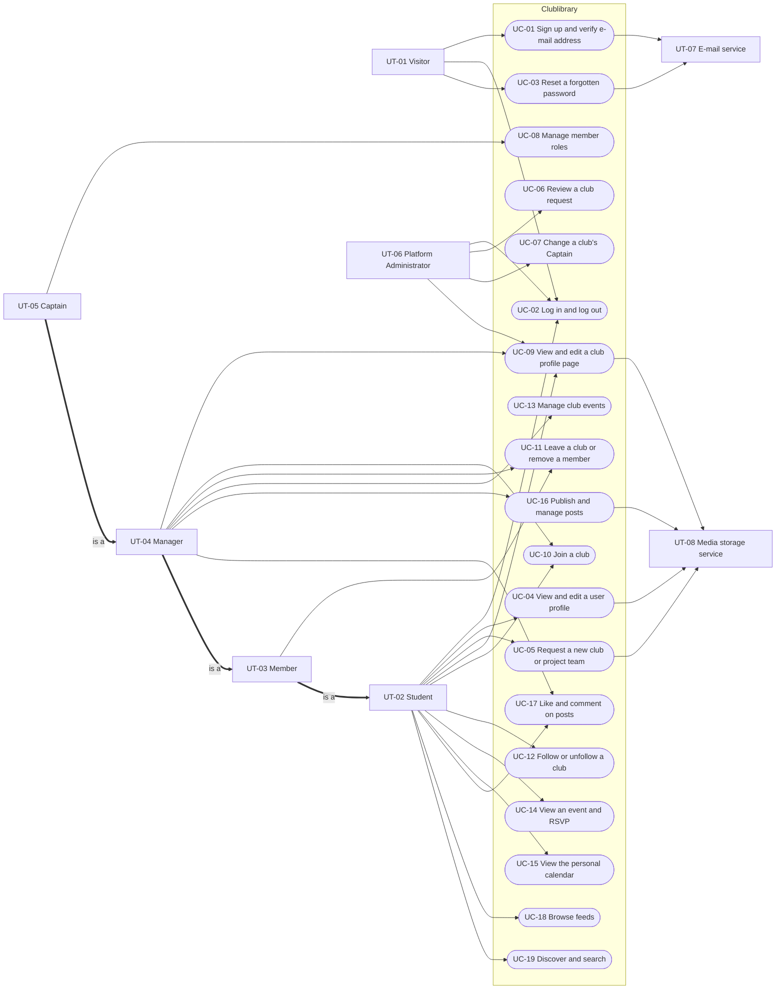
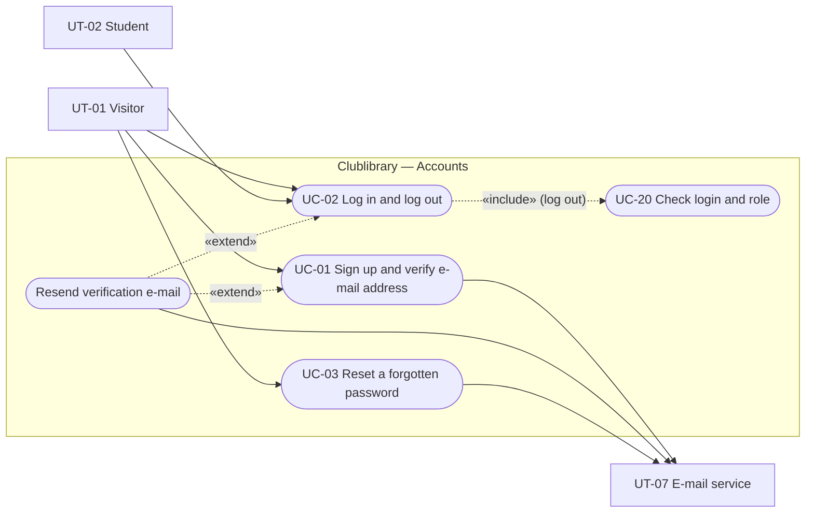
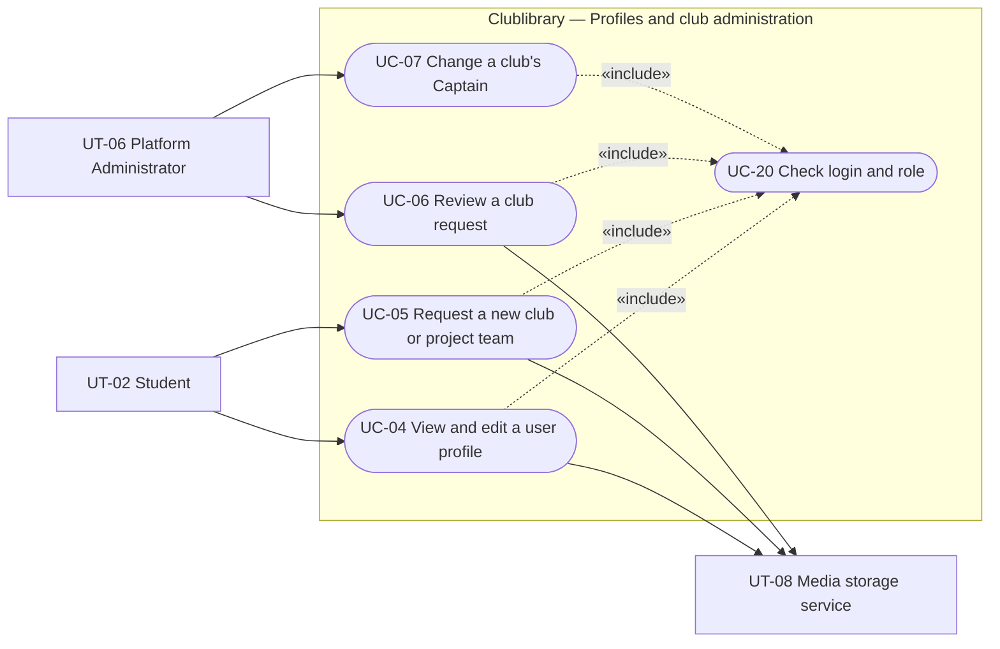
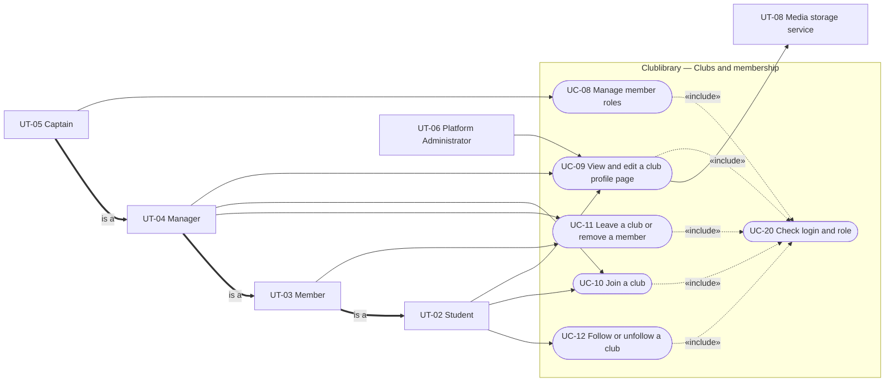
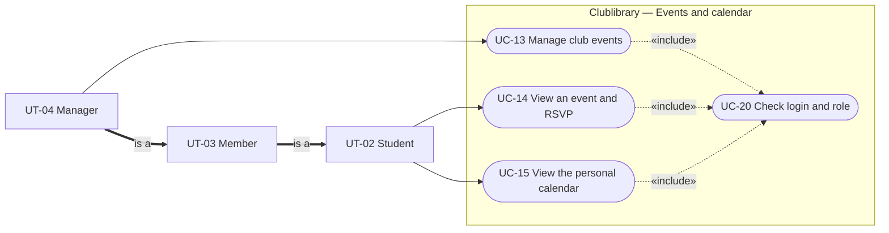
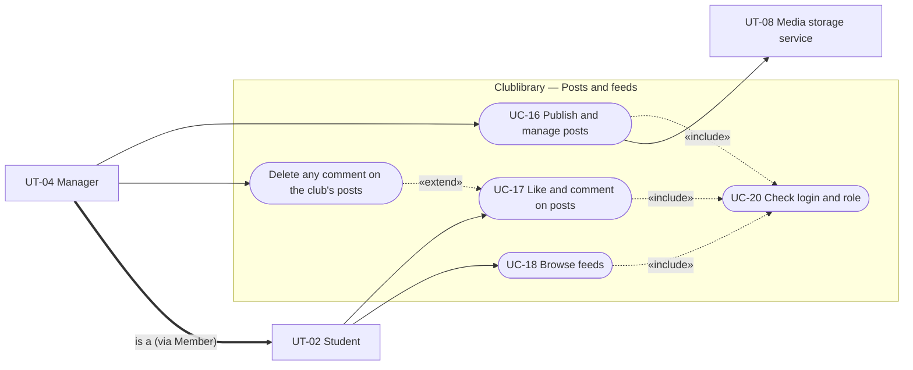
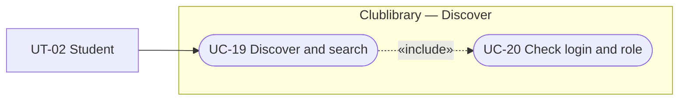

# Software Engineering — Requirements Specification

## Cover Page

| Field | Details |
|---|---|
| **Course** | BLG 411E Software Engineering |
| **Report name** | Requirements Specification |
| **Project title** | Clublibrary – Student Clubs & Project Teams Social Platform |
| **Group name / number** | Al-ı Memnu |
| **Group members** | Melih Kart — 150200701, Beyza Arısan — 150230069, Eslem Azra Yılmaz — 150220110, Yusuf Erdem Cıdık — 040230205 |
| **Instructor** | Ayşe Tosun Kühn, Tolga Ovatman |
| **Submission date** | 2026-11-08 |
| **Document version** | 1.0 |

---

## 1. Introduction

Clublibrary is a social media web and mobile application for the student clubs and project teams of Istanbul Technical University. Students use it to discover clubs and teams, follow them, join them, and keep track of their events, lectures, and meetings; Captains and Managers use it to organize their members, publish events, and share posts; Platform Administrators approve new clubs and project teams. The platform replaces the scattered mix of social media pages, messaging groups, and posters that clubs and teams rely on today.

This document specifies **what** the system must do, so that the team can build it and the test suite can verify it. It refines the scope, tasks (`T-##`), deliverables (`D-##`), and work-breakdown activities (`WBS-#.#`) of the **Project Plan** and uses the same IDs. How the system is built (architecture, database schema, API endpoints) belongs to the Software Design Report. Section 2 lists the functional and non-functional requirements, and Section 3 describes the user types, user scenarios and stories, use case diagrams, and detailed use cases.

---

## 2. System Requirements

### 2.1 Functional Requirements

Each requirement is linked to its Project Plan task and to the deliverables that implement it (D-01–D-04: backend API by feature area, D-05: database, D-06: web application, D-07: mobile application). Unless a requirement says otherwise, it applies to both the web and the mobile application.

| Requirement ID | Related task ID(s) | Related deliverable ID(s) | Functional requirement (natural language) | Priority | Verification / acceptance condition |
|---|---|---|---|---|---|
| FR-01 | T-03 | D-01, D-05, D-06, D-07 | The system **shall** let a visitor create an account by entering a full name, a university e-mail address, a password, and the same password again for confirmation, and **shall** reject a sign-up with an empty name. | Must | Sign-up with valid data creates a new, unverified account and shows the "check your e-mail" screen; a sign-up with an empty name is rejected. |
| FR-02 | T-03 | D-01, D-06, D-07 | The system **shall** reject a sign-up whose e-mail address does not end with `@itu.edu.tr` and **shall** ask for a university e-mail address. | Must | Sign-up with `name@gmail.com` is rejected with this message and no account is created. |
| FR-03 | T-03, T-04 | D-01, D-05, D-06, D-07 | The system **shall** compare e-mail addresses without regard to letter case, at sign-up and at login, and **shall** reject a sign-up with an address that already belongs to a verified account. | Must | When `elif@itu.edu.tr` is verified, a sign-up with `Elif@ITU.edu.tr` is rejected, and login works with both spellings. |
| FR-04 | T-03 | D-01, D-05 | When a sign-up uses an address that belongs to an unverified account, the system **shall** replace that account's name and password with the new ones and send a new verification e-mail. | Must | A second sign-up for an unverified address succeeds without creating a second account; after verification, only the new password works. |
| FR-05 | T-03, T-04 | D-01, D-06, D-07 | The system **shall** reject a password shorter than **8 characters** or longer than **72 bytes** (Turkish letters such as ğ, ş, and ı count as 2 bytes), and **shall** say which limit was not met. | Must | A 7-character password is rejected and an 8-character one accepted; a 73-character password and one of 37 "ğ" letters are rejected with a message, without a server error. |
| FR-06 | T-03 | D-06, D-07 | The web and mobile applications **shall** reject a password confirmation that differs from the password before sending the sign-up. | Must | A different confirmation shows a message next to the field and nothing is sent. |
| FR-07 | T-03 | D-01, D-06, D-07 | After a successful sign-up, the system **shall** send a verification e-mail with a verification link to the entered address. | Must | The e-mail arrives in the test mailbox and contains a link. |
| FR-08 | T-03 | D-01, D-05, D-06 | The system **shall** activate the account when its owner opens a valid verification link in a web browser on any device, and **shall** confirm the activation. | Must | Opening the link in a phone browser and in a computer browser both activate the account; afterwards, the account can log in (FR-13). |
| FR-09 | T-03 | D-01, D-06, D-07 | The system **shall** reject a verification link that is invalid or older than **24 hours**, and **shall** offer to send a new one. | Must | A link opened more than 24 hours after it was sent shows an "expired" message and the account stays unverified. |
| FR-10 | T-03 | D-01, D-06, D-07 | The system **shall** let the owner of an unverified account request a new verification e-mail. | Must | After a resend, a new e-mail arrives and its link activates the account. |
| FR-11 | T-03, T-04 | D-01 | The system **should** send at most one verification or password-reset e-mail per address every **30 seconds**, also when the request does not come from the application screens. | Should | Two direct API requests for the same address within 30 seconds send one e-mail; the second request gets a "try again later" message. |
| FR-12 | T-03, T-04 | D-01, D-06, D-07 | The system **shall** refuse to log in an unverified account and **shall** tell the user to verify the e-mail address first, with an option to resend the verification e-mail. | Must | Login with correct credentials of an unverified account fails with this message (403). |
| FR-13 | T-04 | D-01, D-06, D-07 | The system **shall** log in a verified user who enters a registered e-mail address and the matching password, and **shall** keep the user logged in on that device until the user logs out or the login session expires **7 days** after login. | Must | Valid credentials open the home feed; closing and reopening the app within 7 days does not ask for the password again. |
| FR-14 | T-04 | D-01, D-06, D-07 | When a login fails because of a wrong e-mail address or password, the system **should** show one message that does not say which of the two was wrong. | Should | A wrong password and an unknown address produce the same message. |
| FR-15 | T-04 | D-01, D-06, D-07 | When the user logs out, the system **shall** end the login session both on the device and on the server, so that the server refuses every later request made with that session; the user **shall** have to log in again to see any platform content. | Must | After logout, the login screen appears, and an API request with the old session token is refused (401). |
| FR-16 | T-04 | D-01, D-06, D-07 | When a user asks for a password reset for a registered address, the system **shall** send a password-reset e-mail with a reset link; the link contains a reset code that the user can also paste into the mobile application. | Must | The e-mail arrives and contains a link; pasting its code into the mobile reset screen opens the new-password step. |
| FR-17 | T-04 | D-01, D-06, D-07 | For a reset request with an address that has no account, the system **should** show the same confirmation as for a registered address and send no e-mail. | Should | A request with an unregistered `@itu.edu.tr` address shows the confirmation; no e-mail is sent. |
| FR-18 | T-04 | D-01, D-05, D-06, D-07 | The system **shall** let the user set a new password (with the length rules of FR-05, entered twice) with a valid reset link or code; after that, only the new password **shall** work for login. | Must | After a reset, login with the old password fails and login with the new password succeeds. |
| FR-19 | T-04 | D-01, D-06, D-07 | The system **shall** reject a reset link or code that is invalid, older than **30 minutes**, or issued before the password was last changed. | Must | Using the same link a second time after a successful reset is rejected; a link older than 30 minutes is rejected. |
| FR-20 | T-05 | D-01, D-05, D-06, D-07 | The system **shall** show a user's profile with name, photo, department, year of study, and interests. | Must | The profile screen shows all five fields (photo replaced by initials when there is none). |
| FR-21 | T-05 | D-01, D-05, D-06, D-07 | The system **shall** let a logged-in user change their own name, photo (JPEG, PNG, or WebP, at most 10 MB), department, year of study, and interests, **shall** reject an empty name, and **shall** show the saved values right after saving; a replaced or removed photo **shall** also be deleted from media storage. | Must | Edited values appear on the profile immediately and after logging in again on the other client (web or mobile); after a photo is replaced, the old file no longer exists in media storage. |
| FR-22 | T-05 | D-01, D-06, D-07 | The system **shall** let any logged-in user open another user's profile (for example from a member list or a comment) in read-only form. | Must | Selecting a member's name opens that member's profile without edit controls. |
| FR-23 | T-06 | D-02, D-05, D-06, D-07 | The system **shall** let a logged-in student request a new club by entering a name, a type (club or project team), a category (technology, engineering, science, arts, music, sports, culture, social, career, entrepreneurship, or other), and a description, and by attaching a **proof** that the club or project team is real, for example an approval document or a letter from its academic advisor, as one PDF, JPEG, or PNG file of at most **10 MB**. | Must | A request with all fields and a proof file is stored and appears in the requester's "My requests" list. |
| FR-24 | T-06 | D-02, D-05, D-06, D-07 | The system **shall** reject a club request with an empty name, type, or category, without a proof file, with a proof file in another format or larger than 10 MB, or with a name that an **approved** club already uses; names of pending and rejected requests do not block a new request. | Must | Requests with a missing field, no proof, a 12 MB proof, a `.docx` proof, or the name of an approved club are rejected with a message and nothing is stored; a request with the name of a pending or rejected request is accepted. |
| FR-25 | T-06 | D-02, D-05 | The system **shall** store a new club request with the status **Pending**, and **shall** show a pending or rejected club, and the proof of any request, only to its requester and to Platform Administrators. | Must | A pending club does not appear in Discover, search, or club pages for any other user, and its proof file cannot be opened by other users. |
| FR-26 | T-06 | D-02, D-06, D-07 | The system **shall** show the requester all of their club requests with their status (Pending, Approved, Rejected) and, for a rejected request, the rejection reason. | Must | After approval or rejection, the requester's list shows the new status (and the reason for a rejection). |
| FR-27 | T-07 | D-02, D-06 | The system **shall** show a Platform Administrator the list of pending club requests with each request's name, type, category, description, requester, request date, and proof, **shall** let the administrator open the proof to decide on the request, and **shall** mark the requests whose name is the same as that of another pending request. | Must | All pending requests of the seeded data appear in the list with these fields, each proof file opens from the list, and two pending requests with the same name are both marked. |
| FR-28 | T-07 | D-02, D-05, D-06 | When a Platform Administrator approves a club request, the system **shall**, as one indivisible change, set its status to **Approved**, make the club visible on the platform, and make the requester its **Captain** and first member; the system **shall** refuse the approval if an approved club already uses the same name. | Must | After approval the club appears in Discover with the requester as Captain; if the change fails part-way, the request stays Pending and no membership is created; approving a second request with the name of an approved club is refused. |
| FR-29 | T-07 | D-02, D-05, D-06 | The system **shall** require a rejection reason (for example "the proof does not show that the club exists") when a Platform Administrator rejects a club request, and **shall** store the reason with the status **Rejected**. | Must | A rejection without a reason is refused; with a reason, the status becomes Rejected and the reason is stored. |
| FR-30 | T-07 | D-02, D-05, D-06 | The system **shall** let a Platform Administrator make another current member of an approved club its Captain; in the same change, the previous Captain **shall** become a Member. | Must | After the change, the club has exactly one Captain (the selected member) and the previous Captain is a Member. |
| FR-31 | T-07 | D-02, D-06 | The system **shall** reject a captain change to a user who is not a member of that club. | Must | Choosing a non-member is refused and the roles do not change. |
| FR-32 | T-07, T-08 | D-01, D-02 | The system **shall** allow club approval, club rejection, and captain change only to Platform Administrator accounts. | Must | The same requests from a Captain or Student account are refused (403). |
| FR-33 | T-07 | D-01, D-05 | The system **shall not** create Platform Administrator accounts through sign-up; these accounts are created by the project team. | Must | No combination of sign-up input produces a Platform Administrator account. |
| FR-34 | T-07 | D-06, D-07 | The system **shall** offer the Platform Administrator screens only in the web application. | Must | The mobile application has no administrator screens; the web application shows them only to Platform Administrators. |
| FR-35 | T-08 | D-01, D-06, D-07 | The system **shall** require a logged-in, verified account for every function except sign-up, e-mail verification, login, and password reset. | Must | Every other screen and API request without a valid login is refused (401) or leads to the login screen. |
| FR-36 | T-08 | D-02, D-05 | The system **shall** give each user at most one role in each club (Member, Manager, or Captain), **shall** treat a user without a role as a Student (non-member) of that club, and **shall** keep exactly one Captain in each approved club. | Must | Database and API tests cannot create a second role for the same user and club, or a second Captain. |
| FR-37 | T-08 | D-02, D-05, D-06, D-07 | The system **shall** let the Captain make a Member a Manager and return a Manager to Member. | Must | After each action the member list shows the new role, and the user's rights change accordingly. |
| FR-38 | T-08 | D-02, D-05, D-06, D-07 | The system **shall** let the Captain hand over the Captain role to another member of the same club; in the same change, the previous Captain **shall** become a Member. | Must | After the handover, the club has exactly one Captain (the selected member) and the previous Captain is a Member. |
| FR-39 | T-08 | D-01, D-02, D-03, D-04 | The system **shall** check the user's **current** role on every request and **shall** reject any action that the role does not allow according to the permission table below, even when the request does not come from the application screens; a role change **shall** take effect on the user's next request, without logging in again. | Must | API tests send every protected action with each lower role and expect a refusal (403); after a Manager is returned to Member, their next attempt to create an event is refused while they are still logged in. |
| FR-40 | T-08 | D-06, D-07 | The web and mobile applications **should** show only the actions that the logged-in user's role allows in the club being viewed. | Should | For each role, the club page shows exactly the actions in the permission table. |
| FR-41 | T-09, T-10, T-12 | D-02, D-03, D-05, D-06, D-07 | The system **shall** show every logged-in user a profile page for each approved club with its name, type, category, description, logo, contact information, member count, member list with each member's role, and the club's upcoming events (public events for everyone; member-only events in full for its members and as a teaser for everyone else, FR-55). | Must | The profile page of a seeded club shows all these fields to a non-member, including its upcoming public events and the teasers of its member-only events; a member sees the member-only events in full. |
| FR-42 | T-09 | D-02, D-05, D-06, D-07 | The system **shall** let the Captain and Managers change their club's description, logo (JPEG, PNG, or WebP, at most 10 MB), and contact information, and **shall** show the changes on the profile page right after saving; a replaced logo **shall** also be deleted from media storage. | Must | A Manager's edit appears on the profile page for all users; a Member cannot edit (FR-39); after a logo is replaced, the old file no longer exists in media storage. |
| FR-43 | T-10 | D-02, D-05, D-06, D-07 | The system **shall** let a Student (non-member) send a membership request to an approved club. | Must | After "Join", the request appears as Pending for the student and in the club's request list. |
| FR-44 | T-10 | D-02, D-05 | The system **shall** reject a membership request from a user who is already a member of the club or who already has a pending request for it. | Must | A second request, or a request by a member, is refused; there is still one pending request at most. |
| FR-45 | T-10 | D-02, D-05, D-06, D-07 | The system **shall** show the Captain and Managers the pending membership requests of their club and let them approve or reject each one; an approved requester **shall** become a Member. | Must | After approval the user appears in the member list as Member; after rejection the request is no longer pending. |
| FR-46 | T-10 | D-02, D-05, D-06, D-07 | The system **shall** let a Member or Manager leave a club, and **shall** reject a leave request from the Captain until the Captain role has been handed over; when a user leaves, the system **shall** delete their answers to the club's upcoming member-only events. | Must | A Member's leave removes the membership and their answers to the club's upcoming member-only events (answers to public and past events stay); the Captain's leave is refused with a message to hand over first. |
| FR-47 | T-10 | D-02, D-05, D-06, D-07 | The system **shall** let the Captain and Managers remove a Member from their club, **shall** let only the Captain remove a Manager, and **shall not** let anyone remove the Captain; when a user is removed, the system **shall** delete their answers to the club's upcoming member-only events. | Must | A Manager removing a Member succeeds and the removed user disappears from the RSVP lists of the club's upcoming member-only events; a Manager removing a Manager or anyone removing the Captain is refused. |
| FR-48 | T-10, T-11 | D-02, D-06, D-07 | The system **should** show each user the clubs they belong to (with their role), the clubs they follow, and their pending membership requests. | Should | The "My clubs" screen lists the three groups correctly for a seeded user. |
| FR-49 | T-11 | D-02, D-05, D-06, D-07 | The system **shall** let a logged-in student follow and unfollow an approved club, and **shall** show on the club's page whether the user follows it. | Must | The button state changes after each action and is the same on web and mobile. |
| FR-50 | T-11 | D-02, D-03, D-04 | Following a club **shall** add its posts to the user's home feed and its public events to the user's calendar, and **shall not** give access to its member-only events beyond their teasers on the club page (FR-55). | Must | After following, the club's posts and public events appear; its member-only events do not. |
| FR-51 | T-12 | D-03, D-05, D-06, D-07 | The system **shall** let the Captain and Managers create an event for their club with a title, a type (social event, lecture/talk, meeting, workshop), a start date and time, a location, a visibility (public or member-only), and, optionally, a description and an end time. | Must | An event created with these fields appears on the club page and in the calendars of the users who can see it. |
| FR-52 | T-12 | D-03, D-05, D-06, D-07 | The system **shall** reject an event without a title, type, start date and time, location, or visibility, an event whose end time is earlier than its start time, and an event whose start time has already passed, both when it is created and when it is edited. | Must | Each missing field, an end time before the start time, and a start time in the past (on creation or edit) are rejected with a message. |
| FR-53 | T-12 | D-03, D-05, D-06, D-07 | The system **shall** let the Captain and Managers edit and delete the events of their club; deleting an event **shall** also delete its RSVPs, and changing an event to member-only **shall** delete the answers of users who are not members of the club. | Must | An edit appears on the event page; a deleted event and its RSVPs disappear from all lists and calendars; after a public event is changed to member-only, its lists contain only members. |
| FR-54 | T-12 | D-03, D-06, D-07 | The system **shall** show a public event to every logged-in user and a member-only event only to the Members, Managers, and Captain of its club, on an event page with its club, title, type, start and end time, location, visibility, and description. | Must | The event page of a seeded event shows all these fields; a non-member cannot open or list a member-only event in any screen or API response (NFR-22). |
| FR-55 | T-09, T-12 | D-03, D-06, D-07 | To users who are not members of its club, the system **shall** show each upcoming member-only event only as a **teaser** on the club page: its title, type, and start date and time, with a note that the event is for members and, for students, a *Join* option. The teaser **shall not** show the location, description, end time, or RSVP lists, and **shall not** appear in Discover, search, or the calendar. | Must | A non-member sees the teaser with exactly these fields on the club page; the API response for a non-member contains no location, description, end time, or RSVP data; the event never appears in a non-member's Discover, search results, or calendar. |
| FR-56 | T-12 | D-06, D-07 | The system **should** show event dates and times in the time zone of the device on which they are viewed. | Should | An event created at 18:00 Istanbul time shows 18:00 on a device set to Istanbul time. |
| FR-57 | T-13 | D-03, D-05, D-06, D-07 | The system **shall** let a logged-in student who can see an event answer **going** or **not going** and change the answer **until the event starts**, and **shall** keep at most one answer per user and event. | Must | Answering twice keeps one answer (the latest); the database rejects a duplicate RSVP; an answer sent after the start time is refused. |
| FR-58 | T-13 | D-03, D-05 | The system **shall** accept answers to a member-only event only from the Members, Managers, and Captain of its club. | Must | An answer from a non-member is refused and not stored. |
| FR-59 | T-13 | D-03, D-06, D-07 | The system **shall** show on the event page the number of going and not-going answers and the lists of who is going and who is not going, to every user who can see the event. | Must | A non-member sees the lists of a public event; for a member-only event, only members see them. |
| FR-60 | T-14 | D-03, D-06, D-07 | The system **shall** show each user a personal calendar of the upcoming events of the clubs they belong to (public and member-only events), of the clubs they follow (public events only), and every other upcoming event they answered **going** to, ordered by start time. | Must | For a seeded user, the calendar contains exactly the expected events, in date order, and no past events; a public event of an unfollowed club appears after the user answers going. |
| FR-61 | T-14 | D-03, D-06, D-07 | The system **shall** highlight in the calendar the events that the user answered **going** to. | Must | After answering going, the event is highlighted; after changing to not going, it is not. |
| FR-62 | T-14 | D-06, D-07 | The system **shall** open an event's detail page when the user selects the event in the calendar. | Must | Selecting a calendar entry opens the matching event page. |
| FR-63 | T-15 | D-04, D-05, D-06, D-07 | The system **shall** let the Captain and Managers publish a post on behalf of their club with text, one or more photos or videos, or both. | Must | Text-only, media-only, and mixed posts are published and appear in the club feed. |
| FR-64 | T-15 | D-04, D-06, D-07 | The system **shall** reject a post that has neither text nor media, and **shall** accept only photos in JPEG, PNG, or WebP format of at most **10 MB**, videos in MP4 or MOV format of at most **50 MB**, and at most **10 files** per post. | Must | An empty post, an 11th file, a 12 MB photo, a 60 MB video, and a GIF file are rejected with a message. |
| FR-65 | T-15 | D-06, D-07 | The system **should** show the upload progress of each photo or video while it is uploading. | Should | During the upload of a test video, a progress indicator is visible and reaches 100%. |
| FR-66 | T-15 | D-04, D-05, D-06, D-07 | The system **shall** let the Captain and Managers edit and delete the posts of their club; deleting a post **shall** also delete its likes, comments, photos, and videos, and a photo or video removed from a post **shall** be deleted from media storage. | Must | An edited post shows the new content; a deleted post disappears from all feeds; after a post is deleted or a file is removed from it, the files no longer exist in media storage. |
| FR-67 | T-15 | D-04, D-06, D-07 | The system **shall** show every logged-in user each post with its club's name and logo, its publication time, its text and media, and its like and comment counts. | Must | A post card of the seeded data shows all these fields to a non-member. |
| FR-68 | T-16 | D-04, D-05, D-06, D-07 | The system **shall** let a logged-in student like and unlike a post, **shall** count at most one like per user and post, and **shall** show the updated like count. | Must | Liking twice counts one like; unliking lowers the count by one. |
| FR-69 | T-16 | D-04, D-05, D-06, D-07 | The system **shall** let a logged-in student add a non-empty comment to a post and delete their own comments, and **shall** show the comments under the post with each author's name, photo, and comment time, oldest first. | Must | A comment appears under the post with its author's name, photo, and time, after the older comments; an empty comment is rejected; the author can delete it. |
| FR-70 | T-16 | D-04, D-05, D-06, D-07 | The system **shall** let the Captain and Managers delete any comment on the posts of their club. | Must | A Manager deletes another user's comment on the club's post; a Member cannot (FR-39). |
| FR-71 | T-17 | D-04, D-06, D-07 | The system **shall** show a feed for each club with its posts, newest first. | Must | The club feed lists the club's posts in descending publication time. |
| FR-72 | T-17 | D-04, D-06, D-07 | The system **shall** show each user a home feed with the posts of the clubs they belong to or follow, newest first, with each post only once, even when the user both belongs to and follows its club. | Must | For a seeded user, the home feed contains exactly the posts of joined and followed clubs, in descending time; a member who also follows the club sees each of its posts once. |
| FR-73 | T-17 | D-04, D-06, D-07 | The system **shall** load feeds page by page, **20 posts** per page, and **shall** load the next page when the user reaches the end of the list. | Must | A feed with 45 posts loads in three pages of 20, 20, and 5. |
| FR-74 | T-17 | D-06, D-07 | When the home feed has no posts, the system **may** show a message with a link to Discover. | Could | A new user without clubs sees the message and the link. |
| FR-75 | T-18 | D-04, D-06, D-07 | The system **shall** let users browse, in separate lists, the approved clubs, the upcoming public events (soonest first), and popular posts ranked by number of likes. | Must | The three Discover lists show the expected seeded items in the stated order. |
| FR-76 | T-18 | D-04, D-06, D-07 | The system **shall** let users search clubs by name and events by title, returning every item whose name or title contains the search text, regardless of letter case. | Must | Searching "robot" finds "ITU Robotics Club" and "Robotics meetup". |
| FR-77 | T-18 | D-04, D-06, D-07 | The system **shall** let users filter clubs by category and events by type, alone or together with a search text. | Must | A combined search and filter returns only items that match both. |
| FR-78 | T-18 | D-04 | The system **shall** never show pending or rejected clubs, member-only events, or past events in Discover lists and search results. | Must | Seeded pending clubs, member-only events, and past events never appear in Discover, whatever the search or filter. |
| FR-79 | T-18 | D-04, D-06, D-07 | The system **shall** return Discover lists and search results page by page, **20 items** per page. | Must | A search with more than 20 results returns them in pages of 20. |

**Functional requirement notes:**  

- **Permission table (FR-39).** The table below defines which role may perform each action in a club. Every logged-in student, whatever their role, can also use the functions that do not depend on a club (own profile, other users' profiles, club requests, home feed, calendar, Discover). The Platform Administrator only views clubs and uses the administrator screens.

| Action in a club | Student (non-member) | Member | Manager | Captain | Platform Administrator |
|---|---|---|---|---|---|
| View the club page, member list, posts, and public events | Yes | Yes | Yes | Yes | Yes |
| RSVP to public events; follow / unfollow; like and comment | Yes | Yes | Yes | Yes | No |
| Send a membership request | Yes | — | — | — | No |
| See the teasers of member-only events on the club page (title, type, start date and time) | Yes | Yes | Yes | Yes | Yes |
| View member-only events in full, RSVP to them, and see their RSVP lists | No | Yes | Yes | Yes | No |
| Leave the club | — | Yes | Yes | Only after handing over the Captain role | — |
| Create, edit, and delete events and posts; delete any comment on the club's posts | No | No | Yes | Yes | No |
| Edit the club profile; approve or reject membership requests; remove a Member | No | No | Yes | Yes | No |
| Make a Member a Manager, return a Manager to Member, remove a Manager, hand over the Captain role | No | No | No | Yes | No |
| Approve or reject club requests; change the Captain | No | No | No | No | Yes |

- **Functional requirements by project part.**

| Project part | Project Plan task(s) | Functional requirements |
|---|---|---|
| Accounts: sign-up, e-mail verification, login, logout, password reset | T-03, T-04 | FR-01–FR-19 |
| User profiles | T-05 | FR-20–FR-22 |
| Club requests and administration | T-06, T-07 | FR-23–FR-34 |
| Roles and permissions | T-08 | FR-35–FR-40 |
| Club page and membership | T-09, T-10 | FR-41–FR-48 |
| Following | T-11 | FR-49–FR-50 |
| Events | T-12 | FR-51–FR-56 |
| RSVP | T-13 | FR-57–FR-59 |
| Personal calendar | T-14 | FR-60–FR-62 |
| Posts | T-15 | FR-63–FR-67 |
| Likes and comments | T-16 | FR-68–FR-70 |
| Feeds | T-17 | FR-71–FR-74 |
| Discover and search | T-18 | FR-75–FR-79 |

### 2.2 Non-functional Requirements

The quality attributes below come from Project Plan Section 1.4 and the deliverable acceptance criteria. Thresholds are stated only where the team has agreed on them.

| Requirement ID | Quality attribute | Non-functional requirement (natural language) | Applies to | Verification / measurement |
|---|---|---|---|---|
| NFR-01 | Security | Only verified accounts with a university e-mail address and the Platform Administrator accounts created by the team **shall** be able to use platform functions. | Whole system; FR-02, FR-12, FR-33, FR-35 | API tests call protected endpoints with an unverified account and with no account and expect a refusal. |
| NFR-02 | Security | The system **shall** store passwords only as salted one-way hashes and **shall** never return a password or password hash in any response. | FR-01, FR-18 | Inspection of the stored user records; an automated test checks every user-related response for password fields. |
| NFR-03 | Security | The system **shall** refuse requests with a missing, invalid, or expired login session as *not logged in* (HTTP 401), and requests by a role without the right as *not allowed* (HTTP 403). Login sessions **shall** expire **7 days** after login, and a session ended by logging out **shall** be refused even before it expires. | FR-13, FR-15, FR-32, FR-35, FR-39 | API tests try every protected endpoint without a token, with an expired token, with a token used after logout, and with a lower role. |
| NFR-04 | Security | All traffic between the applications, the server, and the database **shall** be encrypted (HTTPS / TLS). | Whole system | The deployed URLs answer only over HTTPS; the database refuses connections without TLS. |
| NFR-05 | Security | Secrets (database password, session signing key, media-storage keys, e-mail account password) **shall not** be stored in the Git repository or returned in any response. | Whole system; T-01 | A search of the repository history for secret values before each release; manual check of API responses. |
| NFR-06 | Security | The system **shall** treat everything users type only as data: input containing database commands or script code **shall** be stored and shown as plain text and never executed. | All input fields | Tests enter `' OR '1'='1` in search and form fields and `<script>` in a comment; the text is stored and shown unchanged and nothing is executed. |
| NFR-07 | Performance | Typical API requests (login, one feed page, an event list, a Discover search) **shall** respond within **1 second** on the deployed system with the seeded demo data, measured after a warm-up request (the first request after an idle period is covered by NFR-16). | FR-13, FR-60, FR-72, FR-75–FR-77 | After one warm-up request, response times are measured with Postman or the browser developer tools on the deployed system; the slowest endpoints are reported in the Software Test Report. |
| NFR-08 | Performance | Web pages **shall** show their first content within **3 seconds** on a normal connection, measured with Lighthouse's default mobile test (see notes). | D-06 | Lighthouse in Chrome DevTools on the deployed web application, in an incognito window: the middle result of three runs shows a First Contentful Paint of at most 3 seconds. |
| NFR-09 | Usability | The web and mobile applications **shall** offer the same main flows with the same visual style (Style Guide, WBS-2.1); only the Platform Administrator screens are web-only. | D-06, D-07; T-02 | Walkthrough of every main flow on both clients against the wireframes (WBS-2.2) and the style guide. |
| NFR-10 | Usability | The web application **shall** be usable without horizontal scrolling on screens from **360 px** wide up to desktop size. | D-06 | Every screen checked in the browser device mode at 360 px, tablet, and desktop widths, and on a phone. |
| NFR-11 | Usability | A new student **shall** be able to sign up, find a club and send a membership request, and RSVP to an event without help. | UT-01, UT-02 | Usability walkthroughs (WBS-19.3) with **at least 3 students** outside the team; each completes the tasks while the team notes problems. |
| NFR-12 | Usability | For invalid input, the system **shall** show a message next to the field or form that says what is wrong and how to fix it. | All forms | Test cases enter invalid data in every form and check the message. |
| NFR-13 | Usability (accessibility) | Text and buttons **shall** meet the **WCAG AA** contrast ratio for text (4.5:1 for normal text), and buttons and tab bar items **shall** be at least **48 px** tall on mobile. | D-06, D-07 | Contrast checker on the style-guide colors and on screenshots; touch-target sizes measured in the mobile app. |
| NFR-14 | Usability | All user interface text **should** be in English. | D-06, D-07 | Review of all screens. |
| NFR-15 | Reliability | The system **shall** answer invalid input, duplicate actions, and requests for missing items with an error code and a readable message instead of crashing, and the applications **shall** show that message to the user. | Whole system | Tests for invalid input, duplicate actions, and missing resources expect the proper error code and message. |
| NFR-16 | Reliability | The first request after the database has been idle **shall** succeed without a manual restart. | D-01, D-05, D-09 | `/api/health/db` and a normal request are called after an idle period of several hours (for example overnight) and succeed. |
| NFR-17 | Reliability (data integrity) | The system **shall** keep data consistent: no duplicate memberships, pending membership requests, follows, RSVPs, or likes; exactly one Captain per approved club; and approval, captain change, and handover completed fully or not at all — also when the same action is sent twice at the same time. | FR-28, FR-30, FR-36, FR-38, FR-44, FR-49, FR-57, FR-68 | Database constraint tests and tests that send the same request twice in parallel. |
| NFR-18 | Maintainability | Every change **shall** reach the `main` branch only through a pull request reviewed and approved by at least one other team member. | All tasks | GitHub pull-request history shows a review before every merge. |
| NFR-19 | Maintainability | Database structure changes **shall** be made only through migrations, and the full schema **shall** be created from the migrations on an empty database with no manual steps. | D-05; T-01 | The migrations are run on an empty database in a test run. |
| NFR-20 | Compatibility | The web application **shall** work on the current versions of Chrome, Firefox, Safari, and Edge. | D-06 | Manual test run of the main flows on each browser (WBS-19.3). |
| NFR-21 | Compatibility | The mobile application **shall** run on Android and iOS. | D-07 | Manual test run on at least one Android and one iOS device (Expo Go or an installable build). |
| NFR-22 | Privacy | No part of the system (club pages, event pages, calendar, feeds, Discover, search, RSVP lists) **shall** reveal more of a member-only event than its teaser (title, type, and start date and time) to a user who is not a member of its club, and **shall** never reveal its RSVP lists to such a user. | FR-54, FR-55, FR-58, FR-59, FR-60, FR-78 | API tests as a non-member against every endpoint that lists or shows events: member-only events appear only as teasers on the club page, without location, description, end time, or RSVP data. |
| NFR-23 | Privacy | The system **shall** store only the personal data the platform needs: e-mail address, name, department, year of study, interests, and profile photo. | Whole system; FR-20 | The stored user fields are reviewed against this list in the Software Design Report. |
| NFR-24 | Constraint (cost) | The system **shall** run on free service plans only and within their limits: database storage of 5 GiB and 50 million request units per month, server requests of at most 4.5 MB (so media files do not pass through the server), media storage of 25 credits per month shared by storage, viewing bandwidth, and transformations (1 credit = 1 GB), and about 500 e-mails per day. | Whole system; T-20 | Weekly check of usage in the service consoles, including the media storage credits; an upload test with a 20 MB video succeeds, because the file goes directly to media storage and not through the server. |
| NFR-25 | Verifiability | The automated backend tests **shall** run with one command, and every functional requirement in Section 2.1 **shall** be covered by at least one automated or manual test case recorded in the Software Test Report. | T-19; D-08 | One-command test run; traceability table in the Software Test Report. |
| NFR-26 | Deployability | The backend and the web application **shall** be reachable at public HTTPS addresses, and the demo **shall** run from release `v1.0.0` on `main`. | T-20; D-09 | The deployed URLs open; release `v1.0.0` exists on `main` by 25.12.2026. |
| NFR-27 | Documentation | A new team member **shall** be able to set up and run the system locally using only the README, and every API endpoint **shall** be documented. | T-21; D-10 | A member who did not write the README follows it on a clean machine; the API documentation is checked against the endpoint list. |

**Non-functional requirement notes / assumptions:**  

- **Typical API request (NFR-07)** means one of: login, one page of a feed, the event list of a club or calendar, one Discover list or search. **Seeded demo data** is the data created by the seed script (WBS-19.1). **Deployed system** means the backend and web application on Vercel with the database on TiDB Cloud (Project Plan 1.1).
- **Normal connection (NFR-08)** means the connection that Lighthouse simulates in its default mobile test, called "Slow 4G": 150 ms latency, 1.6 Mbps download, and 750 Kbps upload. Lighthouse is built into Chrome DevTools, so anyone can repeat the measurement.
- **Supported environments:** current versions of Chrome, Firefox, Safari, and Edge on desktop and phone screens; Android and iOS for the mobile application (NFR-20, NFR-21).
- **Technology constraints.** The technologies listed in Project Plan Section 1.1 (Flask, Next.js, React Native with Expo, a MySQL-compatible database on TiDB Cloud, Cloudinary for media, Gmail SMTP for e-mail, Vercel hosting) are design decisions and are described in the Software Design Report. The requirements above are written so that they stay valid if one of these services is replaced.

---

## 3. Use Cases

### 3.1 User Types

Clublibrary has six types of human users and two external systems. UT-02 to UT-05 are the club roles of Project Plan T-08: one person can be the Captain of one club, a Member of another, and a Student (non-member) of all other clubs.

| User type ID | User type / actor | Description and responsibilities | Goals / typical actions | Related requirement ID(s) |
|---|---|---|---|---|
| UT-01 | Visitor | A person who is not logged in, usually a new ITU student or a user on a new device. | Sign up with a university e-mail address, verify the address, log in, reset a forgotten password. | FR-01–FR-19 |
| UT-02 | Student | Any logged-in user with a verified account who is not a Platform Administrator. In a club where the user has no role, the user is a Student (non-member) of that club. | Edit own profile and view others; request a new club; discover, search, and follow clubs; send membership requests; see public events and the teasers of member-only events; RSVP to public events; like and comment on posts; read the home feed and the calendar. | FR-20–FR-26, FR-41, FR-43, FR-44, FR-48–FR-50, FR-54–FR-57, FR-59–FR-62, FR-67–FR-69, FR-71–FR-79 |
| UT-03 | Member | A Student who has the Member role in a club. | Everything a Student can do, plus see the club's member-only events in full, RSVP to them, and leave the club. | FR-46, FR-54, FR-57–FR-60 |
| UT-04 | Manager | A Member who has been made a Manager by the Captain. | Everything a Member can do, plus edit the club profile, manage the club's events and posts, delete comments on the club's posts, approve or reject membership requests, and remove Members. | FR-42, FR-45, FR-47, FR-51–FR-53, FR-63–FR-66, FR-70 |
| UT-05 | Captain | The single leader of a club: the requester of an approved club, or a member who received the role through a handover or a captain change. | Everything a Manager can do, plus make Members Managers and return them to Member, remove Managers, and hand over the Captain role. | FR-37, FR-38, FR-46, FR-47 |
| UT-06 | Platform Administrator | A platform-level account created by the project team, for example for staff of the university's student activities office. Uses only the web application. | Check pending club requests and their proofs, approve or reject them with a reason, and change the Captain of a club when needed; view clubs, posts, and public events without taking part in them. | FR-27–FR-34, FR-41, FR-54, FR-55, FR-67 |
| UT-07 | E-mail service *(external system; currently Gmail SMTP)* | The e-mail delivery service used by the platform. | Deliver verification and password-reset e-mails. | FR-07, FR-10, FR-11, FR-16 |
| UT-08 | Media storage service *(external system; currently Cloudinary)* | The service that stores profile photos, club logos, club request proofs, and post photos and videos. | Store uploaded files, return their addresses, and delete files that are replaced or removed. | FR-21, FR-23, FR-42, FR-63–FR-66 |

**Access or role distinctions:**

- **Rights are per club.** A user's rights in a club depend on their role in that club (Student, Member, Manager, or Captain), as listed in the permission table in Section 2.1. The server checks the user's current role on every request (FR-39), not only in the screens.
- **Platform Administrator.** The administrator role is separate from the club roles. It allows reviewing club requests and changing Captains, but gives no Member, Manager, or Captain rights: in clubs, the administrator can only view club pages, member lists, posts, public events, and the teasers of member-only events, and cannot follow, RSVP, like, comment, or send membership requests. Administrator accounts cannot be created through sign-up (FR-33), and their screens exist only in the web application (FR-34).
- **Frequency and device.** Students and Members use the platform several times a week, mostly on the mobile application. Managers and Captains also publish events and posts, often from the web application on a laptop. Platform Administrators use the web application when new club requests arrive.
- **External systems** take part only as secondary actors: they never start a use case.

### 3.2 User Scenarios

The following scenarios describe how users interact with the system across both happy paths and validation/error cases, covering all functional requirements (FR-01 through FR-79) from the system specification and providing Behavior-Driven Development (BDD) acceptance scenarios in Gherkin format (`Given` / `When` / `Then`).

**SC-01 — Account Creation, Verification, First Login, and Onboarding**  
**Persona:** P-01 — Elif Demir (UT-01 Visitor → UT-02 Student)  
**Related requirements:** FR-01, FR-02, FR-03, FR-04, FR-05, FR-06, FR-07, FR-08, FR-09, FR-10, FR-11, FR-12, FR-13, FR-14, FR-20, FR-21, FR-35, FR-74, FR-75

- **Main flow:** Elif opens Clublibrary for the first time and signs up with her full name, her `@itu.edu.tr` address, and a valid password entered twice (FR-01). The system creates an unverified account and sends a verification link to her university mailbox (FR-07). Because she opens the first link more than 24 hours later, the system tells her it has expired and offers to send a new one (FR-09); she requests a new verification e-mail (FR-10) and opens the fresh link in her browser, which activates her account (FR-08). She then logs in with her verified credentials, starting a 7-day session that grants access to protected platform features (FR-13, FR-35). Opening her profile page (FR-20), Elif updates her name, department, year of study, interests, and uploads a JPEG profile photo; when she replaces the photo, the system immediately displays the saved values and deletes the old file from media storage (FR-21). Because she has not joined or followed any clubs yet, her empty home feed displays an onboarding message with a link to Discover (FR-74). In Discover, Elif browses the lists of approved clubs, upcoming public events, and popular posts (FR-75).
- **Alternative and validation flows:** During sign-up and login, the system rejects non-university e-mail addresses (FR-02), empty names (FR-01), passwords shorter than 8 characters or longer than 72 bytes including multi-byte Turkish characters (FR-05), and mismatched password confirmations on the client before submission (FR-06). E-mail comparison is case-insensitive at sign-up and login, rejecting duplicate sign-ups for already verified addresses (FR-03), whereas a new sign-up using an unverified address overwrites the pending name and password and sends a new verification link (FR-04). If a user tries to log in before verifying their e-mail, the system refuses (403) and offers to resend the verification e-mail (FR-12); repeated verification or reset e-mail requests for the same address within 30 seconds are rate-limited (FR-11); and a failed login due to a wrong e-mail or password shows one generic error message without revealing which field was wrong (FR-14).

```gherkin
Feature: University Account Sign-Up, Verification, and Onboarding (SC-01)

  Scenario: Successful registration with an @itu.edu.tr e-mail address
    Given Visitor "Elif Demir" is on the sign-up screen
    When she submits full name "Elif Demir", e-mail "demir26@itu.edu.tr", and matching 10-character passwords
    Then the system shall create an unverified account for "demir26@itu.edu.tr"
    And the system shall send a verification e-mail with an activation link valid for 24 hours
    And the screen shall instruct her to check her e-mail

  Scenario: Reject sign-up with a non-university e-mail or invalid password length
    Given Visitor "Elif Demir" is on the sign-up screen
    When she attempts to sign up with e-mail "elif@gmail.com" or a 7-character password
    Then the system shall reject the submission without creating an account
    And the system shall display a message specifying which validation rule was not met

  Scenario: Block login before e-mail verification and enforce 30-second resend limit
    Given "Elif Demir" has an unverified account for "demir26@itu.edu.tr"
    When she attempts to log in with her correct password
    Then the system shall refuse the login with HTTP 403 and offer to resend the verification e-mail
    And if she requests a resend twice within 30 seconds, the system should send only one e-mail and ask her to try again later
```

**SC-02 — Password Reset, Club Discovery, Following, and Membership Request**  
**Persona:** P-02 — Can Öztürk (UT-02 Student)  
**Related requirements:** FR-15, FR-16, FR-17, FR-18, FR-19, FR-43, FR-44, FR-48, FR-49, FR-50, FR-76, FR-77, FR-78, FR-79

- **Main flow:** After finishing a session on a shared computer, Can logs out, ending his login session on both the device and the server so that any later request with that session token is refused (FR-15). When he later forgets his password, he requests a password reset for his registered @itu.edu.tr address and receives an e-mail with a reset link containing a reset code he can also paste into the mobile app (FR-16). Using the valid code, he enters a new password twice, after which only the new password works for login (FR-18). Once logged in, Can opens Discover, searches for "robot" (case-insensitive) (FR-76), and filters by the "Engineering" category (FR-77); the system returns matching items in pages of 20 (FR-79). Can follows a technology club (FR-49), which adds its posts to his home feed and its public events to his calendar without granting access to full member-only events (FR-50). He also sends a membership request to the club (FR-43) and checks his "My clubs" screen to see his joined clubs, followed clubs, and pending membership requests (FR-48).
- **Alternative and validation flows:** A password-reset request for an unregistered address shows the same confirmation message without sending an e-mail (FR-17). Reset links or codes that are invalid, older than 30 minutes, or issued before the last password change are rejected (FR-19). Discover lists and search results never show pending or rejected clubs, member-only events, or past events (FR-78). A duplicate membership request from a user who is already a member or already has a pending request for that club is rejected (FR-44).

```gherkin
Feature: Password Reset, Club Discovery, Following, and Membership Request (SC-02)

  Scenario: Reset password with a valid code and invalidate old credentials
    Given Student "Can Öztürk" requested a password reset for "ozturkc@itu.edu.tr" 5 minutes ago
    When he submits the valid reset code and a matching new password of 12 characters
    Then the system shall save the new password and invalidate the reset code for future use
    And login with his old password shall fail while login with the new password shall succeed

  Scenario: Search and filter in Discover while excluding restricted or past items
    Given Student "Can Öztürk" is logged in and opens Discover
    When he searches for "robot" and selects the "Engineering" category filter
    Then the system shall return matching approved clubs in pages of 20 items regardless of letter case
    And the results shall never contain pending clubs, rejected clubs, member-only events, or past events

  Scenario: Follow a club and reject a duplicate membership request
    Given Student "Can Öztürk" views the approved club "ITU Robotics Club"
    When he selects "Follow" and sends a membership request
    Then the club's posts and public events shall appear in his home feed and calendar, and his request shall be stored as "Pending"
    And if he sends a second membership request while the first is still "Pending", the system shall reject the duplicate request
```
**SC-03 — Club Request Submission, Platform Administration, and Club Profile Setup**  
**Persona:** P-03 — Zeynep Kaya (UT-02 Student → UT-05 Captain), P-04 — Selin Arslan (UT-06 Platform Administrator)  
**Related requirements:** FR-23, FR-24, FR-25, FR-26, FR-27, FR-28, FR-29, FR-30, FR-31, FR-32, FR-33, FR-34, FR-36, FR-41, FR-42, FR-45

- **Main flow:** Zeynep submits a request for a new project team by entering its name, type (project team), category (engineering), description, and attaching a valid PDF advisor letter under 10 MB as proof (FR-23). The system stores the request as Pending and keeps the pending team and its proof visible only to Zeynep and Platform Administrators (FR-25), while Zeynep tracks the status in her My requests list (FR-26). Selin logs into the web-only administrator screens using a team-created Platform Administrator account (FR-33, FR-34) and views the pending requests list with all details, proof links, and duplicate pending names marked (FR-27). Selin rejects an invalid duplicate request with a mandatory reason (FR-29) and approves Zeynep's request; as one indivisible change, the system sets the status to Approved, makes the team visible on the platform, and makes Zeynep its sole Captain and first member (FR-28, FR-36). Every logged-in user can now view the club profile page showing its details, member list with roles, and upcoming events (FR-41). Zeynep updates the club's description, contact information, and logo (deleting the replaced logo file from media storage) (FR-42), and approves a pending membership request so the student becomes a Member (FR-45). Later, when another club's Captain graduates, Selin changes that club's Captain to an existing member, turning the previous Captain into a Member in the same transaction (FR-30).
- **Alternative and validation flows:** A club request missing a required field or proof file, using an unsupported proof format or a file over 10 MB, or using the name of an already approved club is rejected, whereas names of pending or rejected requests do not block submission (FR-24). Approving a request whose name is already used by an approved club is refused (FR-28), and rejecting a request without a reason is refused (FR-29). Non-administrators attempting club approval, rejection, or administrative captain change are refused with HTTP 403 (FR-32), and attempting to assign the Captain role to a user who is not a member of that club is rejected (FR-31).

```gherkin
Feature: Club Request Approval and Platform Administration (SC-03)

  Scenario: Platform Administrator approves a pending club request atomically
    Given Student "Zeynep Kaya" submitted a pending request for "ITU Autonomous Team" with a valid PDF proof
    And Platform Administrator "Selin Arslan" is logged into the web application
    When "Selin Arslan" opens the proof file and approves the request for "ITU Autonomous Team"
    Then the system shall atomically set the status to "Approved" and make "Zeynep Kaya" its sole Captain and first member
    And "ITU Autonomous Team" shall become visible on the platform

  Scenario: Refuse club rejection without a reason
    Given a pending club request exists in the system
    When a Platform Administrator attempts to reject the request without entering a reason
    Then the system shall refuse the rejection and keep the request "Pending"

  Scenario: Refuse administrative actions by non-administrators
    Given a pending club request exists in the system
    When a Student or Captain sends a club approval or captain-change request
    Then the system shall refuse the request with HTTP 403 and keep the existing state unchanged

  Scenario: Change a club's Captain to an existing member vs. a non-member
    Given "ITU Autonomous Team" is an approved club where "Zeynep Kaya" is Captain and "Ece Çelik" is a Member
    When Platform Administrator "Selin Arslan" selects "Ece Çelik" as the new Captain
    Then "Ece Çelik" shall become the Captain and "Zeynep Kaya" shall become a Member in the same change
    But if "Selin Arslan" selects a user who is not a member of the club, the system shall reject the change
```

**SC-04 — Role Management, Events, Posts, and Membership Lifecycle**  
**Persona:** P-05 — Mert Aydın (UT-05 Captain), P-06 — Deniz Şahin (UT-04 Manager)  
**Related requirements:** FR-22, FR-37, FR-38, FR-39, FR-40, FR-46, FR-47, FR-51, FR-52, FR-53, FR-63, FR-64, FR-65, FR-66

- **Main flow:** Mert promotes Member Deniz to Manager and can also return a Manager to Member (FR-37); the client applications show only the actions allowed for the user's role in that club (FR-40), and the backend checks the user's current role on every request so role changes take effect immediately without logging in again (FR-39). Deniz creates an event for the club with a title, type, start and end times, location, and public visibility (FR-51), and later edits the event to member-only, which deletes the RSVPs of non-members (FR-53). Deniz also publishes a club post with text, photos, and a video while seeing the upload progress of each file (FR-63, FR-65), and later edits or deletes the post, which deletes removed media files (and for a deleted post, its likes, comments, and media) from storage (FR-66). Any logged-in user can open another user's profile in read-only form from a member list or comment (FR-22). When a Member or Manager leaves the club (FR-46)—or when a Manager/Captain removes a Member, or the Captain removes a Manager (FR-47)—the system removes the membership and deletes that user's answers to the club's upcoming member-only events. Finally, Mert hands over the Captain role to Deniz, making Deniz the Captain and Mert a Member in the same change (FR-38).
- **Alternative and validation flows:** The Captain cannot leave the club until handing over the Captain role first (FR-46), and Managers cannot remove other Managers or the Captain (FR-47). Creating or editing an event is rejected if required fields are missing, if the end time is earlier than the start time, or if the start time has already passed (FR-52). Publishing a post is rejected if it has neither text nor media, exceeds 10 files, or contains photos over 10 MB, videos over 50 MB, or unsupported formats (FR-64).

```gherkin
Feature: Role Enforcement, Event and Post Management, and Captain Handover (SC-04)

  Scenario: Immediate backend permission check after a Manager is returned to Member
    Given "Deniz Şahin" is currently a Manager of "ITU UAV Team" and has an active login session
    When Captain "Mert Aydın" returns "Deniz Şahin" to the Member role
    And "Deniz Şahin" attempts to create a club event on the next request without logging in again
    Then the system shall refuse the request with HTTP 403

  Scenario: Block Captain from leaving before role handover
    Given "Mert Aydın" is the Captain of "ITU UAV Team"
    When "Mert Aydın" attempts to leave the club before handing over the Captain role
    Then the system shall reject the leave request with a message to hand over the Captain role first
    And after "Mert Aydın" hands over the Captain role to "Deniz Şahin", "Mert Aydın" shall become a Member and be allowed to leave

  Scenario: Changing a public event to member-only removes non-member RSVPs
    Given an upcoming public event of "ITU UAV Team" has RSVPs from both club Members and non-members
    When Manager "Deniz Şahin" edits the event visibility to "member-only"
    Then the system shall delete the RSVP answers of all users who are not members of "ITU UAV Team"
```

**SC-05 — Feeds, Post Engagement, Event RSVPs, and Personal Calendar**  
**Persona:** P-07 — Ahmet Koç (UT-02 Student, non-member), P-08 — Ece Çelik (UT-03 Member)  
**Related requirements:** FR-54, FR-55, FR-56, FR-57, FR-58, FR-59, FR-60, FR-61, FR-62, FR-67, FR-68, FR-69, FR-70, FR-71, FR-72, FR-73

- **Main flow:** Ahmet opens his personal home feed, which loads 20 posts per page newest first from the clubs he belongs to or follows (FR-72, FR-73), and Ece—who both belongs to and follows her club—sees each post only once (FR-72). Each post shows its club's name and logo, publication time, text, media, and like and comment counts (FR-67), and opening a club's feed lists that club's posts newest first, 20 per page (FR-71). Ahmet likes a post (FR-68) and adds a non-empty comment, which is displayed oldest first with his name, photo, and comment time; Ahmet can delete his own comment (FR-69), and a Manager or Captain of the club can delete any comment on their club's posts (FR-70). On a club page, Ahmet opens a public event in full (FR-54), sees its dates and times in his device's time zone (FR-56), answers going before the event starts (FR-57), and views the going and not-going counts and lists (FR-59). For an upcoming member-only event, non-member Ahmet sees only a teaser on the club page (title, type, start date and time, and a Join option) (FR-55), whereas club Member Ece can view the full member-only event page, see its RSVP lists, and submit her going answer (FR-54, FR-58, FR-59). Opening the personal calendar shows each user their upcoming authorized events (from joined clubs, followed clubs' public events, and any other upcoming event they answered going to) ordered by start time (FR-60), highlights the events they answered going to (FR-61), and opens the event's detail page when selected (FR-62).
- **Alternative and validation flows:** Liking a post twice counts at most one like per user, and unliking lowers the count by one (FR-68); empty comments are rejected (FR-69). Non-members never receive the location, description, end time, or RSVP lists of a member-only event, nor does it appear in their Discover, search, or calendar (FR-55, FR-59), and any RSVP attempt by a non-member on a member-only event is refused (FR-58). RSVP answers keep at most one answer per user and event and are refused after the event's start time has passed (FR-57).

```gherkin
Feature: Member-Only Event Privacy, RSVPs, Feeds, and Personal Calendar (SC-05)

  Scenario: Non-member sees only a member-only event teaser
    Given club "ITU Civil Society" has an upcoming member-only meeting
    When non-member Student "Ahmet Koç" views the club profile page
    Then he shall see only the teaser (title, type, start date and time, and a Join option) without location, description, or RSVP lists
    And if "Ahmet Koç" sends an RSVP answer to that member-only event, the system shall refuse it

  Scenario: Member views full member-only event details and RSVPs
    Given club "ITU Civil Society" has an upcoming member-only meeting
    And "Ece Çelik" is a Member of "ITU Civil Society"
    When "Ece Çelik" opens the event
    Then she shall see the full event page and its RSVP lists
    And she shall be able to answer "going"

  Scenario: Paginated deduplicated home feed and highlighted personal calendar
    Given Member "Ece Çelik" both belongs to and follows "ITU Civil Society"
    And she has answered "going" to an upcoming event starting tomorrow
    When she opens her home feed and her personal calendar
    Then her home feed shall load 20 posts per page newest first with each post of "ITU Civil Society" shown only once
    And her personal calendar shall list her upcoming authorized events ordered by start time with tomorrow's event highlighted
```

#### User Stories Linked to the Project Plan

| Scenario ID | Project Plan WBS activity ID | User story | Related requirement ID(s) |
|---|---|---|---|
| Scenario ID | Project Plan WBS activity ID | User story | Related requirement ID(s) |
|---|---|---|---|
| SC-01 | WBS-3.1, WBS-3.2 | **US-01:** As a Visitor, I want to sign up with my university e-mail (`@itu.edu.tr`) and a validated password so that I can create an account on the platform. | FR-01–FR-06 |
| SC-01 | WBS-3.1, WBS-3.2 | **US-02:** As a new student, I want to activate my account with a link sent to my university e-mail, and get a new link if the first one expires, so that only I can use an account in my name. | FR-07–FR-11 |
| SC-01 | WBS-4.1, WBS-4.2 | **US-03:** As a Student, I want to log in once and stay logged in on my device for 7 days so that I do not have to enter my password every time I open the app. | FR-12–FR-14 |
| SC-02 | WBS-4.1, WBS-4.2 | **US-04:** As a Student, I want to log out and end my session on the server so that nobody else can use my account on a shared computer. | FR-15 |
| SC-02 | WBS-4.1, WBS-4.2 | **US-05:** As a Student who forgot my password, I want to set a new one through a reset link or code sent to my e-mail so that I can get back into my account. | FR-16–FR-19 |
| SC-01, SC-04 | WBS-5.1, WBS-5.2 | **US-06:** As a Student, I want to add my photo, department, year, and interests to my profile, and see other members' profiles, so that club members know who they are talking to. | FR-20–FR-22 |
| SC-03 | WBS-6.1, WBS-6.2 | **US-07:** As a Student, I want to request a new club or project team with a proof document and see its review status so that I can officially gather people with similar interests. | FR-23–FR-26 |
| SC-03 | WBS-7.1, WBS-7.2 | **US-08:** As a Platform Administrator, I want to review pending club requests and their proofs on the web application and approve or reject them with a reason so that only legitimate clubs appear on the platform. | FR-27–FR-29, FR-33, FR-34 |
| SC-03 | WBS-7.1, WBS-7.2 | **US-09:** As a Platform Administrator, I want to change the Captain of a club to another existing member so that a club whose Captain has graduated or left can keep working. | FR-30–FR-32 |
| SC-03, SC-04 | WBS-8.1, WBS-8.2 | **US-10:** As a Captain, I want to promote Members to Managers, return Managers to Member, and hand over the Captain role so that I can share and transition the workload of running the club. | FR-36–FR-38 |
| SC-01, SC-04 | WBS-8.1, WBS-8.2 | **US-11:** As a Captain, I want only the Managers and me to be able to change the club's content, and each user to see only the actions their current role allows, so that the club cannot be misused. | FR-35, FR-39, FR-40 |
| SC-03, SC-05 | WBS-9.1, WBS-9.2 | **US-12:** As a Student, I want to open a club's page with its description, members, public events, and member-only event teasers so that I can decide whether to join it. | FR-41, FR-55 |
| SC-03 | WBS-9.1, WBS-9.2 | **US-13:** As a Manager, I want to edit our club's description, logo, and contact information so that the page stays up to date. | FR-42 |
| SC-02, SC-03 | WBS-10.1, WBS-10.2 | **US-14:** As a Student, I want to send a membership request to a club and see when it is approved so that I can become a member. | FR-43–FR-45, FR-48 |
| SC-04 | WBS-10.1, WBS-10.2 | **US-15:** As a Member, I want to leave a club I am no longer active in so that its member-only events no longer fill my calendar. | FR-46 |
| SC-04 | WBS-10.1, WBS-10.2 | **US-16:** As a Manager, I want to remove members who are no longer part of the club so that the member list stays correct. | FR-47 |
| SC-02 | WBS-11.1, WBS-11.2 | **US-17:** As a Student, I want to follow a club without joining it so that I see its posts and public events. | FR-48–FR-50 |
| SC-04, SC-05 | WBS-12.1, WBS-12.2 | **US-18:** As a Manager, I want to create, edit, and delete public and member-only events so that our members and followers stay informed about our activities. | FR-51–FR-53, FR-56 |
| SC-05 | WBS-12.1, WBS-12.2, WBS-13.1, WBS-13.2 | **US-19:** As a Student, I want to open an event, answer going or not going, and see who else is going so that I can plan to attend with friends. | FR-54, FR-57–FR-59 |
| SC-05 | WBS-14.1, WBS-14.2 | **US-20:** As a Student, I want to view a personalized calendar of upcoming events with the events I am going to highlighted so that I don't miss any important meetings. | FR-60–FR-62 |
| SC-04, SC-05 | WBS-15.1, WBS-15.2 | **US-21:** As a Captain, I want to publish, edit, and delete posts with text, photos, and videos uploaded directly to media storage so that I can share rich visual updates of our projects. | FR-63–FR-67 |
| SC-05 | WBS-16.1, WBS-16.2 | **US-22:** As a Student, I want to like and comment on posts so that I can react to my clubs' news. | FR-68, FR-69 |
| SC-05 | WBS-16.1, WBS-16.2 | **US-23:** As a Manager, I want to delete inappropriate comments on our club's posts so that the discussion stays respectful. | FR-70 |
| SC-01, SC-05 | WBS-17.1, WBS-17.2 | **US-24:** As a Student, I want one paginated home feed with the newest posts of all clubs I joined or follow so that I can catch up in one place. | FR-71–FR-74 |
| SC-01, SC-02 | WBS-18.1, WBS-18.2 | **US-25:** As a Student, I want to browse Discover, search for clubs and events, and filter them by category or type so that I can easily find groups that match my interests. | FR-75–FR-79 |
| — | WBS-1.1, WBS-1.2, WBS-1.3 | *Internal (project setup).* Repository, external services, backend skeleton, database schema, and application skeletons have no direct user; they support all stories above and are checked by NFR-05 and NFR-19. | — |
| — | WBS-2.1, WBS-2.2 | *Design activities.* The design system and wireframes describe the screens used by US-01–US-25 and do not add a user goal of their own; they are checked by NFR-09 and NFR-13. | — |
| — | WBS-19.1, WBS-19.2, WBS-19.3 | *Testing.* The seed script, automated tests, and manual and usability tests verify the stories above; their quality goals are NFR-11, NFR-20, NFR-21, and NFR-25. | — |
| — | WBS-20.1, WBS-20.2 | *Deployment and release.* Making the system available to users is a delivery activity without its own user goal; it is checked by NFR-26. | — |
| — | WBS-21.1–WBS-21.4 | *Documentation.* The course reports, README, and API documentation are project deliverables, not user-facing features; the README and API documentation are checked by NFR-27. | — |

### 3.3 Use Case Diagrams

The diagrams use UML use case notation drawn with Mermaid, which GitHub renders directly. Actors are shown as rectangles outside the system boundary, use cases as rounded shapes inside it. A solid arrow connects an actor to a use case it takes part in; external systems (UT-07, UT-08) are secondary actors and appear on the right. Dotted arrows show `«include»` (the base use case always uses the included one) and `«extend»` (the extending use case adds optional behaviour to the base one) relationships. The use case IDs and names are the same as in Section 3.4.

#### 3.3.1 Whole-System Use Case Diagram



**Whole-system diagram notes:**

- **Actors.** UT-01 Visitor uses only the account functions. UT-02 Student is any logged-in user who is not a Platform Administrator. The club roles build on each other: a Member *is a* Student, a Manager *is a* Member, and a Captain *is a* Manager (thick arrows, UML generalization), so each role can also do everything the roles below it can do (permission table in Section 2.1). UT-06 Platform Administrator is a separate actor and uses only the web application (FR-34).
- **Use cases.** The 19 use cases cover all functional tasks of the Project Plan, T-03 to T-18 (coverage matrix in Section 3.4.1). The supporting use case **UC-20 Check login and role** is included by every use case except UC-01 and UC-03 and by the log-in part of UC-02; to keep the diagram readable, it is shown only in the functionality-specific diagrams.
- **External systems.** UT-07 E-mail service delivers verification and password-reset e-mails; UT-08 Media storage service stores photos, logos, proof files, and post media. Neither starts a use case.

#### 3.3.2 Functionality-Specific Use Case Diagram — Accounts (sign-up, login, password reset)



**Functionality covered:** T-03, T-04 / FR-01–FR-19, FR-35 / UC-01, UC-02, UC-03, UC-20  
**Diagram notes:** A Visitor signs up, verifies the address, and logs in; a logged-in Student logs out. *Resend verification e-mail* extends UC-01 when the first e-mail did not arrive or its link expired (UC-01 A2, E3), and extends UC-02 when an unverified account tries to log in (UC-02 E2). Logging out needs a valid login session, so that part of UC-02 includes UC-20.

#### 3.3.3 Functionality-Specific Use Case Diagram — Profiles, club requests, and administration



**Functionality covered:** T-05, T-06, T-07 / FR-20–FR-34 / UC-04, UC-05, UC-06, UC-07  
**Diagram notes:** Students edit their own profile and request new clubs with a proof file; the Platform Administrator reviews the requests (opening the proof from media storage) and changes Captains, only in the web application (FR-34). UC-20 checks that UC-06 and UC-07 are used only by a Platform Administrator (FR-32).

#### 3.3.4 Functionality-Specific Use Case Diagram — Club page, membership, roles, and following



**Functionality covered:** T-08, T-09, T-10, T-11 / FR-35–FR-50, FR-55 / UC-08–UC-12, UC-20  
**Diagram notes:** Every logged-in user views club pages; Managers and the Captain also edit them (logo stored in media storage). Students send membership requests and Managers or the Captain decide on them (UC-10). Members leave and Managers or the Captain remove members (UC-11). Only the Captain manages roles and hands over the Captain role (UC-08). UC-20 checks the user's current role in the club on every action (FR-39).

#### 3.3.5 Functionality-Specific Use Case Diagram — Events, RSVP, and calendar



**Functionality covered:** T-12, T-13, T-14 / FR-51–FR-62 / UC-13, UC-14, UC-15  
**Diagram notes:** Managers and the Captain create, edit, and delete events. Every Student can open public events and RSVP to them; only Members (and therefore Managers and the Captain) can open and RSVP to member-only events, which UC-20 checks (FR-58). The calendar lists the upcoming events the user may see, and selecting one opens it in UC-14.

#### 3.3.6 Functionality-Specific Use Case Diagram — Posts, likes and comments, and feeds



**Functionality covered:** T-15, T-16, T-17 / FR-63–FR-74 / UC-16, UC-17, UC-18  
**Diagram notes:** Managers and the Captain publish posts, whose photos and videos go directly to media storage. Every Student likes, comments, and reads feeds. *Delete any comment on the club's posts* extends UC-17 for Managers and the Captain (UC-17 A3, FR-70).

#### 3.3.7 Functionality-Specific Use Case Diagram — Discover and search



**Functionality covered:** T-18 / FR-75–FR-79 / UC-19  
**Diagram notes:** A Student browses the three Discover lists, searches, and filters. Selecting a club or an event in the results opens its page (UC-09 or UC-14). Pending and rejected clubs, member-only events, and past events never appear (FR-78).

### 3.4 Use Cases

Each use case below describes one user goal with its main success flow, alternative flows, and exception flows. Use case IDs and names are the same as in the diagrams of Section 3.3, and the requirement IDs refer to Section 2.

#### 3.4.1 Use Case Coverage Matrix

Every functional task of the Project Plan (T-03 to T-18) and every functional requirement (FR-01 to FR-79) is covered by at least one use case. T-01 (project setup), T-02 (UI/UX design), T-19 (testing), T-20 (deployment), and T-21 (documentation) are supporting tasks without user goals of their own (see the user story table in Section 3.2), so they have no use case. UC-20 is a supporting use case included by most other use cases.

| Project Plan task ID | Functional requirement ID(s) | Use case ID(s) | Scenario ID(s) |
|---|---|---|---|
| T-03 | FR-01–FR-12 | UC-01, UC-02, UC-03 | SC-01 |
| T-04 | FR-03, FR-05, FR-11–FR-19 | UC-01, UC-02, UC-03 | SC-01, SC-02 |
| T-05 | FR-20–FR-22 | UC-04 | SC-01, SC-04 |
| T-06 | FR-23–FR-26 | UC-05 | SC-03 |
| T-07 | FR-27–FR-34 | UC-06, UC-07 | SC-03 |
| T-08 | FR-32, FR-35–FR-40 | UC-02, UC-06, UC-07, UC-08, UC-20 | SC-01, SC-03, SC-04 |
| T-09 | FR-41, FR-42, FR-55 | UC-09, UC-14 | SC-03, SC-05 |
| T-10 | FR-41, FR-43–FR-48 | UC-09, UC-10, UC-11, UC-12 | SC-02, SC-03, SC-04 |
| T-11 | FR-48–FR-50 | UC-10, UC-12 | SC-02 |
| T-12 | FR-41, FR-51–FR-56 | UC-09, UC-13, UC-14 | SC-03, SC-04, SC-05 |
| T-13 | FR-57–FR-59 | UC-14 | SC-05 |
| T-14 | FR-60–FR-62 | UC-15 | SC-05 |
| T-15 | FR-63–FR-67 | UC-16, UC-18 | SC-04, SC-05 |
| T-16 | FR-68–FR-70 | UC-17 | SC-05 |
| T-17 | FR-71–FR-74 | UC-18 | SC-01, SC-05 |
| T-18 | FR-75–FR-79 | UC-19 | SC-01, SC-02 |


#### 3.4.2 UC-01 — Sign up and verify e-mail address

| Field | Description |
|---|---|
| **Use case ID** | UC-01 |
| **Use case name** | Sign up and verify e-mail address |
| **Goal / Purpose** | A new ITU student creates an account and activates it, so that they can start using the platform. |
| **Actor(s)** | UT-01 — Visitor (primary); UT-07 — E-mail service (secondary) |
| **Related Project Plan task(s)** | T-03 |
| **Related functional requirement(s)** | FR-01, FR-02, FR-03, FR-04, FR-05, FR-06, FR-07, FR-08, FR-09, FR-10, FR-11 |

**Pre-condition(s):**  
The visitor is not logged in and has access to the mailbox of an `@itu.edu.tr` address.

**Main success flow:**

1. **Actor:** Opens the sign-up screen.
2. **System:** Shows fields for full name, university e-mail address, password, and password confirmation.
3. **Actor:** Fills in the fields and submits the form.
4. **System:** Checks that the name is not empty, the address ends with `@itu.edu.tr`, the password is between 8 characters and 72 bytes long, and the confirmation matches the password; compares the address without regard to letter case and checks that it does not belong to a verified account.
5. **System:** Creates an unverified account, sends a verification e-mail with a link through the e-mail service, and shows the "check your e-mail" screen.
6. **Actor:** Opens the link from the e-mail in a web browser, on any device.
7. **System:** Activates the account and confirms the activation; the visitor can now log in (UC-02).

**Alternative flows:**

- **A1 — Address belongs to an unverified account (branches from step 4):**
  1. The address was used for an earlier sign-up that was never verified.
  2. The system replaces that account's name and password with the new ones instead of creating a second account (FR-04).
  3. The flow continues at step 5.
- **A2 — Visitor asks for a new verification e-mail (branches from step 5):**
  1. The e-mail did not arrive, or the visitor needs a new link.
  2. The visitor selects *Resend e-mail*; the system sends a new verification e-mail, unless one was sent to the same address in the last 30 seconds, in which case it asks the visitor to try again later (FR-10, FR-11).
  3. The flow continues at step 6.

**Exception / error flows (if applicable):**

- **E1 — Invalid input (occurs at step 4):** For an empty name, an address that is not `@itu.edu.tr`, a password outside the length limits, or a confirmation that does not match, the system shows a message next to the field saying what is wrong; no account is created and the visitor corrects the input (step 3). The confirmation check is done by the application before anything is sent (FR-06).
- **E2 — Address already verified (occurs at step 4):** The system rejects the sign-up with a message and creates no account (FR-03).
- **E3 — Invalid or expired link (occurs at step 7):** If the link is invalid or older than 24 hours, the system shows an "expired" message, keeps the account unverified, and offers to send a new link (A2) (FR-09).

**Post-condition(s):**  
After step 7, exactly one verified account exists for the address (whatever its letter case) and can log in. If the flow ends at E1 or E2, no new account exists; if it ends at E3, the account stays unverified.

---

#### 3.4.3 UC-02 — Log in and log out

| Field | Description |
|---|---|
| **Use case ID** | UC-02 |
| **Use case name** | Log in and log out |
| **Goal / Purpose** | A user with a verified account starts a login session to use the platform and ends it when they are done. |
| **Actor(s)** | UT-01 — Visitor (log in); UT-02 — Student and UT-06 — Platform Administrator (log out) |
| **Related Project Plan task(s)** | T-04 |
| **Related functional requirement(s)** | FR-03, FR-12, FR-13, FR-14, FR-15, FR-35 |

**Pre-condition(s):**  
An account exists for the user's e-mail address.

**Main success flow:**

1. **Actor:** Opens the login screen.
2. **System:** Shows fields for the university e-mail address and the password.
3. **Actor:** Enters the e-mail address and the password and submits.
4. **System:** Finds the account by the address, without regard to letter case, checks the password, and checks that the account is verified.
5. **System:** Starts a login session that lasts 7 days and opens the start screen.
6. **Actor:** Later, selects *Log out*.
7. **System:** Ends the login session on the device and on the server and shows the login screen.

**Alternative flows:**

- **A1 — User opens the application again within 7 days (branches from step 1):**
  1. The device still holds a login session that has not expired or been ended.
  2. The system opens the start screen without asking for the password (FR-13).
- **A2 — Login session expires (branches from step 6):**
  1. Seven days have passed since login.
  2. The system refuses the next request as *not logged in* (401) and shows the login screen; the flow continues at step 3 (FR-35, NFR-03).

**Exception / error flows (if applicable):**

- **E1 — Wrong e-mail address or password (occurs at step 4):** The system shows one message that does not say which of the two was wrong, and the user can try again (FR-14).
- **E2 — Account not verified (occurs at step 4):** The system refuses the login (403), tells the user to verify the e-mail address first, and offers to resend the verification e-mail (UC-01 A2) (FR-12).
- **E3 — Request with an ended session (after step 7):** Any request sent later with the old session token is refused as *not logged in* (401) (FR-15).

**Post-condition(s):**  
After step 5, the user has a valid login session for 7 days. After step 7, the session is no longer valid on the device or on the server, and no platform content can be seen without logging in again.

---

#### 3.4.4 UC-03 — Reset a forgotten password

| Field | Description |
|---|---|
| **Use case ID** | UC-03 |
| **Use case name** | Reset a forgotten password |
| **Goal / Purpose** | A user who forgot the password sets a new one through a link sent by e-mail and gets access to the account again. |
| **Actor(s)** | UT-01 — Visitor (primary); UT-07 — E-mail service (secondary) |
| **Related Project Plan task(s)** | T-04 |
| **Related functional requirement(s)** | FR-05, FR-11, FR-16, FR-17, FR-18, FR-19 |

**Pre-condition(s):**  
The user is not logged in and knows the e-mail address of their account.

**Main success flow:**

1. **Actor:** Selects *Forgot password?* on the login screen.
2. **System:** Asks for the university e-mail address.
3. **Actor:** Enters the address and submits.
4. **System:** Sends a password-reset e-mail with a reset link that contains a reset code, and shows a confirmation.
5. **Actor:** Opens the link in a web browser, or pastes the reset code into the reset screen of the mobile application.
6. **System:** Checks the link or code and asks for the new password twice.
7. **Actor:** Enters the new password twice and submits.
8. **System:** Checks the length rules of FR-05 and that both entries match, saves the new password, and shows a confirmation with the login screen.

**Alternative flows:**

- **A1 — Address without an account (branches from step 4):**
  1. No account exists for the address.
  2. The system shows the same confirmation as in step 4 but sends no e-mail (FR-17). The use case ends.
- **A2 — Repeated request (branches from step 4):**
  1. The user asks again for the same address within 30 seconds.
  2. The system sends no second e-mail and asks the user to try again later (FR-11); the first e-mail stays valid.

**Exception / error flows (if applicable):**

- **E1 — Invalid or expired link or code (occurs at step 6):** If the link or code is invalid, older than 30 minutes, or was issued before the password was last changed (for example, a link that was already used), the system rejects it and offers to request a new one (step 1) (FR-19).
- **E2 — New password not accepted (occurs at step 8):** If the password breaks a length rule or the two entries differ, the system says which rule was not met and the user enters it again (step 7).

**Post-condition(s):**  
After step 8, only the new password works for login (FR-18), and earlier reset links and codes for the account no longer work.

---

#### 3.4.5 UC-04 — View and edit a user profile

| Field | Description |
|---|---|
| **Use case ID** | UC-04 |
| **Use case name** | View and edit a user profile |
| **Goal / Purpose** | A user keeps their own profile up to date and looks at other users' profiles, so that club members know who they are dealing with. |
| **Actor(s)** | UT-02 — Student (primary); UT-08 — Media storage service (secondary) |
| **Related Project Plan task(s)** | T-05 |
| **Related functional requirement(s)** | FR-20, FR-21, FR-22 |

**Pre-condition(s):**  
The user is logged in (UC-20).

**Main success flow:**

1. **Actor:** Opens their own profile.
2. **System:** Shows the name, photo (or initials when there is no photo), department, year of study, and interests.
3. **Actor:** Selects *Edit*, changes some of the fields, and chooses a new photo.
4. **System:** Checks that the photo is a JPEG, PNG, or WebP file of at most 10 MB, and the application uploads it directly to media storage.
5. **Actor:** Saves the changes.
6. **System:** Checks that the name is not empty, saves the values, deletes the old photo from media storage, and shows the saved profile.

**Alternative flows:**

- **A1 — View another user's profile (branches from step 1):**
  1. The user selects another user's name, for example in a member list or under a comment.
  2. The system shows that user's profile in read-only form, without edit controls (FR-22). The use case ends.
- **A2 — Remove the photo (branches from step 3):**
  1. The user removes the photo instead of choosing a new one.
  2. On saving, the system deletes the photo from media storage and shows the initials instead (FR-21).

**Exception / error flows (if applicable):**

- **E1 — Empty name (occurs at step 6):** The system rejects the change with a message next to the name field; the saved profile does not change.
- **E2 — Photo not accepted (occurs at step 4):** For another file type or a file larger than 10 MB, the system shows a message and keeps the current photo.

**Post-condition(s):**  
The saved values appear immediately on the profile, also on the other client (web or mobile) after logging in there; a replaced or removed photo no longer exists in media storage.

---

#### 3.4.6 UC-05 — Request a new club or project team

| Field | Description |
|---|---|
| **Use case ID** | UC-05 |
| **Use case name** | Request a new club or project team |
| **Goal / Purpose** | A student asks for a new club or project team to be added to the platform and follows the decision. |
| **Actor(s)** | UT-02 — Student (primary); UT-08 — Media storage service (secondary) |
| **Related Project Plan task(s)** | T-06 |
| **Related functional requirement(s)** | FR-23, FR-24, FR-25, FR-26 |

**Pre-condition(s):**  
The student is logged in (UC-20) and has a proof that the club or project team is real, for example an approval document or a letter from its academic advisor.

**Main success flow:**

1. **Actor:** Selects *Request a club*.
2. **System:** Shows a form for the name, the type (club or project team), the category, the description, and the proof file.
3. **Actor:** Fills in the form, attaches the proof as one PDF, JPEG, or PNG file of at most 10 MB, and submits.
4. **System:** Checks that the name, type, and category are filled in, that the proof file has an accepted format and size, and that no **approved** club uses the same name.
5. **System:** Stores the proof in media storage and the request with the status *Pending*; the pending club and its proof are visible only to the requester and to Platform Administrators.
6. **System:** Shows the request in the requester's *My requests* list with the status *Pending*.
7. **Actor:** Later, opens *My requests*.
8. **System:** Shows each request with its status (Pending, Approved, or Rejected) and, for a rejected request, the rejection reason (FR-26).

**Alternative flows:**

- **A1 — Name of a pending or rejected request (branches from step 4):**
  1. Another pending or rejected request already uses the same name.
  2. The system accepts the request; the Platform Administrator will see the matching names marked (UC-06). The flow continues at step 5.

**Exception / error flows (if applicable):**

- **E1 — Incomplete request or proof not accepted (occurs at step 4):** For a missing name, type, or category, no proof file, or a proof in another format or larger than 10 MB, the system shows a message and stores nothing; the student corrects the form (step 3).
- **E2 — Name used by an approved club (occurs at step 4):** The system rejects the request with a message and stores nothing.

**Post-condition(s):**  
A pending request with its proof is stored; the club does not appear in Discover, search, or club pages for other users until it is approved (FR-25).

---

#### 3.4.7 UC-06 — Review a club request

| Field | Description |
|---|---|
| **Use case ID** | UC-06 |
| **Use case name** | Review a club request |
| **Goal / Purpose** | A Platform Administrator checks whether a requested club or project team is real and approves or rejects it, so that only legitimate clubs appear on the platform. |
| **Actor(s)** | UT-06 — Platform Administrator (primary); UT-08 — Media storage service (secondary) |
| **Related Project Plan task(s)** | T-07 |
| **Related functional requirement(s)** | FR-27, FR-28, FR-29, FR-32, FR-33, FR-34 |

**Pre-condition(s):**  
The administrator is logged in in the web application with a Platform Administrator account created by the project team (FR-33, FR-34), and at least one request is pending.

**Main success flow:**

1. **Actor:** Opens the list of pending club requests.
2. **System:** Shows each request with its name, type, category, description, requester, request date, and proof, and marks the requests whose name is the same as that of another pending request.
3. **Actor:** Opens the proof of a request and decides that the club is real.
4. **Actor:** Selects *Approve*.
5. **System:** In one indivisible change, sets the status to *Approved*, makes the club visible on the platform, and makes the requester its Captain and first member.
6. **System:** Removes the request from the pending list; the requester sees the status *Approved* (UC-05).

**Alternative flows:**

- **A1 — Reject the request (branches from step 4):**
  1. The proof does not show that the club exists, or the request is a duplicate.
  2. The administrator selects *Reject* and enters a reason, for example "the proof does not show that the club exists".
  3. The system stores the status *Rejected* with the reason; the requester sees the reason in *My requests* (FR-29, FR-26). The use case ends.

**Exception / error flows (if applicable):**

- **E1 — Rejection without a reason (occurs at A1 step 3):** The system refuses the rejection and asks for a reason.
- **E2 — Name already used by an approved club (occurs at step 5):** The system refuses the approval with a message; the request stays *Pending* and the administrator can reject it (A1) (FR-28).
- **E3 — Approval fails part-way (occurs at step 5):** Nothing is changed: the request stays *Pending* and no membership is created (FR-28, NFR-17).
- **E4 — Not a Platform Administrator (occurs at step 4):** An approval or rejection request from any other account is refused as *not allowed* (403) (FR-32).

**Post-condition(s):**  
The request is either *Approved*, with a visible club that has exactly one Captain, or *Rejected*, with a stored reason.

---

#### 3.4.8 UC-07 — Change a club's Captain

| Field | Description |
|---|---|
| **Use case ID** | UC-07 |
| **Use case name** | Change a club's Captain |
| **Goal / Purpose** | A Platform Administrator gives the Captain role of a club to another member, for example when the Captain has graduated or left, so that the club can keep working. |
| **Actor(s)** | UT-06 — Platform Administrator |
| **Related Project Plan task(s)** | T-07 |
| **Related functional requirement(s)** | FR-30, FR-31, FR-32 |

**Pre-condition(s):**  
The administrator is logged in in the web application; the club is approved and has at least one member besides the Captain.

**Main success flow:**

1. **Actor:** Opens the club in the administrator screens and selects *Change Captain*.
2. **System:** Shows the current members of the club with their roles.
3. **Actor:** Selects a member as the new Captain and confirms.
4. **System:** In one change, makes the selected member the Captain and the previous Captain a Member.
5. **System:** Shows the updated member list.

**Alternative flows:**

- **A1 — Administrator cancels (branches from step 3):**
  1. The administrator closes the dialog without confirming.
  2. The roles do not change. The use case ends.

**Exception / error flows (if applicable):**

- **E1 — Selected user is not a member (occurs at step 4):** If the selected user is not, or no longer, a member of the club, the system refuses the change and the roles stay the same (FR-31).
- **E2 — Not a Platform Administrator (occurs at step 4):** The same request from a Captain or Student account is refused as *not allowed* (403) (FR-32).

**Post-condition(s):**  
The club has exactly one Captain, the selected member, and the previous Captain is a Member.

---

#### 3.4.9 UC-08 — Manage member roles

| Field | Description |
|---|---|
| **Use case ID** | UC-08 |
| **Use case name** | Manage member roles |
| **Goal / Purpose** | The Captain shares the work of running the club by making Members Managers, returning Managers to Member, and handing over the Captain role. |
| **Actor(s)** | UT-05 — Captain |
| **Related Project Plan task(s)** | T-08 |
| **Related functional requirement(s)** | FR-35, FR-36, FR-37, FR-38, FR-39, FR-40 |

**Pre-condition(s):**  
The user is logged in and is the Captain of the club (UC-20).

**Main success flow:**

1. **Actor:** Opens the member list of the club.
2. **System:** Shows each member with their role and, next to each member, only the actions that the Captain's role allows (FR-40).
3. **Actor:** Selects *Make Manager* for a Member.
4. **System:** Checks the user's current role (FR-39) and changes the member's role to Manager.
5. **System:** Shows the new role in the member list; the new Manager gets the Manager rights on their next request, without logging in again.

**Alternative flows:**

- **A1 — Return a Manager to Member (branches from step 3):**
  1. The Captain selects *Make Member* for a Manager.
  2. The system changes the role; the user loses the Manager rights on their next request, for example a new event is refused (FR-37, FR-39).
- **A2 — Hand over the Captain role (branches from step 3):**
  1. The Captain selects *Hand over Captain role* for another member and confirms.
  2. In one change, the system makes that member the Captain and the previous Captain a Member (FR-38); the previous Captain now sees the actions of a Member.

**Exception / error flows (if applicable):**

- **E1 — Not the Captain (occurs at step 4):** The same request from a Manager or Member, also when it does not come from the application screens, is refused as *not allowed* (403) (FR-39).
- **E2 — Rule would be broken (occurs at step 4):** A change that would give a user a second role in the club or leave the club with no Captain or two Captains is refused, and the roles stay the same (FR-36).

**Post-condition(s):**  
Each user has at most one role in the club, the club has exactly one Captain, and every user's rights match their current role.

---

#### 3.4.10 UC-09 — View and edit a club profile page

| Field | Description |
|---|---|
| **Use case ID** | UC-09 |
| **Use case name** | View and edit a club profile page |
| **Goal / Purpose** | Users learn about a club from its page; the Captain and Managers keep the page up to date. |
| **Actor(s)** | UT-02 — Student and UT-06 — Platform Administrator (view); UT-04 — Manager and UT-05 — Captain (edit); UT-08 — Media storage service (secondary) |
| **Related Project Plan task(s)** | T-09 |
| **Related functional requirement(s)** | FR-41, FR-42, FR-55 |

**Pre-condition(s):**  
The user is logged in (UC-20) and the club is approved.

**Main success flow:**

1. **Actor:** Opens a club, for example from Discover, *My clubs*, or a post.
2. **System:** Shows the club's name, type, category, description, logo, contact information, member count, member list with each member's role, and upcoming events.
3. **System:** Shows the upcoming public events to everyone. Member-only events are shown in full to the club's members; to everyone else they appear only as teasers with the title, type, and start date and time, a note that the event is for members, and, for students, a *Join* option (FR-55).

**Alternative flows:**

- **A1 — Edit the club page (branches from step 2):**
  1. A Manager or the Captain selects *Edit* and changes the description, the contact information, or the logo (JPEG, PNG, or WebP, at most 10 MB, uploaded directly to media storage).
  2. The system saves the changes, deletes a replaced logo from media storage, and shows the updated page to all users (FR-42).

**Exception / error flows (if applicable):**

- **E1 — Not allowed to edit (occurs at A1 step 2):** An edit by a Member or Student is refused as *not allowed* (403) (FR-39).
- **E2 — Logo not accepted (occurs at A1 step 1):** For another file type or a file larger than 10 MB, the system shows a message and keeps the current logo.
- **E3 — Club not approved (occurs at step 1):** A pending or rejected club is not shown to anyone except its requester and Platform Administrators (FR-25).

**Post-condition(s):**  
Each user sees the page with the content their role allows; no non-member receives the location, description, end time, or RSVP lists of a member-only event (NFR-22).

---

#### 3.4.11 UC-10 — Join a club

| Field | Description |
|---|---|
| **Use case ID** | UC-10 |
| **Use case name** | Join a club |
| **Goal / Purpose** | A student becomes a member of a club after its Captain or a Manager accepts the membership request. |
| **Actor(s)** | UT-02 — Student (requester); UT-04 — Manager or UT-05 — Captain (decides) |
| **Related Project Plan task(s)** | T-10 |
| **Related functional requirement(s)** | FR-43, FR-44, FR-45, FR-48 |

**Pre-condition(s):**  
The student is logged in, is not a member of the approved club, and has no pending request for it.

**Main success flow:**

1. **Actor (Student):** Selects *Join* on the club page.
2. **System:** Stores a pending membership request and shows it as *Pending* to the student, in the student's *My clubs* screen (FR-48), and in the club's request list.
3. **Actor (Manager or Captain):** Opens the club's membership requests.
4. **System:** Shows the pending requests.
5. **Actor (Manager or Captain):** Approves the student's request.
6. **System:** Makes the student a Member of the club; the student appears in the member list and can now see the club's member-only events.

**Alternative flows:**

- **A1 — Request rejected (branches from step 5):**
  1. The Manager or Captain rejects the request.
  2. The request is no longer pending; the student stays a Student of the club and can send a new request later.

**Exception / error flows (if applicable):**

- **E1 — Duplicate request (occurs at step 2):** A request from a user who is already a member or who already has a pending request for the club is refused, so there is at most one pending request (FR-44).
- **E2 — Not allowed to decide (occurs at step 5):** An approval or rejection by a Member or Student is refused as *not allowed* (403) (FR-39).

**Post-condition(s):**  
The student is either a Member of the club or has no pending request; at most one pending request per user and club exists.

---

#### 3.4.12 UC-11 — Leave a club or remove a member

| Field | Description |
|---|---|
| **Use case ID** | UC-11 |
| **Use case name** | Leave a club or remove a member |
| **Goal / Purpose** | A member leaves a club they are no longer active in, or the Captain or a Manager removes a member, so that the member list stays correct. |
| **Actor(s)** | UT-03 — Member and UT-04 — Manager (leave); UT-04 — Manager and UT-05 — Captain (remove) |
| **Related Project Plan task(s)** | T-10 |
| **Related functional requirement(s)** | FR-46, FR-47 |

**Pre-condition(s):**  
The user is logged in and is a member of the club (UC-20).

**Main success flow:**

1. **Actor:** Selects *Leave club* on the club page.
2. **System:** Asks the user to confirm.
3. **Actor:** Confirms.
4. **System:** Removes the membership and deletes the user's answers to the club's upcoming member-only events; answers to public and past events stay.
5. **System:** Shows the club page with the *Join* option again.

**Alternative flows:**

- **A1 — Remove a member (branches from step 1):**
  1. A Manager or the Captain selects *Remove* for a member in the member list and confirms.
  2. The system removes the member and deletes their answers to the club's upcoming member-only events (FR-47).

**Exception / error flows (if applicable):**

- **E1 — Captain tries to leave (occurs at step 4):** The system refuses and asks the Captain to hand over the Captain role first (UC-08 A2) (FR-46).
- **E2 — Removal not allowed (occurs at A1 step 2):** A Manager removing another Manager, anyone removing the Captain, or a Member removing anyone is refused (FR-47, FR-39).

**Post-condition(s):**  
The user is no longer a member and has no answers to the club's upcoming member-only events; the club still has exactly one Captain.

---

#### 3.4.13 UC-12 — Follow or unfollow a club

| Field | Description |
|---|---|
| **Use case ID** | UC-12 |
| **Use case name** | Follow or unfollow a club |
| **Goal / Purpose** | A student keeps up with a club's posts and public events without becoming a member. |
| **Actor(s)** | UT-02 — Student |
| **Related Project Plan task(s)** | T-11 |
| **Related functional requirement(s)** | FR-48, FR-49, FR-50 |

**Pre-condition(s):**  
The student is logged in (UC-20) and the club is approved.

**Main success flow:**

1. **Actor:** Opens the club page.
2. **System:** Shows whether the student follows the club.
3. **Actor:** Selects *Follow*.
4. **System:** Stores the follow and shows *Following* on both the web and the mobile application.
5. **System:** From now on, adds the club's posts to the student's home feed and its public events to the student's calendar, and lists the club under the followed clubs in *My clubs* (FR-48, FR-50).

**Alternative flows:**

- **A1 — Unfollow (branches from step 3):**
  1. The student already follows the club and selects *Unfollow*.
  2. The system removes the follow; the club's posts and public events are no longer added because of the follow (they stay if the student is a member).

**Exception / error flows (if applicable):**

- **E1 — Already following (occurs at step 4):** A second follow request does not create a second follow (NFR-17).
- **E2 — Platform Administrator (occurs at step 3):** Platform Administrators cannot follow clubs; the request is refused (permission table, Section 2.1).

**Post-condition(s):**  
At most one follow exists per user and club; following gives no access to member-only events beyond their teasers (FR-50).

---

#### 3.4.14 UC-13 — Manage club events

| Field | Description |
|---|---|
| **Use case ID** | UC-13 |
| **Use case name** | Manage club events |
| **Goal / Purpose** | The Captain and Managers inform members and followers about the club's events by creating, editing, and deleting them. |
| **Actor(s)** | UT-04 — Manager, UT-05 — Captain |
| **Related Project Plan task(s)** | T-12 |
| **Related functional requirement(s)** | FR-51, FR-52, FR-53, FR-56 |

**Pre-condition(s):**  
The user is logged in and is a Manager or the Captain of the club (UC-20).

**Main success flow:**

1. **Actor:** Selects *New event* on the club page.
2. **System:** Shows a form for the title, type (social event, lecture/talk, meeting, workshop), start date and time, location, visibility (public or member-only), and, optionally, a description and an end time.
3. **Actor:** Fills in the form and submits.
4. **System:** Checks that the required fields are filled in, that the end time is not earlier than the start time, and that the start time has not passed.
5. **System:** Stores the event and shows it on the club page and in the calendars of the users who can see it, in the time zone of each user's device (FR-56).

**Alternative flows:**

- **A1 — Edit an event (branches from step 1):**
  1. The user opens an event of the club and selects *Edit*; the system checks the changes as in step 4.
  2. The system saves the changes. If the visibility is changed from public to member-only, it deletes the answers of users who are not members of the club (FR-53).
- **A2 — Delete an event (branches from step 1):**
  1. The user opens an event of the club, selects *Delete*, and confirms.
  2. The system deletes the event and its RSVPs; the event disappears from all lists and calendars (FR-53).

**Exception / error flows (if applicable):**

- **E1 — Invalid event (occurs at step 4 or A1):** For a missing required field, an end time before the start time, or a start time in the past, the system shows a message and saves nothing (FR-52).
- **E2 — Not allowed (occurs at step 4):** The same request from a Member or Student is refused as *not allowed* (403) (FR-39).

**Post-condition(s):**  
The club's events are stored as created or edited, and only users allowed to see an event can find it (NFR-22).

---

#### 3.4.15 UC-14 — View an event and RSVP

| Field | Description |
|---|---|
| **Use case ID** | UC-14 |
| **Use case name** | View an event and RSVP |
| **Goal / Purpose** | A student sees the details of an event, tells the club whether they are going, and sees who else is going. |
| **Actor(s)** | UT-02 — Student (including UT-03 — Member for member-only events) |
| **Related Project Plan task(s)** | T-12, T-13 |
| **Related functional requirement(s)** | FR-54, FR-55, FR-56, FR-57, FR-58, FR-59 |

**Pre-condition(s):**  
The student is logged in (UC-20) and may see the event: it is public, or it is member-only and the student is a member of its club.

**Main success flow:**

1. **Actor:** Opens an event, for example from the club page, the calendar, or Discover.
2. **System:** Shows the event page with its club, title, type, start and end time (in the device's time zone), location, visibility, description, the number of going and not-going answers, and the lists of who is going and who is not going.
3. **Actor:** Selects *Going*.
4. **System:** Stores the answer, keeping at most one answer per user and event, and updates the counts and lists.

**Alternative flows:**

- **A1 — Change the answer (branches from step 3):**
  1. The student selects *Not going* before the event starts.
  2. The system replaces the earlier answer and updates the counts and lists (FR-57).
- **A2 — Member-only event of another club (branches from step 1):**
  1. The student is not a member of the event's club.
  2. The student sees the event only as a teaser on the club page (title, type, start date and time) with a *Join* option (UC-10), and cannot open the event page or its lists (FR-55). The use case ends.

**Exception / error flows (if applicable):**

- **E1 — Event already started (occurs at step 4):** An answer sent after the start time is refused (FR-57).
- **E2 — Non-member answers a member-only event (occurs at step 4):** The answer is refused and not stored, also when the request does not come from the application screens (FR-58).
- **E3 — Platform Administrator (occurs at step 3):** Platform Administrators cannot RSVP; the request is refused (permission table, Section 2.1).

**Post-condition(s):**  
At most one answer exists per user and event, and the counts and lists on the event page match the stored answers.

---

#### 3.4.16 UC-15 — View the personal calendar

| Field | Description |
|---|---|
| **Use case ID** | UC-15 |
| **Use case name** | View the personal calendar |
| **Goal / Purpose** | A student sees in one place the upcoming events that matter to them and does not miss the ones they are going to. |
| **Actor(s)** | UT-02 — Student |
| **Related Project Plan task(s)** | T-14 |
| **Related functional requirement(s)** | FR-60, FR-61, FR-62 |

**Pre-condition(s):**  
The student is logged in (UC-20).

**Main success flow:**

1. **Actor:** Opens the calendar.
2. **System:** Shows the upcoming events of the clubs the student belongs to (public and member-only), of the clubs the student follows (public only), and every other upcoming event the student answered *going* to, ordered by start time.
3. **System:** Highlights the events the student answered *going* to (FR-61).
4. **Actor:** Selects an event.
5. **System:** Opens the event's page (UC-14) (FR-62).

**Alternative flows:**

- **A1 — Answer changed to not going (branches from step 5):**
  1. On the event page, the student changes the answer to *Not going* and returns to the calendar.
  2. The event is no longer highlighted; if it was in the calendar only because of the *going* answer, it no longer appears.

**Exception / error flows (if applicable):**

- **E1 — Event deleted meanwhile (occurs at step 5):** If the event was deleted after the calendar was loaded, the system shows that the event no longer exists and refreshes the calendar (NFR-15).

**Post-condition(s):**  
The calendar shows no past events and no member-only events of clubs the student does not belong to.

---

#### 3.4.17 UC-16 — Publish and manage posts

| Field | Description |
|---|---|
| **Use case ID** | UC-16 |
| **Use case name** | Publish and manage posts |
| **Goal / Purpose** | The Captain and Managers share club news with text, photos, and videos, and keep the posts correct. |
| **Actor(s)** | UT-04 — Manager, UT-05 — Captain (primary); UT-08 — Media storage service (secondary) |
| **Related Project Plan task(s)** | T-15 |
| **Related functional requirement(s)** | FR-63, FR-64, FR-65, FR-66, FR-67 |

**Pre-condition(s):**  
The user is logged in and is a Manager or the Captain of the club (UC-20).

**Main success flow:**

1. **Actor:** Selects *New post* for the club.
2. **System:** Shows the post composer.
3. **Actor:** Writes the text and selects photos or videos.
4. **System:** Checks each file (photos: JPEG, PNG, or WebP, at most 10 MB; videos: MP4 or MOV, at most 50 MB; at most 10 files), and the application uploads each file directly to media storage while showing its upload progress (FR-65).
5. **Actor:** Selects *Publish*.
6. **System:** Checks that the post has text, media, or both, and stores it on behalf of the club.
7. **System:** Shows the post in the club feed and the home feeds of the club's members and followers, with the club's name and logo, the publication time, the text and media, and the like and comment counts (FR-67).

**Alternative flows:**

- **A1 — Edit a post (branches from step 1):**
  1. The user opens one of the club's posts, selects *Edit*, and changes the text or the media.
  2. The system saves the changes and deletes removed photos or videos from media storage (FR-66).
- **A2 — Delete a post (branches from step 1):**
  1. The user selects *Delete* on one of the club's posts and confirms.
  2. The system deletes the post with its likes, comments, photos, and videos; the post disappears from all feeds (FR-66).

**Exception / error flows (if applicable):**

- **E1 — Post or file not accepted (occurs at step 4 or 6):** For a post with neither text nor media, an 11th file, or a file of another format or above its size limit, the system shows a message and does not publish the post (FR-64).
- **E2 — Upload fails (occurs at step 4):** The system shows a message for that file; the user can try again or remove the file before publishing (NFR-15).
- **E3 — Not allowed (occurs at step 6):** The same request from a Member or Student is refused as *not allowed* (403) (FR-39).

**Post-condition(s):**  
The post is stored and shown in the feeds, and every file of a deleted post, or removed from a post, no longer exists in media storage.

---

#### 3.4.18 UC-17 — Like and comment on posts

| Field | Description |
|---|---|
| **Use case ID** | UC-17 |
| **Use case name** | Like and comment on posts |
| **Goal / Purpose** | Students react to club posts; the Captain and Managers keep the discussion respectful. |
| **Actor(s)** | UT-02 — Student; UT-04 — Manager and UT-05 — Captain (moderation) |
| **Related Project Plan task(s)** | T-16 |
| **Related functional requirement(s)** | FR-68, FR-69, FR-70 |

**Pre-condition(s):**  
The user is logged in (UC-20) and can see the post.

**Main success flow:**

1. **Actor:** Selects *Like* on a post.
2. **System:** Stores the like (at most one per user and post) and shows the updated like count.
3. **Actor:** Opens the comments and writes a comment.
4. **System:** Checks that the comment is not empty, stores it, and shows it under the post with the author's name, photo, and comment time, after the older comments.

**Alternative flows:**

- **A1 — Unlike (branches from step 1):**
  1. The user has already liked the post and selects *Unlike*.
  2. The system removes the like and lowers the count by one.
- **A2 — Delete own comment (branches from step 3):**
  1. The user selects *Delete* on one of their own comments.
  2. The system deletes the comment.
- **A3 — Delete any comment as Captain or Manager (branches from step 3):**
  1. A Manager or the Captain selects *Delete* on another user's comment on one of their club's posts.
  2. The system deletes the comment (FR-70).

**Exception / error flows (if applicable):**

- **E1 — Empty comment (occurs at step 4):** The system rejects it with a message.
- **E2 — Second like (occurs at step 2):** A second like by the same user is not counted (FR-68).
- **E3 — Not allowed to delete (occurs at A3 step 2):** A Member deleting another user's comment is refused as *not allowed* (403) (FR-39).
- **E4 — Platform Administrator (occurs at step 1 or 3):** Platform Administrators cannot like or comment; the request is refused (permission table, Section 2.1).

**Post-condition(s):**  
The like count equals the number of users who like the post, and the comments are shown oldest first.

---

#### 3.4.19 UC-18 — Browse feeds

| Field | Description |
|---|---|
| **Use case ID** | UC-18 |
| **Use case name** | Browse feeds |
| **Goal / Purpose** | A student catches up on the posts of their clubs in one home feed, or on one club's posts in its club feed. |
| **Actor(s)** | UT-02 — Student |
| **Related Project Plan task(s)** | T-17 |
| **Related functional requirement(s)** | FR-67, FR-71, FR-72, FR-73, FR-74 |

**Pre-condition(s):**  
The student is logged in (UC-20).

**Main success flow:**

1. **Actor:** Opens the home feed.
2. **System:** Shows the first 20 posts of the clubs the student belongs to or follows, newest first, each post only once.
3. **Actor:** Scrolls to the end of the list.
4. **System:** Loads the next 20 posts (FR-73).
5. **Actor:** Selects a club's name on a post.
6. **System:** Shows that club's feed with its posts, newest first, also 20 per page (FR-71).

**Alternative flows:**

- **A1 — Empty home feed (branches from step 2):**
  1. The student belongs to and follows no club, or these clubs have no posts.
  2. The system may show a message with a link to Discover (UC-19) (FR-74).

**Exception / error flows (if applicable):**

- **E1 — Next page cannot be loaded (occurs at step 4):** The system shows a readable error message and keeps the posts already loaded; the student can try again (NFR-15).

**Post-condition(s):**  
The feeds show each post once, in descending publication time, without loading all posts at once.

---

#### 3.4.20 UC-19 — Discover and search

| Field | Description |
|---|---|
| **Use case ID** | UC-19 |
| **Use case name** | Discover and search |
| **Goal / Purpose** | A student finds clubs, public events, and popular posts that match their interests. |
| **Actor(s)** | UT-02 — Student |
| **Related Project Plan task(s)** | T-18 |
| **Related functional requirement(s)** | FR-75, FR-76, FR-77, FR-78, FR-79 |

**Pre-condition(s):**  
The student is logged in (UC-20).

**Main success flow:**

1. **Actor:** Opens Discover.
2. **System:** Shows three lists: approved clubs, upcoming public events (soonest first), and popular posts ranked by number of likes, 20 items per page.
3. **Actor:** Types a search text.
4. **System:** Returns the clubs whose name and the events whose title contain the text, regardless of letter case.
5. **Actor:** Selects a club category or an event type as a filter.
6. **System:** Returns only the items that match both the search text and the filter.
7. **Actor:** Selects a club or an event in the results.
8. **System:** Opens the club page (UC-09) or the event page (UC-14).

**Alternative flows:**

- **A1 — More than 20 results (branches from step 4 or 6):**
  1. The student moves to the next page of results.
  2. The system shows the next 20 items (FR-79).
- **A2 — Filter without search text (branches from step 3):**
  1. The student only selects a filter.
  2. The system shows all items of that category or type; the flow continues at step 7.

**Exception / error flows (if applicable):**

- **E1 — No results (occurs at step 4 or 6):** The system shows that nothing was found and keeps the search text and filter, so the student can change them.

**Post-condition(s):**  
Discover lists and search results never contain pending or rejected clubs, member-only events, or past events (FR-78).

---

#### 3.4.21 UC-20 — Check login and role

| Field | Description |
|---|---|
| **Use case ID** | UC-20 |
| **Use case name** | Check login and role |
| **Goal / Purpose** | The system makes sure that every request comes from a logged-in, verified user whose current role allows the action. This supporting use case is included by every use case except UC-01, UC-03, and the log-in part of UC-02. |
| **Actor(s)** | None directly (started by the including use case) |
| **Related Project Plan task(s)** | T-08 |
| **Related functional requirement(s)** | FR-35, FR-39 |

**Pre-condition(s):**  
A use case that includes UC-20 sends a request to the server.

**Main success flow:**

1. **System:** Receives the request with its login session token.
2. **System:** Checks that the session is valid: it exists, has not expired (7 days), and has not been ended by logging out.
3. **System:** Reads the user's **current** role in the club concerned, or the Platform Administrator role, and checks it against the permission table in Section 2.1.
4. **System:** Lets the including use case continue.

**Alternative flows:**

- **A1 — Action that does not depend on a club (branches from step 3):**
  1. The request is for a function that every logged-in user may use, such as the own profile, the home feed, the calendar, or Discover.
  2. The system skips the role check; the flow continues at step 4.

**Exception / error flows (if applicable):**

- **E1 — Not logged in (occurs at step 2):** A request with a missing, invalid, expired, or ended session is refused as *not logged in* (401), and the application shows the login screen (FR-35, NFR-03).
- **E2 — Role does not allow the action (occurs at step 3):** The request is refused as *not allowed* (403) with a message, and nothing is changed (FR-39).

**Post-condition(s):**  
Only allowed actions are carried out; a role change takes effect on the user's next request, without logging in again (FR-39).
