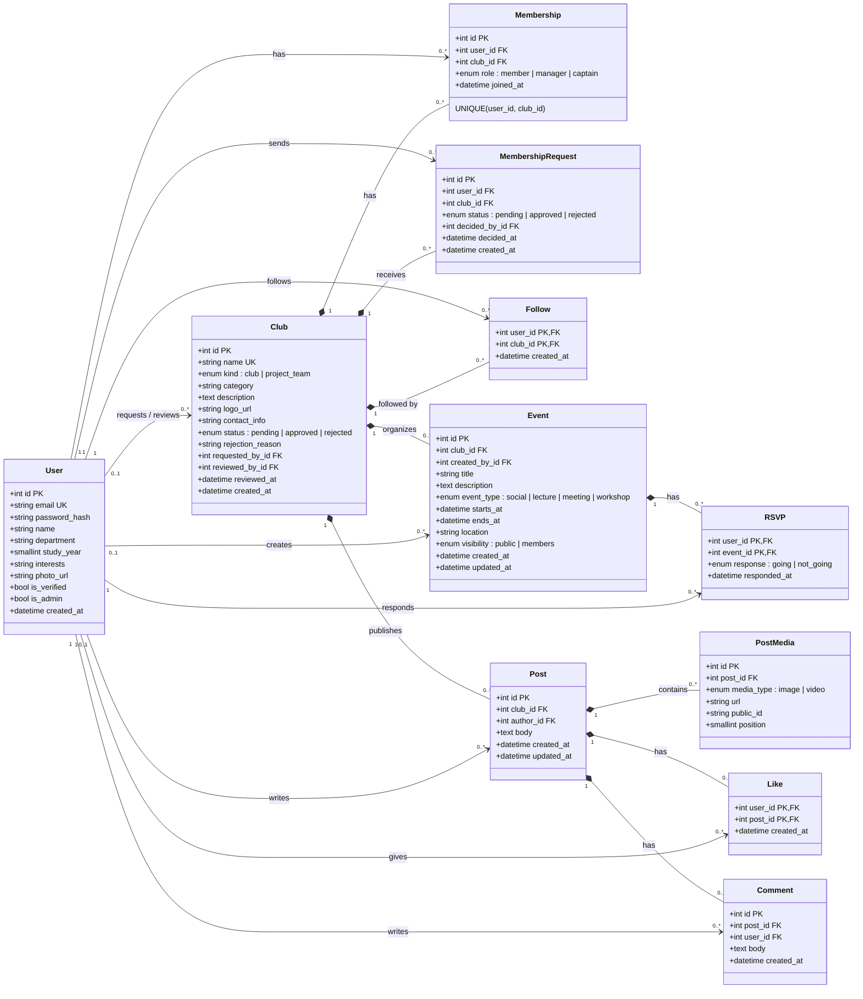

# Database Schema (WBS-1.2)

UML class diagram of the backend models in `backend/api/models/`. PK = primary key, FK = foreign key, UK = unique. A filled diamond means the child is deleted with its parent (`CASCADE`).

