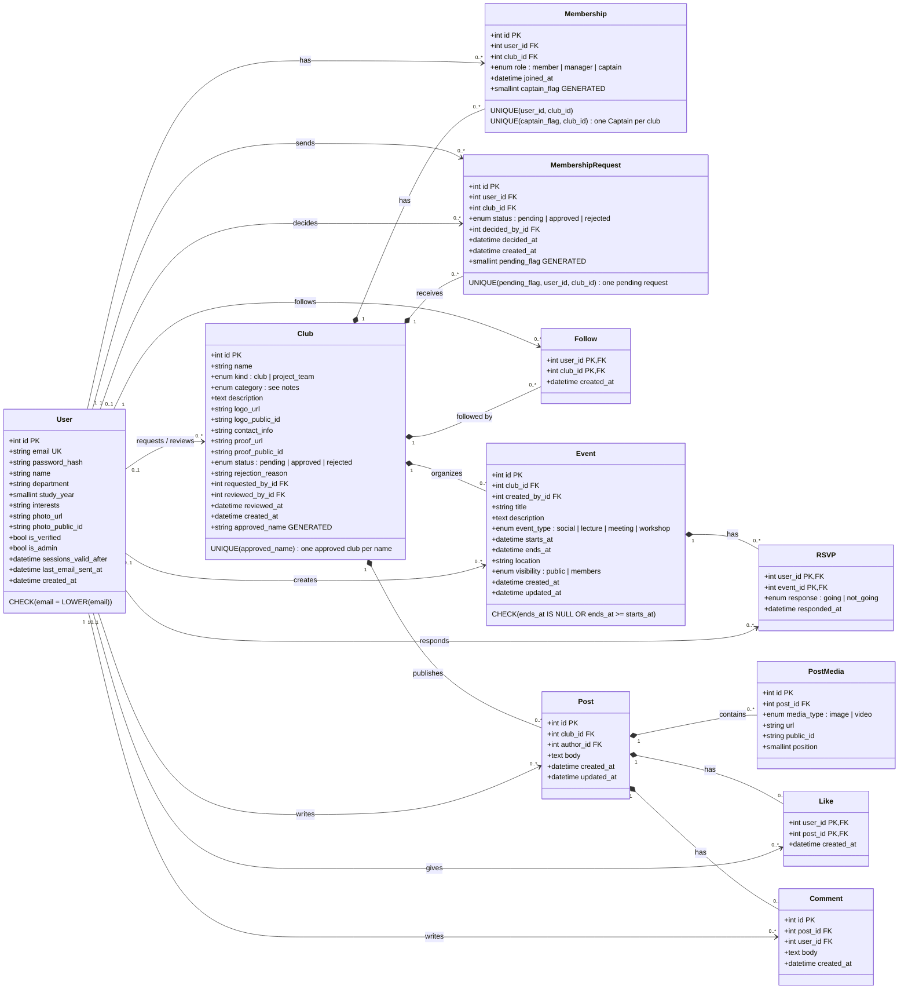

# Database Schema (WBS-1.2)

UML class diagram of the backend models in `backend/api/models/`. PK = primary key, FK = foreign key, UK = unique. A filled diamond means the child is deleted with its parent (`CASCADE`). Arrows from `User` follow the multiplicity: `1` is also `CASCADE` (deleting a user deletes their memberships, requests, follows, RSVPs, likes and comments), `0..1` keeps the row and sets the link to `NULL` (`SET NULL`).



## Notes

**Club categories.** `clubs.category` is an enum used by the Discover filters: `technology`, `engineering`, `science`, `arts`, `music`, `sports`, `culture`, `social`, `career`, `entrepreneurship`, `other`. Values are stored in lowercase English; the clients show display names. Adding a category needs a migration.

**Enforced by the database**

| Rule | How |
|---|---|
| A user has at most one membership per club | `UNIQUE(user_id, club_id)` on `memberships` |
| A club has at most one Captain | `captain_flag` is generated from `role` (1 for the Captain, NULL otherwise) with `UNIQUE(captain_flag, club_id)` |
| A user has at most one pending join request per club | `pending_flag` is generated from `status` (1 while pending, NULL otherwise) with `UNIQUE(pending_flag, user_id, club_id)`; rejected or approved requests do not block a new one |
| An event cannot end before it starts | `CHECK(ends_at IS NULL OR ends_at >= starts_at)` on `events` |
| Two approved clubs cannot have the same name, ignoring upper and lower case; pending and rejected requests can share a name | `approved_name` is generated from `status` and `name` (`CASE WHEN status = _utf8mb4'approved' THEN LOWER(name) END`: the lowercase name while approved, NULL otherwise) with `UNIQUE(approved_name)`; NULLs never clash |
| E-mail addresses are stored in lowercase, so two accounts cannot differ only in letter case | `CHECK(email = LOWER(email))` on `users`, together with the unique key on `email`; the API converts every address with `.strip().lower()` before sign-up, login, verification, and password reset |
| One RSVP, one like and one follow per user | Composite primary keys on `rsvps`, `likes`, `follows` |
| `updated_at` / `responded_at` refresh on every change | `DEFAULT CURRENT_TIMESTAMP ON UPDATE CURRENT_TIMESTAMP`, so raw SQL updates are covered too |

The generated flags are computed only from `role` / `status`, never from `user_id` or `club_id`: TiDB rejects generated columns based on a column whose foreign key has `ON DELETE CASCADE`. Application code never writes them; TiDB rejects a hand-written value.

Handing over Captaincy must demote the old Captain **before** promoting the new one, inside one transaction: the unique key is checked on every statement, so promoting first fails.

**TiDB Cloud notes**

- The database runs on TiDB Cloud Starter (MySQL-compatible). Stored generated columns cannot be added with `ALTER TABLE`; a new one needs the table to be created with it.
- CHECK constraints are only enforced when the cluster setting `tidb_enable_check_constraint` is `ON` (set once with `SET GLOBAL`; it is on for our cluster). A constraint created while it was off is ignored.
- String literals in generated column expressions are written as `_utf8mb4'captain'`, the form TiDB reports back, so `flask db check` sees no false difference.
- Tables use the `utf8mb4_bin` collation: equality and unique keys are case- and accent-sensitive, so `Ali@x.com` and `ali@x.com` would be different e-mails; this is why e-mail addresses are stored in lowercase (see the check on `users`). Two rules keep lists and search friendly:
  - **Sorting.** Alphabetical lists (club names, event titles) sort with the `utf8mb4_0900_ai_ci` collation: `ORDER BY name COLLATE utf8mb4_0900_ai_ci`, in SQLAlchemy `order_by(Club.name.collate("utf8mb4_0900_ai_ci"))`. This gives `ağ, Bilim, Çevre, İnovasyon, Robotics, Zeka`; the plain byte order would be `Bilim, Robotics, Zeka, ağ, Çevre, İnovasyon`.
  - **Search.** Search ignores case and Turkish accents, so `cevre` finds `Çevre` and `siir` finds `Şiir`. Compare with the same collation, and first replace the dotless `ı` with `i` on both sides, because the collation treats `ı` as a separate letter (otherwise `isik` would not find `Işık`):

    ```python
    searchable = func.replace(Club.name, "ı", "i").collate("utf8mb4_0900_ai_ci")
    query = query.where(searchable.contains(term.replace("ı", "i"), autoescape=True))
    ```

    `autoescape=True` makes a `%` or `_` typed by the user match literally.
- `AUTO_INCREMENT` ids are unique but not consecutive, and a newer row can get a smaller id. Sort by `created_at`, never by `id`.

**Enforced by the API, not the database**

- A Captain can only exist on an approved club. Approving a club request sets `clubs.status` and creates the requester's Captain membership in one transaction.
- An approved club always has a Captain; leaving is blocked for a Captain until Captaincy is handed over.
- A user who is already a member cannot send a join request.
- A post must have a body, at least one media item, or both (media live in `post_media`, so a CHECK cannot see them).
- A sign-up with the address of an unverified account replaces that account's name and password and sends a new verification e-mail; an address of a verified account is refused.
- A new club request needs a proof file and is refused if an approved club already uses the name; approving a request is refused for the same reason (`UNIQUE(approved_name)` also catches it).
- An event's start time cannot be in the past, both when the event is created and when it is edited (a CHECK cannot compare with the current time).
- RSVPs are accepted only until the event starts.
- Changing an event to member-only deletes the RSVPs of users who are not members of the club.
- Leaving a club or being removed deletes the user's RSVPs to the club's upcoming member-only events.
- A post has at most 10 media items.
- Platform Administrator accounts (`is_admin`) get no memberships, follows, RSVPs, likes, or comments.

**Cloudinary.** Every stored file keeps its Cloudinary `public_id` (`users.photo_public_id`, `clubs.logo_public_id`, `clubs.proof_public_id`, `post_media.public_id`) so a replaced or deleted file can also be removed from Cloudinary. The proof of a club request is stored as a non-public (authenticated) file and opened only through a link that the server creates for the requester or a Platform Administrator; `proof_url` is never sent to other users. `proof_url` and `proof_public_id` are nullable so that seeded clubs need no file; the API requires a proof for every new request.

**E-mail verification and password reset** need no table. Links carry signed, expiring `itsdangerous` tokens. A reset token also includes a short fragment of the current `password_hash`; once the password changes, the fragment no longer matches and every earlier reset link stops working.

**Login sessions** need no table either. A login token (JWT) is valid for 7 days. Logging out sets `users.sessions_valid_after` to the current time, and the API refuses (401) every token that was issued before that time, so logging out ends the user's sessions on every device. `sessions_valid_after` is NULL until the first logout.

**E-mail limit.** Before sending a verification or password-reset e-mail, the API checks `users.last_email_sent_at`: if it is less than 30 seconds ago, the request is refused with "try again later"; otherwise the e-mail is sent and the field is set to the current time. Reset requests for addresses without an account send no e-mail, so they need no record.

**Time zone.** All `datetime` columns are stored in **UTC**. The API sends and receives times in ISO 8601 with a `Z` (for example `2026-11-12T15:00:00Z`), and the apps convert them to the device's time zone. The database connection sets `time_zone = '+00:00'` when it opens, so the `CURRENT_TIMESTAMP` defaults (`created_at`, `updated_at`, `responded_at`) and comparisons with the current time (upcoming events, RSVP closing at the start time) are in UTC too. The seed script writes UTC times as well.
