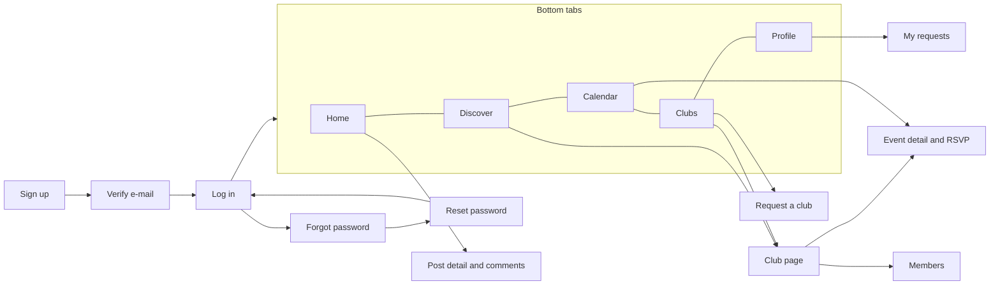

# Clublibrary Mobile Wireframes (WBS-2.2)

Low-fidelity wireframes for the React Native (Expo) application. Visual style is defined in [StyleGuide.md](StyleGuide.md). The web application offers the same flows; the Platform Administrator screens exist only on the web.

Legend: `[ Button ]` button, `[____]` text field, `( )` radio or toggle, `[x]` checked, `<...>` link, `o` avatar, `[img]` photo or video.

## 1. Navigation map



## 2. Screen list and coverage

| ID | Screen | Tab | Task | Status |
|---|---|---|---|---|
| M-01 | Sign up | none | T-03 | Built |
| M-02 | Verify e-mail | none | T-03 | Built |
| M-03 | Log in | none | T-04 | Built |
| M-04 | Forgot password | none | T-04 | Built |
| M-05 | Reset password | none | T-04 | Built |
| M-06 | Home feed | Home | T-17 | Planned |
| M-07 | Post detail and comments | Home | T-16 | Planned |
| M-08 | Post composer | Home, Club page | T-15 | Planned |
| M-09 | Discover | Discover | T-18 | Planned |
| M-10 | Calendar | Calendar | T-14 | Planned |
| M-11 | Event detail and RSVP | Calendar, Club page | T-13 | Planned |
| M-12 | Event form | Club page | T-12 | Planned |
| M-13 | My clubs | Clubs | T-10, T-11 | Planned |
| M-14 | Club page | Clubs, Discover | T-09, T-10, T-11 | Planned |
| M-15 | Members and join requests | Club page | T-10 | Planned |
| M-16 | Manage roles (Captain) | Members | T-08 | Planned |
| M-17 | Request a club or team | Clubs | T-06 | Planned |
| M-18 | My requests | Profile | T-06 | Planned |
| M-19 | Profile (own and others) | Profile | T-05 | Planned |
| M-20 | Edit profile | Profile | T-05 | Planned |

## 3. Authentication (built)

```
M-01 Sign up                M-02 Verify e-mail          M-03 Log in
+----------------------+    +----------------------+    +----------------------+
| Create account       |    | Check your e-mail    |    | Log in               |
| Sign up with your    |    | We sent a link to    |    | Welcome back to      |
| university e-mail.   |    | name@itu.edu.tr.     |    | Clublibrary.         |
|                      |    |                      |    |                      |
| Full name            |    | [ Resend e-mail 30s ]|    | University e-mail    |
| [__________________] |    | <I have verified,    |    | [__________________] |
| University e-mail    |    |  log in>             |    | Password             |
| [__________________] |    | <Use a different     |    | [__________________] |
| Password             |    |  e-mail>             |    |  error message here  |
| [__________________] |    |                      |    | [      Log in      ] |
| Confirm password     |    +----------------------+    | <Forgot password?>   |
| [__________________] |                                | <No account? Sign up>|
| [     Sign up      ]  |    M-04 Forgot password       +----------------------+
| <Already have an     |    +----------------------+
|  account? Log in>    |    | Reset password       |    M-05 Reset password
+----------------------+    | [__________________] |    +----------------------+
                            | [ Send reset link ]  |    | Choose a new password|
                            | <I have a reset code>|    | Reset code           |
                            | <Back to log in>     |    | New password         |
                            +----------------------+    | Confirm new password |
                                                        | [ Update password ]  |
                                                        +----------------------+
```

## 4. Home and posts

```
M-06 Home feed                       M-07 Post detail and comments
+--------------------------------+   +--------------------------------+
| Home                      (+)  |   | <  Post                        |
|--------------------------------|   |--------------------------------|
| +----------------------------+ |   | o AI Club              2h ago  |
| | o AI Club           2h ago | |   | Workshop on Thursday: intro to |
| | Workshop on Thursday...    | |   | neural nets.                   |
| | [img]                      | |   | [img]                          |
| | heart 24   comment 6       | |   | heart 24 (liked)  comment 6    |
| +----------------------------+ |   |--------------------------------|
| +----------------------------+ |   | o Ece: Count me in!   <Delete> |
| | o Robotics         5h ago  | |   | o Can: What time?              |
| | ...                        | |   |--------------------------------|
| +----------------------------+ |   | [ Add a comment...     ] [Send]|
| (load more on scroll)          |   +--------------------------------+
|--------------------------------|   <Delete> shows for the comment's
| Home Disc. Cal. Clubs Profile  |   author, and for Captain/Manager.
+--------------------------------+   (+) on Home shows only if the user
                                     is Captain/Manager somewhere.

M-08 Post composer (Captain / Manager)
+--------------------------------+
| X  New post          [ Post ]  |
|--------------------------------|
| Posting as: [ AI Club v ]      |
| [____________________________] |
| [ What do you want to share? ] |
| [____________________________] |
| [img] [img]  (+ photo / video) |
| Upload progress: ####----  60% |
+--------------------------------+
```

## 5. Discover and calendar

```
M-09 Discover                        M-10 Calendar
+--------------------------------+   +--------------------------------+
| [ Search clubs and events    ] |   | Calendar                       |
| ( Clubs ) Events  Posts        |   | < November 2026 >              |
| Category: [All v]              |   | M  T  W  T  F  S  S            |
|--------------------------------|   |       1  2  3  4  5  6         |
| +----------------------------+ |   | 7  8  9 10 11 12 13            |
| | o AI Club      Technology  | |   |      (.) (o)    (.)            |
| | 120 members     [ Follow ] | |   |--------------------------------|
| +----------------------------+ |   | Thu 12 Nov                     |
| +----------------------------+ |   | 18:00 Robotics meetup  GOING   |
| | o Photo Club   Arts        | |   | 20:00 AI workshop  [ Going? ]  |
| +----------------------------+ |   +--------------------------------+
| Events tab: type filter        |   (o) = you are going, (.) = other
| (social, talk, meeting, ws)    |   events from joined or followed
| Posts tab: ranked by likes     |   clubs.
|--------------------------------|
| Home Disc. Cal. Clubs Profile  |
+--------------------------------+
```

## 6. Events

```
M-11 Event detail and RSVP           M-12 Event form (Captain / Manager)
+--------------------------------+   +--------------------------------+
| <  Event                       |   | X  New event       [ Save ]    |
|--------------------------------|   |--------------------------------|
| Robotics meetup                |   | Title   [__________________]   |
| o Robotics Club                |   | Type    [ Meeting v ]          |
| Fri 13 Nov, 18:00              |   | Date    [__ / __ / ____]       |
| EEB building, room 3           |   | Time    [__ : __]              |
| Visibility: Members only       |   | Place   [__________________]   |
|                                |   | Visible to: (o) Members only   |
| [ Going ]  ( Not going )       |   |             ( ) Everyone       |
| 18 going                       |   | Details [__________________]   |
|--------------------------------|   +--------------------------------+
| Captain / Manager only:        |
| <See attendees> <Edit> <Delete>|
+--------------------------------+
```

## 7. Clubs and membership

```
M-13 My clubs                        M-14 Club page
+--------------------------------+   +--------------------------------+
| Clubs                  [ + New]|   | <  AI Club                     |
|--------------------------------|   |--------------------------------|
| Joined                         |   |   (logo)  AI Club              |
| o AI Club          Captain     |   |   Technology . 120 members     |
| o Robotics         Member      |   |   Description text goes here.  |
|                                |   |   Contact: ai@itu.edu.tr       |
| Following                      |   |                                |
| o Photo Club                   |   | Student:  [Join] [Follow]      |
|                                |   | Member:   [Leave] [Following]  |
| Pending requests               |   | Manager:  [Leave] + Manage     |
| o Chess Club     Pending       |   | Captain:  Manage (no Leave     |
|--------------------------------|   |           until handover)      |
| Home Disc. Cal. Clubs Profile  |   |--------------------------------|
+--------------------------------+   | Posts   Events   Members       |
                                     | ... list for the selected tab  |
                                     +--------------------------------+

M-15 Members and join requests       M-16 Manage roles (Captain)
+--------------------------------+   +--------------------------------+
| <  Members                     |   | <  Manage Ece Yilmaz           |
| Requests (3)   Members (120)   |   |--------------------------------|
|--------------------------------|   | Current role: Member           |
| o Ali K.    [Approve] [Reject] |   | [ Make Manager ]               |
| o Zeynep T. [Approve] [Reject] |   | [ Remove from club ]           |
|--------------------------------|   | ------------------------------ |
| o Ece Y.         Member    ... |   | For Managers:                  |
| o Can D.         Manager   ... |   | [ Return to Member ]           |
| o Melih K.       Captain       |   | ------------------------------ |
| "..." menu: Remove (Captain or |   | [ Hand over Captain role ]     |
| Manager; only Captain removes  |   | You will become a Member.      |
| a Manager)                     |   +--------------------------------+
+--------------------------------+

M-17 Request a club or team          M-18 My requests
+--------------------------------+   +--------------------------------+
| X  New club or team            |   | <  My requests                 |
|--------------------------------|   |--------------------------------|
| Type: (o) Club ( ) Project team|   | Chess Club        PENDING      |
| Name        [______________]   |   | Drone Team        APPROVED     |
| Category    [ Technology v ]   |   | Salsa Club        REJECTED     |
| Description [______________]   |   |   Reason: duplicate of Dance   |
| [ Send request ]               |   |   Club                         |
| An administrator reviews it.   |   +--------------------------------+
| You become Captain once it is  |
| approved.                      |
+--------------------------------+
```

## 8. Profile

```
M-19 Profile                         M-20 Edit profile
+--------------------------------+   +--------------------------------+
| Profile              <Edit>    |   | X  Edit profile     [ Save ]   |
|--------------------------------|   |--------------------------------|
|        (photo)                 |   |        (photo)  <Change photo> |
|        Melih Kart              |   | Name        [______________]   |
|        Computer Eng. . Year 3  |   | Department  [______________]   |
|        Interests: AI, robotics |   | Year        [ 3 v ]            |
|--------------------------------|   | Interests   [______________]   |
| <My requests>                  |   +--------------------------------+
| <Log out>                      |
|--------------------------------|
| Home Disc. Cal. Clubs Profile  |
+--------------------------------+
```

## 9. Role visibility summary (matches T-08)

| Action | Student | Member | Manager | Captain |
|---|---|---|---|---|
| See public posts and events | Yes | Yes | Yes | Yes |
| See member-only events | No | Yes | Yes | Yes |
| RSVP to public events | Yes | Yes | Yes | Yes |
| RSVP to member-only events | No | Yes | Yes | Yes |
| Create and edit events and posts | No | No | Yes | Yes |
| Delete any comment on club posts | No | No | Yes | Yes |
| Approve join requests, remove Members | No | No | Yes | Yes |
| Edit club profile | No | No | Yes | Yes |
| Make or remove Managers | No | No | No | Yes |
| Remove a Manager, hand over Captain role | No | No | No | Yes |

Web-only (not on mobile): Platform Administrator dashboard to approve or reject club requests and to change a Captain (T-07).
