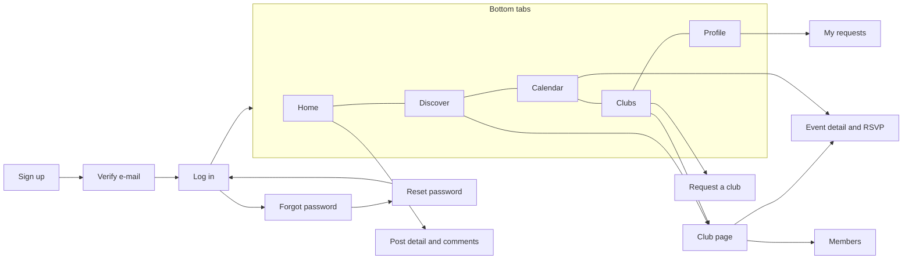

# Clublibrary Wireframes (WBS-2.2)

Low-fidelity wireframes for the React Native (Expo) application (M-01 to M-20) and the web-only Platform Administrator screens (W-01, W-02). Visual style is defined in [StyleGuide.md](StyleGuide.md). The web application offers the same flows as the mobile screens. Requirement IDs (FR-##) refer to the Requirements Specification (RS).

Legend: `[ Button ]` button, `[____]` text field, `( )` radio or toggle, `[x]` checked, `<...>` link, `o` avatar, `[img]` photo or video.

## 1. Navigation map



## 2. Screen list and coverage

| ID | Screen | Tab | Task | Status |
|---|---|---|---|---|
| M-01 | Sign up | none | T-03 | Built |
| M-02 | Verify e-mail | none | T-03 | Built |
| M-03 | Log in | none | T-04 | Built |
| M-04 | Forgot password | none | T-04 | Built |
| M-05 | Reset password | none | T-04 | Built |
| M-06 | Home feed | Home | T-17 | Planned |
| M-07 | Post detail and comments | Home | T-16 | Planned |
| M-08 | Post composer | Home, Club page | T-15 | Planned |
| M-09 | Discover | Discover | T-18 | Planned |
| M-10 | Calendar | Calendar | T-14 | Planned |
| M-11 | Event detail and RSVP | Calendar, Club page | T-13 | Planned |
| M-12 | Event form | Club page | T-12 | Planned |
| M-13 | My clubs | Clubs | T-10, T-11 | Planned |
| M-14 | Club page | Clubs, Discover | T-09, T-10, T-11, T-12 | Planned |
| M-15 | Members and join requests | Club page | T-10 | Planned |
| M-16 | Manage roles (Captain) | Members | T-08 | Planned |
| M-17 | Request a club or team | Clubs | T-06 | Planned |
| M-18 | My requests | Profile | T-06 | Planned |
| M-19 | Profile (own and others) | Profile | T-05 | Planned |
| M-20 | Edit profile | Profile | T-05 | Planned |
| W-01 | Club requests (administrator) | web only | T-07 | Planned |
| W-02 | Change Captain and read-only club view (administrator) | web only | T-07 | Planned |

## 3. Authentication (built)

```
M-01 Sign up               M-02 Verify e-mail         M-03 Log in
+----------------------+   +----------------------+   +----------------------+
| Create account       |   | Check your e-mail    |   | Log in               |
| Sign up with your    |   | We sent a link to    |   | Welcome back to      |
| university e-mail.   |   | name@itu.edu.tr.     |   | Clublibrary.         |
|                      |   | It is valid for      |   |                      |
| Full name            |   | 24 hours.            |   | University e-mail    |
| [__________________] |   |                      |   | [__________________] |
| University e-mail    |   | [ Resend e-mail 30s ]|   | Password             |
| [__________________] |   | <I have verified,    |   | [__________________] |
| Password             |   |  log in>             |   |  error message here  |
| [__________________] |   | <Use a different     |   | [      Log in      ] |
| At least 8 characters|   |  e-mail>             |   | <Forgot password?>   |
| Confirm password     |   +----------------------+   | <No account? Sign up>|
| [__________________] |                              +----------------------+
| [     Sign up      ] |
| <Already have an     |
|  account? Log in>    |
+----------------------+

M-04 Forgot password       M-05 Reset password
+----------------------+   +----------------------+
| Reset password       |   | Choose a new password|
| [__________________] |   | Reset code           |
| [ Send reset link ]  |   | [__________________] |
| The link and code are|   | New password         |
| valid for 30 minutes.|   | [__________________] |
| <I have a reset code>|   | Confirm new password |
| <Back to log in>     |   | [__________________] |
+----------------------+   | [ Update password ]  |
                           +----------------------+
```

- M-01: the password must have at least 8 characters; a password that is too long (more than 72 bytes) is rejected with a message (RS FR-05).
- M-02 and M-04: the times shown come from RS FR-09 (24 hours) and FR-19 (30 minutes). The resend link waits 30 seconds (FR-11).

## 4. Home and posts

```
M-06 Home feed                       M-07 Post detail and comments
+--------------------------------+   +--------------------------------+
| Home                      (+)  |   | <  Post                        |
|--------------------------------|   |--------------------------------|
| +----------------------------+ |   | o AI Club              2h ago  |
| | o AI Club           2h ago | |   | Workshop on Thursday: intro to |
| | Workshop on Thursday...    | |   | neural nets.                   |
| | [img]                      | |   | [img]                          |
| | heart 24   comment 6       | |   | heart 24 (liked)  comment 6    |
| +----------------------------+ |   |--------------------------------|
| +----------------------------+ |   | o Ece K.  3h ago      <Delete> |
| | o Robotics         5h ago  | |   |   Count me in.                 |
| | ...                        | |   | o Can D.  1h ago               |
| +----------------------------+ |   |   What time does it start?     |
| (load more on scroll)          |   |--------------------------------|
|--------------------------------|   | [ Add a comment...     ] [Send]|
| Home Disc. Cal. Clubs Profile  |   +--------------------------------+
+--------------------------------+

M-08 Post composer                   M-06 Home feed (empty)
+--------------------------------+   +--------------------------------+
| X  New post          [ Post ]  |   | Home                           |
|--------------------------------|   |--------------------------------|
| Posting as: [ AI Club v ]      |   |                                |
| [____________________________] |   |           (icon)               |
| [ What do you want to share? ] |   |         No posts yet           |
| [____________________________] |   |   Follow or join clubs to see  |
| [img] [img]  (+ photo / video) |   |   their posts here.            |
| Upload progress: ####----  60% |   |                                |
| Photos: JPEG, PNG, WebP, max   |   |      [ Discover clubs ]        |
| 10 MB. Videos: MP4, MOV, max   |   |                                |
| 50 MB. At most 10 files.       |   |--------------------------------|
+--------------------------------+   | Home Disc. Cal. Clubs Profile  |
                                     +--------------------------------+
```

- M-06: posts of joined and followed clubs, newest first, 20 per page; each post appears once. (+) shows only if the user is a Captain or Manager somewhere.
- M-07: comments show the author's photo, name, and time, oldest first. <Delete> shows for the comment's author and for the club's Captain and Managers.
- M-08: only for Captains and Managers. The limits shown are those of RS FR-64.

## 5. Discover and calendar

```
M-09 Discover                        M-10 Calendar
+--------------------------------+   +--------------------------------+
| [ Search clubs and events    ] |   | Calendar                       |
| ( Clubs ) Events  Posts        |   | < November 2026 >              |
| Category: [All v]              |   | M  T  W  T  F  S  S            |
|--------------------------------|   |       1  2  3  4  5  6         |
| +----------------------------+ |   | 7  8  9 10 11 12 13            |
| | o AI Club      Technology  | |   |      (.) (o)    (.)            |
| | 120 members     [ Follow ] | |   |--------------------------------|
| +----------------------------+ |   | Thu 12 Nov                     |
| +----------------------------+ |   | 18:00 Robotics meetup  GOING   |
| | o Photo Club   Arts        | |   | 20:00 AI workshop  [ Going? ]  |
| +----------------------------+ |   +--------------------------------+
| Events tab: type filter        |   (o) = you are going (any club),
| (social, talk, meeting, ws)    |   (.) = other events from joined
| Posts tab: ranked by likes     |   or followed clubs.
|--------------------------------|
| Home Disc. Cal. Clubs Profile  |
+--------------------------------+
```

- M-09: Discover shows only approved clubs and upcoming public events; member-only events, teasers, and past events never appear here (RS FR-78).
- M-10: the calendar shows upcoming events of joined clubs (also member-only), of followed clubs (public only), and every event the user answered *going* to (RS FR-60).

## 6. Events

```
M-11 Event detail and RSVP           M-12 Event form
+--------------------------------+   +--------------------------------+
| <  Event                       |   | X  New event       [ Save ]    |
|--------------------------------|   |--------------------------------|
| Robotics meetup                |   | Title   [__________________]   |
| o Robotics Club       Meeting  |   | Type    [ Meeting v ]          |
| Fri 13 Nov, 18:00-20:00        |   | Date    [__ / __ / ____]       |
| EEB building, room 3           |   | Start   [__ : __]              |
| Visibility: Members only       |   | End     [__ : __]  (optional)  |
| Details text goes here.        |   | Place   [__________________]   |
|                                |   | Visible to: (o) Members only   |
| [ Going ]  ( Not going )       |   |             ( ) Everyone       |
| 18 going . 4 not going         |   | Details [__________________]   |
| <See who is going / not going> |   | A start time in the past is    |
|--------------------------------|   | rejected.                      |
| After the start time:          |   +--------------------------------+
| RSVP closed, no buttons        |
|--------------------------------|
| Captain / Manager only:        |
| <Edit> <Delete>                |
+--------------------------------+
```

- M-11: everyone who can see the event sees both counts and both lists (RS FR-59). Answers close when the event starts (FR-57).
- M-12: only for Captains and Managers. The end time is optional but cannot be before the start (FR-51, FR-52). Changing an event to *Members only* removes the answers of non-members (FR-53).

## 7. Clubs and membership

```
M-13 My clubs                        M-14 Club page
+--------------------------------+   +--------------------------------+
| Clubs                  [ + New]|   | <  AI Club                     |
|--------------------------------|   |--------------------------------|
| Joined                         |   |   (logo)  AI Club              |
| o AI Club          Captain     |   |   Club . Technology            |
| o Robotics         Member      |   |   120 members                  |
|                                |   |   Description text goes here.  |
| Following                      |   |   Contact: ai@itu.edu.tr       |
| o Photo Club                   |   |                                |
|                                |   | Student:  [Join] [Follow]      |
| Pending requests               |   | Member:   [Leave] [Following]  |
| o Chess Club     Pending       |   | Manager:  [Leave] + Manage     |
|--------------------------------|   | Captain:  Manage (no Leave     |
| Home Disc. Cal. Clubs Profile  |   |           until handover)      |
+--------------------------------+   |--------------------------------|
                                     | Posts  ( Events )  Members     |
                                     | Wed 11 Nov, 19:00     Talk     |
                                     | Intro to LLMs          Public  |
                                     |--------------------------------|
                                     | Thu 12 Nov, 18:00     Meeting  |
                                     | Board meeting   [Members only] |
                                     | Join the club to see details.  |
                                     +--------------------------------+

M-15 Members and join requests       M-16 Manage roles (Captain)
+--------------------------------+   +--------------------------------+
| <  Members                     |   | <  Manage Ece Yilmaz           |
| Requests (3)   Members (120)   |   |--------------------------------|
|--------------------------------|   | Current role: Member           |
| o Ali K.    [Approve] [Reject] |   | [ Make Manager ]               |
| o Zeynep T. [Approve] [Reject] |   | [ Remove from club ]           |
|--------------------------------|   | ------------------------------ |
| o Ece Y.         Member    ... |   | For Managers:                  |
| o Can D.         Manager   ... |   | [ Return to Member ]           |
| o Melih K.       Captain       |   | ------------------------------ |
| "..." menu: Remove (Captain or |   | [ Hand over Captain role ]     |
| Manager; only Captain removes  |   | You will become a Member.      |
| a Manager)                     |   +--------------------------------+
+--------------------------------+

M-17 Request a club or team          M-18 My requests
+--------------------------------+   +--------------------------------+
| X  New club or team            |   | <  My requests                 |
|--------------------------------|   |--------------------------------|
| Type: (o) Club ( ) Project team|   | Chess Club        PENDING      |
| Name        [______________]   |   | Drone Team        APPROVED     |
| Category    [ Technology v ]   |   | Salsa Club        REJECTED     |
| Description [______________]   |   |   Reason: the proof does not   |
| Proof       [ Choose file ]    |   |   show that the club exists    |
| PDF, JPEG or PNG, max 10 MB,   |   +--------------------------------+
| e.g. an approval document or   |
| a letter from your advisor.    |
| [ Send request ]               |
| An administrator reviews it.   |
| You become Captain once it is  |
| approved.                      |
+--------------------------------+
```

- M-14: the Events tab lists the club's upcoming events. Members see member-only events in full; everyone else sees only a teaser with the title, type, and start date and time (RS FR-41, FR-55).
- M-17: a request without a proof, or with a file in another format or larger than 10 MB, is rejected (FR-23, FR-24). The name must not belong to an approved club.

## 8. Profile

```
M-19 Profile                         M-20 Edit profile
+--------------------------------+   +--------------------------------+
| Profile              <Edit>    |   | X  Edit profile     [ Save ]   |
|--------------------------------|   |--------------------------------|
|        (photo)                 |   |        (photo)  <Change photo> |
|        Melih Kart              |   | JPEG, PNG or WebP, max 10 MB   |
|        Computer Eng. . Year 3  |   | Name        [______________]   |
|        Interests: AI, robotics |   | Department  [______________]   |
|--------------------------------|   | Year        [ 3 v ]            |
| <My requests>                  |   | Interests   [______________]   |
| <Log out>                      |   +--------------------------------+
|--------------------------------|
| Home Disc. Cal. Clubs Profile  |
+--------------------------------+
```

- M-20: a replaced photo is also deleted from media storage (RS FR-21).

## 9. Role visibility summary (matches the permission table in the Requirements Specification, Section 2.1)

| Action | Student | Member | Manager | Captain | Platform Administrator (web) |
|---|---|---|---|---|---|
| See public posts, public events, club pages, and member lists | Yes | Yes | Yes | Yes | Yes |
| See the teasers of member-only events on the club page | Yes | Yes | Yes | Yes | Yes |
| See member-only events in full and their RSVP lists | No | Yes | Yes | Yes | No |
| RSVP to public events; follow; like; comment | Yes | Yes | Yes | Yes | No |
| RSVP to member-only events | No | Yes | Yes | Yes | No |
| Send a membership request | Yes | — | — | — | No |
| Leave the club | — | Yes | Yes | Only after handing over the Captain role | — |
| Create and edit events and posts | No | No | Yes | Yes | No |
| Delete any comment on club posts | No | No | Yes | Yes | No |
| Approve join requests, remove Members | No | No | Yes | Yes | No |
| Edit club profile | No | No | Yes | Yes | No |
| Make Managers or return them to Member | No | No | No | Yes | No |
| Remove a Manager, hand over Captain role | No | No | No | Yes | No |
| Approve or reject club requests, change a Captain | No | No | No | No | Yes |

## 10. Platform Administrator (web only)

```
W-01 Club requests
+--------------------------------------------------------------------+
| Clublibrary admin       ( Club requests )   Clubs     <Log out>    |
|--------------------------------------------------------------------|
| Pending club requests (3)                                          |
|                                                                    |
| Name           Type   Category     Requester   Date    Proof       |
| Kanat Drones   Team   Engineering  Bora E.     9 Nov   <Open>      |
| Go Club        Club   Culture      Ada S.      8 Nov   <Open>      |
|   [Same name]  another pending request uses this name              |
| Go Club        Club   Culture      Emre T.     7 Nov   <Open>      |
|   [Same name]                                                      |
|--------------------------------------------------------------------|
| Selected: Kanat Drones                                             |
| Description text of the request.                                   |
| [ Approve ]    <Reject>   Reason [__________________________]      |
| A reason is required to reject. Approval fails if an approved      |
| club already has this name.                                        |
+--------------------------------------------------------------------+

W-02 Change Captain and read-only club view
+--------------------------------------------------------------------+
| Clublibrary admin         Club requests   ( Clubs )   <Log out>    |
|--------------------------------------------------------------------|
| <  Chess Club                          Culture . 42 members        |
| Current Captain: Deniz A.                                          |
|                                                                    |
| New Captain   [ Choose a member v ]                                |
|               only current members can be chosen                   |
| [ Change Captain ]                                                 |
| The current Captain becomes a Member.                              |
|--------------------------------------------------------------------|
| Posts  Events  Members        (read-only: no Join, Follow,         |
|                                RSVP, like, or comment)             |
+--------------------------------------------------------------------+
```

- W-01: the proof opens only for the requester and Platform Administrators (RS FR-25, FR-27). Requests whose name another pending request also uses are marked *Same name*.
- W-02: the administrator sees club pages like a non-member (posts, public events, teasers, members) and has no Join, Follow, RSVP, like, or comment actions (RS permission table).
